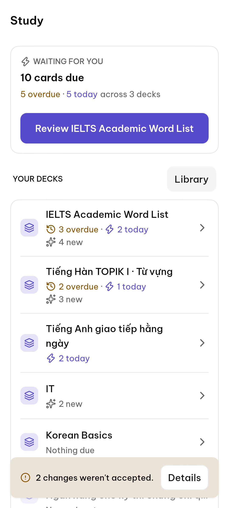
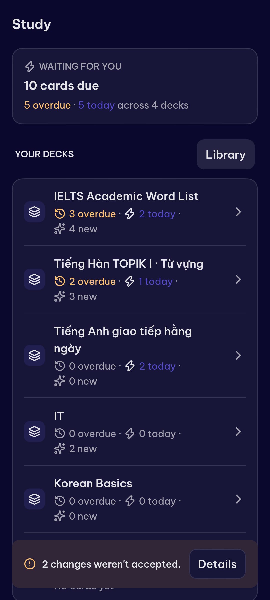
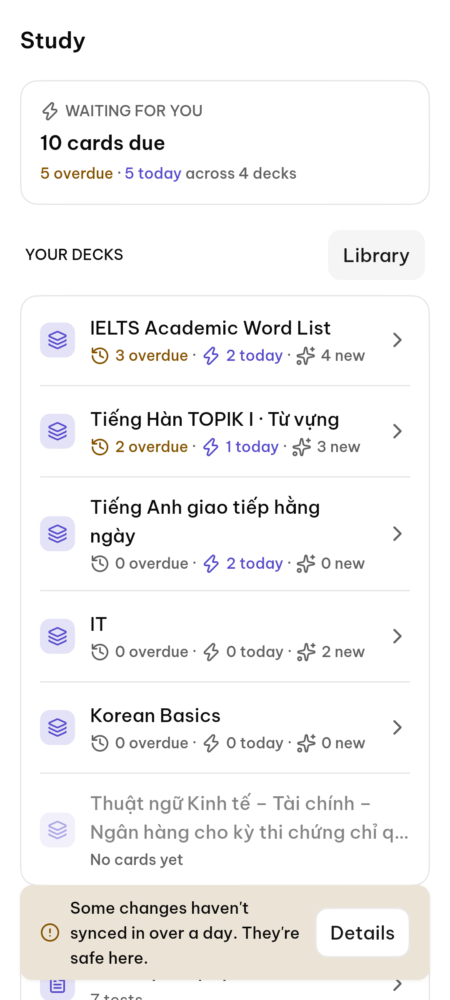
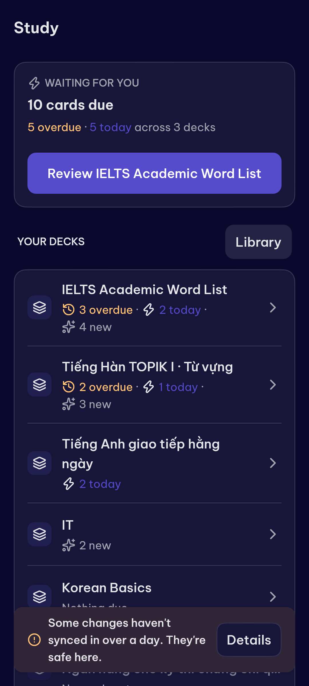
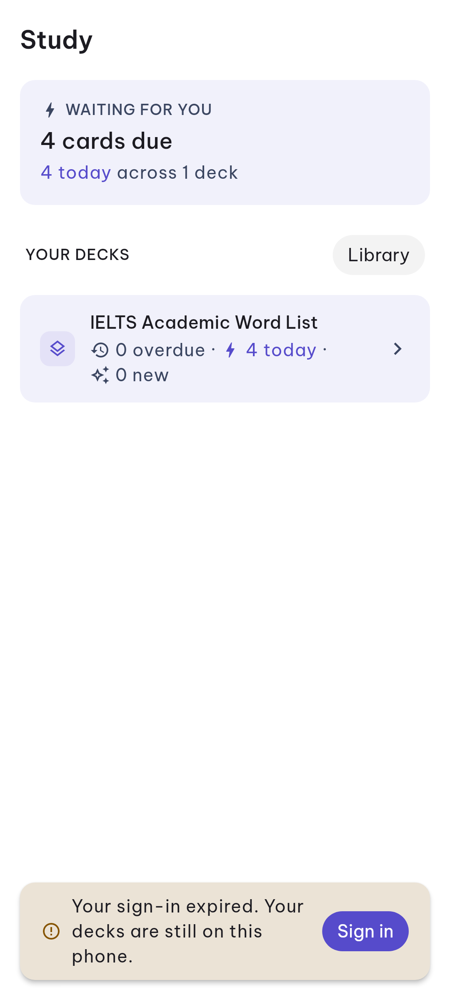
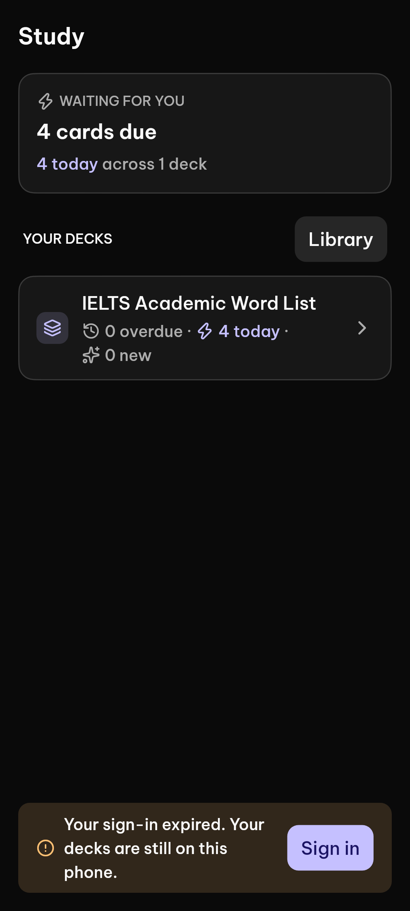

<!-- Hand-written screen record. -->

# 13 · Study home

The Study tab's landing screen (FE-A8): `StudyHomeScreen`, the session Resume
card takes up plus every root deck with its whole-tree workload, read as one
snapshot. UC-STUDY-002.

## Layout

| Region | Widget | Design |
|---|---|---|
| App bar | `MxAppBar` | "Study"; no date (see Rulings). |
| Resume card | `MxCard` (hero) + `MxIconTile` + new: `MxLinearProgress` | "Continue studying" overline with a static primary dot (`MxDotOverline`, ruling S3); the title "{root} › {deck}" on a sub-deck, the deck alone on a root (two lines, then an ellipsis); the session line "{kind} · {mode}" (`body`, muted); a last row of the thin progress track and "{done} / {total} cards" (`meta`, muted), with "Resume" (`MxButton`, primary, play glyph) at its end when the card's content is 280 wide or more and the text scale is below 1.3, a block under it otherwise (ruling S9, Study home spec H3). No track while the round serves nothing. Shown only when BR-STUDY-075's four read-only conditions all hold. |
| Workload card | `MxCard` (no hero) + `MxWorkloadBreakdownLine` + `MxButton` | "Waiting for you", "{n} cards due", then overdue · today "across {k} decks" (BR-STUDY-068). While a card is due, a block "Review {deck}" closes the card, 16 under the breakdown: it opens the Study entry (14) of the first listed deck with an overdue or today card (Study home spec H2; replaces R2). It is primary without a Resume card and outline under one (H4). Only new cards due: no button. Zero workload swaps to a calm `MxEmptyState`-shaped card: "Nothing due right now" (BR-STUDY-008) — not an error, not an achievement. |
| Section header | `MxListSectionHeader` + trailing `MxButton` (small secondary, ruling E-L3) | "Your decks" · "Library" (opens the Library root, screen 01). |
| Sync notice | `MxFloatingNotice` in `MxAppShell.notice` + small `MxButton` | SB-U1: floats over the bottom of the loaded page when a change has waited more than 24 h or the server refused a row (sync status spec R2, §5.3; owner ruling 2026-09-28: short, over the content). "Details" (outline, a link out of a warning, not the screen's decision; critique 2026-09-30 part 1) on the message line opens screen 27. No close button (R7). Hidden without Supabase, while loading, on a read error and when the status stream fails. |
| Re-auth notice | `MxFloatingNotice` in the same slot + small `MxButton` | FE-B10 (account UI spec §5.7, R2, B5): while the sign-in is refused, "Your sign-in expired. Your decks are still on this phone." · "Sign in", which opens screen 30 `reauth` under Settings and returns here once signed in. It takes the slot over the sync notice, since the expired sign-in is why sync stopped. The account feature builds it; `app/` hands it in as `reauthNotice`. |
| Rows | full-bleed `MxCard` of `MxListRow`s | leading `MxIconTile` ("layers"); title = deck name; meta = `MxWorkloadBreakdownLine` (overdue · today · new, a zero term dropped, each shown term led by its glyph; "Nothing due" when all three are 0 on a deck with cards, "No cards yet" for a deck with no card — BR-STUDY-076, BR-STUDY-077); a chevron on every row that can be studied; the due counts are in the meta line, so there is no due badge (critique 2026-09-30). A deck with no card (`canStudy = false`) gets no chevron and no tap target (BR-STUDY-076). Rows are ordered Overdue ↓ Due today ↓ New ↓ name (BR-STUDY-076). |
| Practice slot | `MxListSectionHeader` "Practice" + `MxCard` of one `MxListRow` (`TopikPracticeEntryWidget`) | The optional `practiceEntry` slot, composed in `lib/app/` (`topikPracticeEntry`, `topik_routes.dart`) so `study` never imports `topik` (ADR-023). After the content, 16 dp under it, outside `MxTwoColumns` (full width under both columns); in every data state (loaded, noResume, zero, noDecks, noCards), absent while loading and on error. Leading `MxIconTile`, title "TOPIK past papers", meta "{n} tests" (none while the catalog loads or fails, so the row is one line tall and grows to two), a chevron; a tap opens screen 34 with `context.push`, whatever the catalog read says. |

From a content width of 672 (`MxTwoColumns.minWidth`, a medium window with the
rail taken off) the Workload card and the deck list sit side by side, each column
starting at the top; below it they stack, Workload first. The Resume card stays
above both at full width.

## States

| State | Golden (light) | Golden (dark) | App |
|---|---|---|---|
| loaded | `study_home_loaded_light.png` | `study_home_loaded_dark.png` | The compact Resume card with its primary dot, the workload card with an outline "Review {deck}", rows without zero terms (see Rulings). The Resume card at a 1.3 text scale, its button a block under the progress: `study_home_resume_large_text_light/dark.png`. |
| noResume | `study_home_no_resume_light.png` | `study_home_no_resume_dark.png` | Same workload card and deck list, no Resume card (BR-STUDY-075 A1); "Review {deck}" is the screen's one primary. Scrolled to the end, `study_home_scrolled_light/dark.png` shows the Practice slot under six decks (audit 2026-10-19, G6). |
| zero | `study_home_zero_light.png` | `study_home_zero_dark.png` | Every root deck holds cards but nothing is due; rows still list every deck, each reading "Nothing due"; the workload card has no button (BR-STUDY-008, BR-STUDY-076, BR-STUDY-077). |
| noDecks | `study_home_no_decks_light.png` | `study_home_no_decks_dark.png` | "Browse starter decks" opens the Starter Library (screen 03), "Go to Library" the Library root (UC-STUDY-002 A4). |
| noCards | `study_home_no_cards_light.png` | `study_home_no_cards_dark.png` | Root decks exist, none holds a card, no invented Due number (BR-STUDY-077). |
| loading | `study_home_loading_light.png` | `study_home_loading_dark.png` | A two-bar hero skeleton and `MxSkeletonList` rows (see Rulings). |
| error | `study_home_error_light.png` | `study_home_error_dark.png` | `MxErrorState` with Retry; no table or query names (BR-STUDY-077). |
| syncRejected |  |  | (SB-U1) the sync banner, refused rows. Golden `study_home_sync_rejected_*`. |
| syncStale |  |  | (SB-U1) the sync banner, a change waiting over a day. Golden `study_home_sync_stale_*`. |
| reauth |  |  | (FE-B10) the re-auth notice over the page. Golden `study_home_reauth_*` (in the account tests). |

Every state above is built.

**Built (FE-A8, study roadmap P6):** `StudyHomeScreen` in the Study tab's branch, over
`WatchStudyHomeUseCase`; it writes nothing but Resume (BR-STUDY-075).
- Resume runs `ResumeStudySessionUseCase` and opens the session route. A refusal
  shows the toast "That session has ended. Its answers are kept.", and a failed write
  shows "Your answers are kept. Couldn't resume the session, so try again."; the
  stream refreshes by itself.
- A deck row opens that deck's Study Entry; "Library" and "Go to Library" open the
  Library root, and "Browse starter decks" the Starter Library. All navigate into the
  Library branch, as the summary's "Study again" does.
- Goldens:
  `test/features/study/presentation/goldens/study_home_{loaded,no_resume,zero,no_decks,no_cards,loading,error}_*`.

## Transitions

| From | Event | To | Evidence |
|---|---|---|---|
| loaded (Resume card shown) | tap Resume | the session route; a refusal keeps 13 with a toast | BR-STUDY-075. VERIFIED `study_home_screen_test.dart::Resume takes today's session up and opens it (H3)`, `::a refused Resume says so and opens nothing (H3, S8)` |
| loaded (Resume card shown) | tap Resume, and the write fails (a busy database) | 13 stays and opens nothing; the toast "Your answers are kept. Couldn't resume the session, so try again." | VERIFIED `study_home_screen_test.dart::a Resume that cannot be written says so, local-first, and opens nothing (audit 2026-10-17)` |
| loaded (Resume card shown) | tap Resume, and the write meets a bug (not a `Failure`) | as a `Failure`: 13 stays and opens nothing, with the same toast; Resume is no longer running; the bug is reported | VERIFIED `study_held_bug_test.dart::a Resume that dies on a bug is no longer running and answers ResumeFailed, as a Failure does (resume)` |
| loaded | tap a deck row | that deck's Study Entry (14); a deck with no card is not a target | BR-STUDY-076. VERIFIED `::a deck with no card is disabled; a deck row opens its entry; Library opens the Library (S4, H3)` |
| loaded | tap Library | the Library root (01) | E-L3. VERIFIED same test |
| loaded / noResume | tap "Review {deck}" | the priority deck's Study Entry (14), by the deck rows' route; nothing is written | Study home spec H2. VERIFIED `study_home_workload_test.dart::the workload card opens the first due deck of the list (Study home spec H2)`, `::… a tie: the one listed first …`, `::… new cards before it in the list are skipped …`; the screen hands it `onOpenDeck`, the deck rows' callback: `UNVERIFIED (code read)` for the route at screen level |
| loaded / noResume | a Resume, an answer or a sync makes the priority deck's due count 0 | the button names the next due deck, or goes when none is left | Study home spec §4. VERIFIED for the absence `study_home_workload_test.dart::the workload card opens new cards alone: no way in (Study home spec H2)`; the stream's re-emit is the deck list's own (UC-STUDY-002 step 5) |
| noDecks | tap Browse starter decks / Go to Library | the Starter Library (03) / the Library root | UC-STUDY-002 A4. VERIFIED `::no root deck: "Browse starter decks" first, then "Go to Library" (UC-STUDY-002 A4, 13 noDecks)` |
| syncRejected / syncStale | tap Details on the sync notice | screen 27 | SB-U1. VERIFIED `study_home_sync_banner_test.dart::refused rows show the banner; Details opens screen 27` |
| reauth | tap Sign in on the re-auth notice | screen 30 `reauth`; back here once signed in | FE-B10. The notice takes the slot over sync: VERIFIED `study_home_screen_test.dart::an expired sign-in takes the notice slot over sync (P3b B5)`; the tap and the return are `UNVERIFIED (code read)`, and the notice's frame is the account golden `study_home_reauth_*` |
| any data state | tap the Practice row | 34, the tab bar kept; Back climbs back to 13 | ADR-023. VERIFIED `test/app/topik_routes_test.dart::Study home → TOPIK → a level → a test under the tab bar; Back climbs one level each time`; the row names the tests and calls `onOpen`: `topik_practice_entry_test.dart::names the tests and opens TOPIK` |
| loading | the read lands | loaded / noResume / zero / noDecks / noCards, with the Practice slot under the content | VERIFIED `study_home_practice_slot_test.dart::the practice slot shows under the content in a state with data, even with no deck (detail file 13)`, `::the practice slot is absent while loading` |
| loading | the read fails | error: the slot is gone | VERIFIED `::the practice slot is absent on a read that fails (detail file 13)`; Retry reads again `study_home_screen_test.dart::a read that fails says so, and Retry reads again` |
| error | Retry | the state the read gives, with the slot | `UNVERIFIED (code read)` for the slot's return (`_loaded` appends it); the Retry itself is VERIFIED in the test above |
| loaded | the read errors after data was shown | error: the slot is gone | `UNVERIFIED (code read)`: the `AsyncError` branch drops the whole body |
| any data state | a second tap on the Practice row while 34 opens | (possibly a second 34 on the stack) | `UNVERIFIED (code read)`, suspect: `context.push` has no guard, unlike the deck rows' `go`; the same pattern is in every `push` in `lib/app/router/` (also 35's row), so a fix belongs to the router or `MxRowInk`; an Impeccable audit 2026-10-17 P3 |
| any data state | the catalog read behind the slot fails | the Practice row without a meta line, still opening 34 | `UNVERIFIED (code read)`: the count is `ref.watch(topikCatalogProvider).value?.length`; no test pins the missing meta, "0 tests" or the row's merged TalkBack node |

## Rulings

- **TOPIK entry (owner brief 2026-10-15, DEV-394; built in plan 6a):** a "Practice" `MxListSectionHeader` after the deck list and one `MxCard` holding one `MxListRow` (leading `MxIconTile`, "TOPIK past papers", meta "{n} tests", chevron) that opens screen 34. The screen takes it as an optional slot `practiceEntry` from `lib/app/`, so `study` does not import `topik` ([ADR-023](../../decisions/ADR-023-luyen-de-topik.md)). It shows in every state with data, `noDecks` and `noCards` included, and is absent while loading and on error. Built: the frames with data were re-rendered (`study_home_{no_cards,no_decks,no_resume,sync_rejected,sync_stale,zero}`; `loaded` runs past the frame) and go through the golden review; the slot is VERIFIED by `study_home_practice_slot_test.dart::the practice slot shows under the content in a state with data, even with no deck (detail file 13)`, `::the practice slot is absent while loading` and `::the practice slot is absent on a read that fails (detail file 13)`. While the catalog loads or fails the row has no meta line, so it is one line tall and grows to two when the count arrives; with no valid test it reads "0 tests" where 34 says "No tests yet" (audit 2026-10-16, low).
- **Impeccable audit 2026-10-17 (owner to decide):** the golden frames with several decks (`study_home_{no_resume,sync_rejected,sync_stale}_*`) crop the slot: only the "PRACTICE" overline and the card's top edge reach the frame's bottom (`loaded` runs past it, as ruled above), so the real row beside deck rows is seen in only three frames (zero, noDecks, noCards) and the golden review sees an orphaned heading. A tall frame (or a scrolled one) that shows the slot under the six-deck library, light and dark, is the owner's call; `UNVERIFIED (golden read)` for the real row in the common state until then. The slot also hides when the Study overview read fails although the TOPIK catalog is an independent read; the ruling above accepts it.
- **BR-STUDY-068 (owner 2026-09-30):** the hero states "{n} cards due" over its two halves, overdue · today (`MxWorkloadBreakdownLine`); new and scheduled cards are not in the hero, new ones show in each deck row.
- **UI-base row 28:** the resume dot and paused tile use primary; there is no streak tone.
- The app bar carries no date: `MxAppBar.actions` takes buttons only and no BR/UC calls for one.
- **FE-A8 ruling S3:** the dot beside "Continue studying" is static, as on 14; no looping motion. The resume progress is the shared 4-tall `MxLinearProgress`.
- **FE-A8 ruling S2, BR-STUDY-074:** the zero-workload body says "…tomorrow." on the next local day, "…on {date}." later, and "Every card is resting." with no next date.
- **FE-A6 spec D14:** the zero card's check tile uses the `success` tone; green is mastery's alone.
- **FE-A8 ruling S9, Study home spec H3 (owner 2026-10-20):** Resume is a primary `MxButton` with the play glyph, beside the progress when the card's content is 280 wide or more and the text scale is below 1.3, a block under it otherwise; 48 tall either way (`study_home_resume_test.dart::Resume on …`); "Go to Library" in noDecks is `MxEmptyState`'s neutral secondary action; `primary-soft` is preserve-only.
- **E-L3:** "Library" is a small secondary `MxButton`.
- **BR-STUDY-076 (changed by Study home spec H1, owner 2026-10-20):** the hero and row breakdowns wrap between whole terms, never cut; a zero count drops, the others keep Overdue → Today → New, each led by its glyph (history, zap, sparkles) in its text token; all three at 0 reads "Nothing due" (muted, no glyph, the row keeps its chevron, BR-STUDY-008); a deck with no card reads "No cards yet".
- **Study home spec H2, H4 (owner 2026-10-20; replaces R2 "a summary, not a door"):** the workload card opens the deck that needs it most, never a session of its own; Resume stays above it, so its button is an outline under Resume and the one fill without it.
- **UI-base ruling O3:** loading uses a two-bar hero skeleton and the standard `MxSkeletonList` rows.
- `MxEmptyState` actions carry no glyph.
- **Account UI spec R2, B5:** the re-auth notice takes the slot over the sync notice.
- **SB-U1 (sync status spec R2, UI-base row 143):** a floating sync notice shows under the sync status rules (ADR-015).
- **Critique 2026-09-30 part 2 (spec `2026-10-01-critique-fixes-part2-typography-design.md`):** "Continue studying" and "Waiting for you" are eyebrows; Waiting for you no longer borrows the Required style, and its glyph follows the eyebrow's colour.
- **Owner 2026-10-16 (Q-P6-4), Study home spec H3:** the resume card's session line ("{kind} · {mode}") wraps only between its terms (`lib/l10n/meta_line.dart`); the count moved to the progress row.

## Accessibility

- The dot and the glyphs, the workload terms' included, are decorative (no node of their own); the progress track says nothing, as the count beside it states "{done} / {total} cards" (FE-A8 S3, S7). "Review {deck}" is a button named by its label.
- The Practice row is the slot's one node besides its heading: "Practice" is a heading (`topik_practice_entry_test.dart::names the tests and opens TOPIK`), and the row reads as one button, "TOPIK past papers, {n} tests", with the tile glyph and the chevron decorative. `UNVERIFIED (code read)` for the row's merged label and button role: no test calls `getSemantics` on it.
- A deck with no card is shown dimmed and read as a disabled button (S4); every row is a two-line list row, at least `sizeListRowTwoLine` (72) tall.
- The hero title and "across {n} decks" are plurals (S5).
- A row's breakdown wraps between whole terms (glyph, count, word and dot stay together) instead of ellipsizing, so every shown count shows at any text size (BR-STUDY-076; replaces S6's one-line ellipsis); a zero term is not read. The hero's breakdown wraps the same way.

## Copy

- Header: "Study" · "Tuesday, 16 Sep" (dropped).
- Resume: "Continue studying" · "{root} › {deck}" · "{kind} · {mode}" e.g. "Review · Self-assess" · "{done} / {total} cards" ("{done} / {total} thẻ") · "Resume".
- Workload: "Waiting for you" · "{n} cards due" · "across {n} decks" · "Review {deck}" ("Ôn {deck}").
- Rows: "{n} overdue · {n} today · {n} new", zero terms dropped · "Nothing due" ("Chưa có thẻ đến hạn") · "No cards yet".
- Workload, zero: "Nothing due right now" · "Every card is resting. The next one becomes due tomorrow." · "…on {date}." · "Every card is resting." (ruling S2).
- Resume refused: "That session has ended. Its answers are kept."
- Resume failed: "Your answers are kept. Couldn't resume the session, so try again."
- Section: "Your decks" · "Library".
- No decks: "Nothing to study yet" · "Your library is empty. Copy a starter deck to begin with content, or create a deck in Library." · "Browse starter decks" · "Go to Library" (since the Impeccable audit of 2026-09-28).
- No cards: "Your decks have no cards yet" · "Add cards to a sub-deck, or import them from a file, and they will show up here." · "Go to Library".
- Re-auth notice (FE-B10): "Your sign-in expired. Your decks are still on this phone." · "Sign in".
- Sync notice (SB-U1): "{n} changes weren't accepted." (one: "1 change wasn't accepted."; critique 2026-09-30 part 3a, R3) · "Some changes haven't synced in over a day. They're safe here." · "Details".
- Error: "Couldn't load your study overview" · "Your cards are safe on this device. You can still open Library directly."
