<!-- Hand-written screen record. -->

# 23 · Settings

The Settings tab, a hub (settings hub spec 2026-10-07, D1): five groups of rows that
name their value and open their page, and one action row. The study rows live on
[23a Study options](23a-study-defaults.md), the admin rows on [23b Admin](23b-admin.md);
Theme, Language, Daily reminder, Sync and the account keep their pages. UC-SETTINGS-001;
specs [2026-09-26-settings-ui-design.md](../../../superpowers/specs/2026-09-26-settings-ui-design.md)
§5.2 (the rows' behaviour) and
[2026-10-07-settings-hub-design.md](../../../superpowers/specs/2026-10-07-settings-hub-design.md)
§5.1 (the hub).

## Entry points

- **The Settings tab** of the bottom bar, `/settings`.
- **Debug builds only:** the app bar's gallery icon opens the component gallery (D11).

Every row opens its page on the root navigator, with no bottom bar (FE-A3 D2): 23a
(`/settings/study`), 25, 26, 24, 27, 30/32, 23b (`/settings/admin`). Back returns here.

## Layout

| Region | Widget | Design |
|---|---|---|
| App bar | `MxAppBar` | "Settings"; the gallery icon in debug builds. |
| Account & sync | `MxSection` + `MxSettingsRow` × 2 | "Account & sync" (D2, D7). The account row as the account feature draws it (FE-B9, FE-B10): an anonymous device gets "Sign in" / "Keep your decks if you reinstall or change phones" with the person tile, opening screen 30; while the account cannot link yet (offline, including `Validating` offline with a session) the row is disabled with "Available when you're online"; while it is still starting at launch (`Booting`, `Bootstrapping`) the row is disabled with its usual hint, with no offline note (audit 2026-10-17, as ACC-2); an attached account shows its email / "Your decks sync to this account" with a chevron to screen 32. Then "Sync" (SB-U1) with the cloud-sync tile toned by state and its sub-line, the first that applies of "{n} changes weren't accepted", "Couldn't sync · no connection" (or "· couldn't sign in", "· server error", "· something went wrong"), "Synced {Today, 14:32}", "Not synced yet" (sync status spec §5.1), opening screen 27. An expired sign-in puts a warning `MxInlineBanner` above the overline: "Your sign-in expired. Your decks are still on this phone." · "Sign in" → 30 `reauth` (account UI spec §5.5; P3b plan ruling 1). `app/` composes the row and the banner as slots and passes none in a build without Supabase, where the Sync row has no status either, so the section is hidden whole. |
| Study | `MxSection` + `MxSettingsRow` | "Study". "Study options" / "{n} cards · {order} · Read aloud on\|off", "1 card" for one (D8), library tile, opens 23a. |
| App | `MxSection` + `MxSettingsRow` × 3 | "App". "Theme" with the choice ("Follows the system setting", "Light" or "Dark"); "Language" with "System · {language}", "English" or "Tiếng Việt"; "Daily reminder" with "Off" or "On · {HH:mm}" (FE-B5). Each opens its page. |
| Admin | `MxSection` + `MxSettingsRow` | "Admin", only while the session's account is an admin (users spec U2, ADR-018 §7). "Admin tools" / "Monitoring, users, SQL log" with the shield tile (`AppIcons.safe`), opens 23b (D4). |
| Reset | `MxSection` + `MxSettingsRow` (`isAction`: it opens a dialog, so no chevron; critique 2026-09-30 part 1) | "Reset app options" / "Theme, language, study options, read-aloud, reminder". The note: "Only these app options return to their defaults. Decks, cards, per-deck study options and learning progress are not touched." |
| Reset dialog | `MxDialog` + `MxNote` + `MxSheetActions.custom` | "Reset app options?", "Theme, language, cards per session, new-card order, read-aloud settings and the daily reminder (off, 20:00) go back to their defaults.", the shield note "Your decks, cards, schedules and study history stay exactly as they are. This is not “Reset learning progress”.", then Cancel (outline) · "Reset" (primary, spinning while it runs), 1 : 1 (DEV-179), stacked when a label cannot fit (UI-base row 118). Back and Cancel do nothing while it runs. |
| Toasts | `MxSnackbar` | The reset's only (D9): "App options reset to defaults"; "Couldn't reset the app options. Nothing changed." · Retry. |

At 360×800 the tab shows ≈696 dp between the bars. Without an account the hub fits; with
a signed-in account and Sync it is ≈774 dp (about one row of scroll), ≈885 dp for an
admin; only Reset falls below the fold (spec §5.1, measured on the goldens).

## States

| State | Golden (light) | Golden (dark) | App |
|---|---|---|---|
| loaded | `settings_loaded_light.png` | `settings_loaded_dark.png` | Study, App and Reset (no account in the test); Theme opens 25 (D2); the Daily reminder row reads "Off" or "On · {HH:mm}" and opens 24 (FE-B5). |
| loading | `settings_loading_light.png` | `settings_loading_dark.png` | Section-shaped skeleton cards of `MxSkeletonRow`s: 2·1·3·1 rows, or 1·3·1 when `app/` composes no account, as in the golden (UI-base row 125, part 3d-2). |
| admin row | `settings_admin_row_light.png` | `settings_admin_row_dark.png` | The Admin group with its one row, for an admin. |
| resetConfirm | `settings_reset_confirm_light.png` | `settings_reset_confirm_dark.png` | — |
| resetDone | `settings_reset_done_light.png` | `settings_reset_done_dark.png` | — |
| resetting | — | — | (A3) after "Reset" in the dialog: the dialog is held (`MxDialog.isHeld`: Back and a scrim tap refused, Cancel disabled) and "Reset" spins (`isConfirmLoading`) while `resetAppOptions` runs. Code read: `settings_reset_dialog_widget.dart`; no golden. |
| resetFailed | — | — | (A3, E2) the write failed: the dialog closes, nothing changed, and the toast "Couldn't reset the app options. Nothing changed." carries Retry. Code read: `settings_controller.dart` `reset` / `_submit`; no golden. |
| syncSynced | 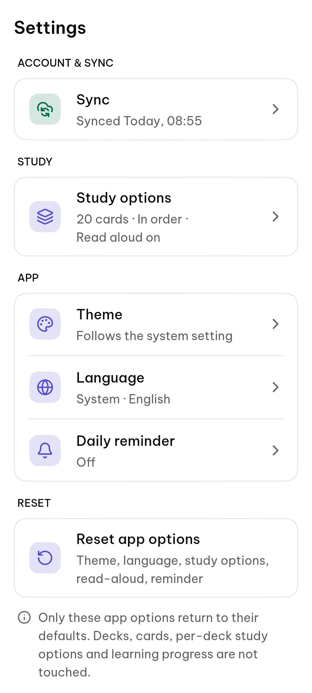 | 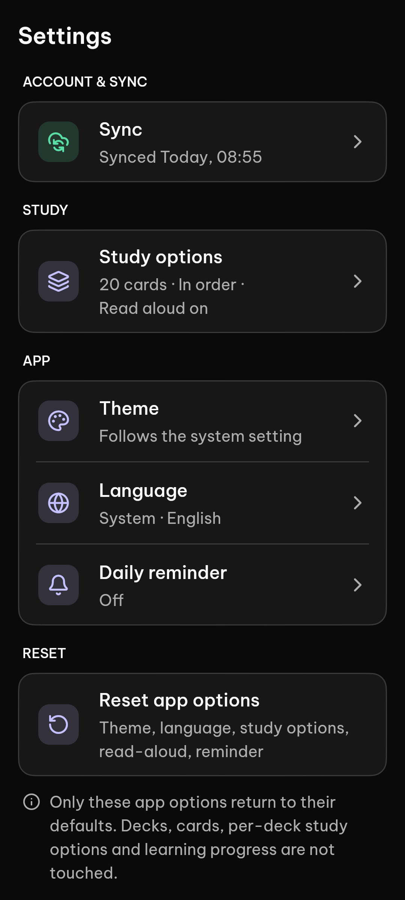 | (SB-U1) the Sync row after a success, in Account & sync. |
| syncFailed | 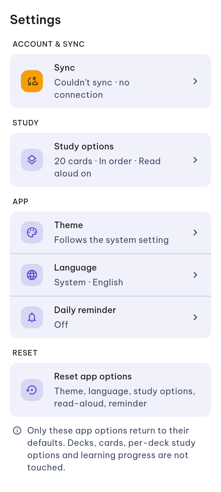 | 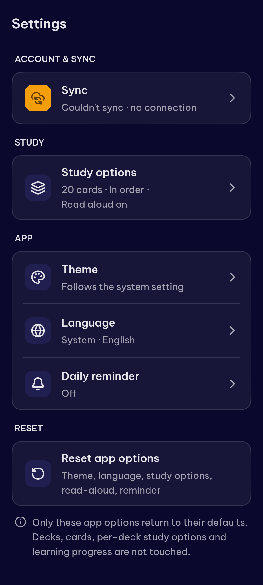 | (SB-U1) the Sync row after a failed run. |
| syncRejected | 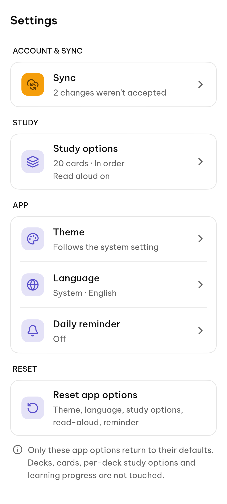 |  | (SB-U1) the Sync row with refused rows. |
| account | 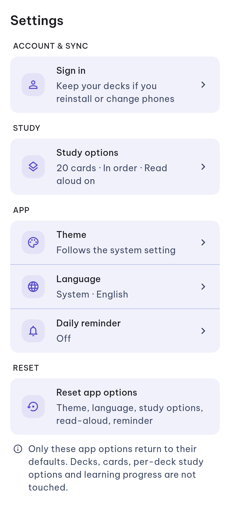 | 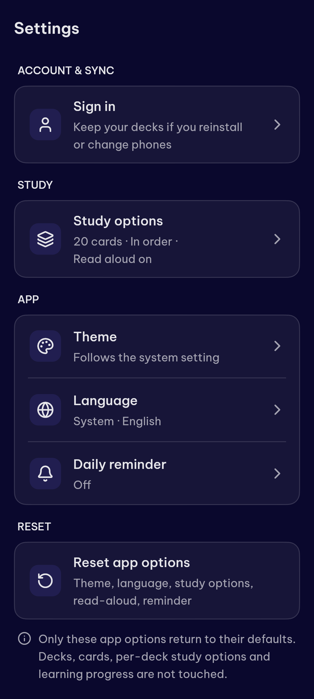 | Golden `settings_account_*` (in the account tests): the Account & sync section first, anonymous. |
| account, signed in | 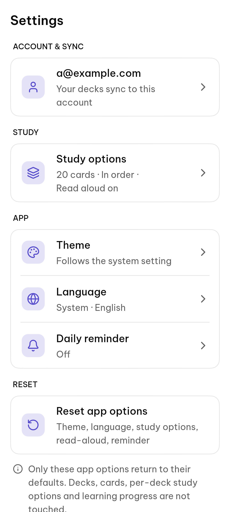 | 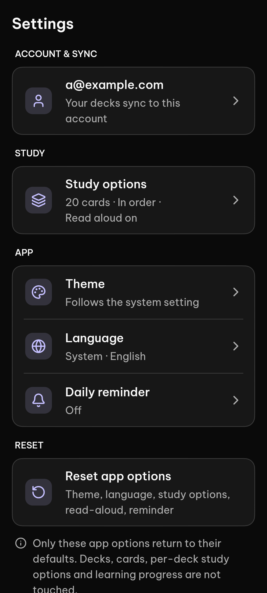 | (FE-B10) the account row and its chevron. |
| account, re-auth | 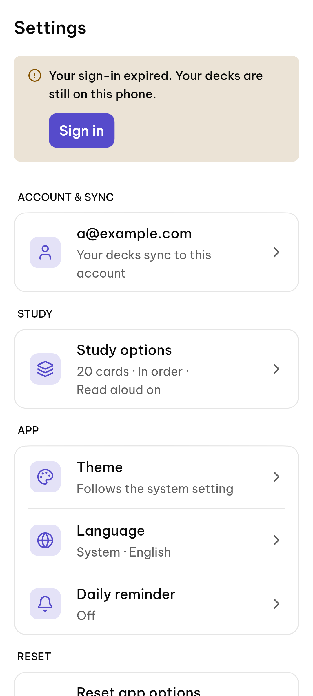 | 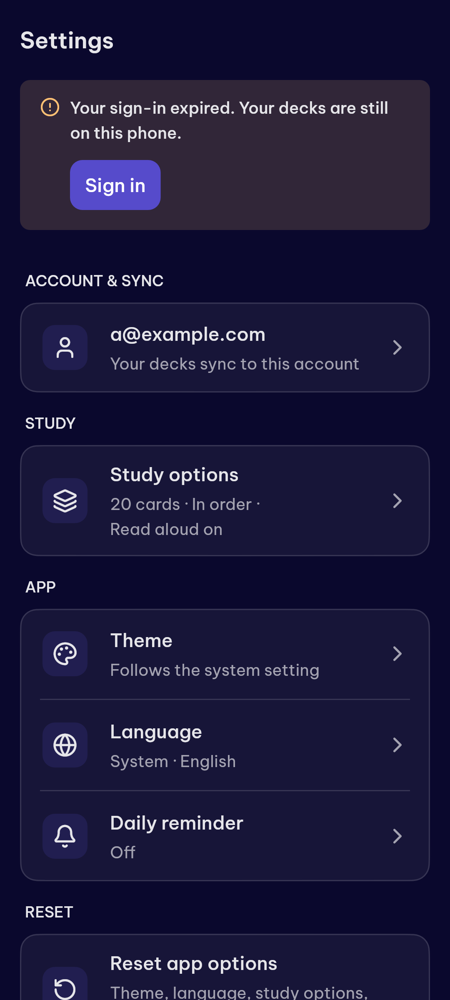 | (FE-B10) the banner leads the section. |
| read error | — | — | (UC E3) `MxErrorState` "Couldn't open Settings" with the local-first body and Retry; no value is shown. |
| gallery (debug build) | `app_gallery_light.png` | `app_gallery_dark.png` | The component gallery opened from the app bar's gallery icon (D11); the dark golden is taken after the gallery's own theme switch. A developer surface, exempt from the screen audits. `test/app/app_golden_test.dart::Gallery, ${brightness.name}`; `test/app/gallery_test.dart::the theme switch flips the gallery to dark`. |

Goldens: `test/features/settings/presentation/goldens/settings_{loaded,loading,admin_row,reset_confirm,reset_done,sync_synced,sync_failed,sync_rejected}_{light,dark}.png`.

## Transitions

| From | Event | To | Evidence |
|---|---|---|---|
| loading | the `app_settings` stream emits | loaded | UC-SETTINGS-001 step 1. VERIFIED `settings_screen_test.dart::the hub names every group and value: Study summary, Theme, reminder, Reset (settings hub spec §5.1)`; the skeleton before the first read `::before the first read the screen shows skeleton rows and no value (loading)` |
| loading | the read fails | read error | UC E3. VERIFIED `::a failed read shows the error with Retry and no invented value (E3)` |
| read error | Retry | error with Retry spinning (`isRetrying`), then loaded | UC E3. The error is VERIFIED in the test above; the tap (`ref.invalidate(appSettingsProvider)`) is `UNVERIFIED (code read)`: `settings_screen.dart` |
| loaded | the stream errors after data was shown | read error | `UNVERIFIED (code read)`: the `AsyncError` branch matches before the held value, so the rows go; recovery is Retry |
| loaded | tap Study options / Theme / Language / Daily reminder | 23a / 25 / 26 / 24 on the root navigator; Back returns here | D2, D8. VERIFIED `::the Study defaults row opens screen 23a and reflects a stored change (D8)`, `::the Theme and Language rows open their pages`, `::the reminder row names the time when on, and opens screen 24` |
| loaded | tap the Sync row | 27 | SB-U1. VERIFIED `settings_sync_section_test.dart::the Sync row names the state and opens screen 27` |
| loaded | the status stream fails | the Sync row is gone | spec §6. VERIFIED `settings_sync_section_test.dart::the Sync row hides when the status stream fails (spec §6)` |
| loaded | tap the account row / the re-auth banner | 30 (anonymous, `reauth`) / 32 (attached) | FE-B9, FE-B10. `UNVERIFIED (code read)` for the taps here (`app/` composes the slots: `lib/app/router/app_router.dart`); the slots' frames are the account goldens and `::the account row and the Sync row share one section, the banner above its overline (settings hub spec D7)` |
| loaded | the account becomes (or stops being) an admin | the Admin group appears or goes, without a restart | users spec U2. VERIFIED `::an account confirmed as admin shows the row without a restart, and a lost confirmation hides it` |
| loaded (admin) | tap Admin tools | 23b | D4. VERIFIED `::an admin sees one Admin tools row, and it opens screen 23b` |
| loaded (debug build) | tap the gallery icon | the component gallery | D11. `UNVERIFIED (code read)`: `onOpenGallery`, null in release |
| loaded | tap Reset app options | resetConfirm | UC A3. VERIFIED `::Reset asks first, then puts the defaults back (A3)` |
| resetConfirm | Cancel | loaded, nothing written | UC A3. VERIFIED same test |
| resetConfirm | Back or a scrim tap | loaded, nothing written | `UNVERIFIED (code read)`: `showMxDialog` dismisses with null unless held |
| resetConfirm | Reset | resetting | UC A3. `UNVERIFIED (code read)` for the held dialog and the spinner: no test reads `isHeld` or `isConfirmLoading` |
| resetting | Back, a scrim tap or Cancel | resetting (refused) | `UNVERIFIED (code read)`: `MxDialog.isHeld`, `onCancel: null` while `_isResetting` |
| resetting | a second tap on Reset | resetting (ignored) | `UNVERIFIED (code read)`: `_isResetting` in the dialog and `state.isBusy(reset)` in `SettingsController._submit` |
| resetting | the write lands | loaded with the defaults; the dialog closes; toast "App options reset to defaults" | UC A3. VERIFIED `::Reset asks first, then puts the defaults back (A3)`; `settings_controller_test.dart::reset returns every option to its default in one write (A3)` |
| resetting | the write fails | resetFailed; the dialog closes either way (`Navigator.pop` after `reset` returns) | UC E2. VERIFIED `::reset runs the reset app/ composed; a failure says so and the next confirm runs it again` (the toast; the dialog closing after a failure is a code read), `settings_controller_test.dart::a failed reset changes nothing and says so` |
| resetFailed | Retry on the toast | the reset runs again with no dialog; the toast then says the result | `UNVERIFIED (code read)`: `SettingsController.reset` registers `retry`; the screen test confirms again from the dialog instead of tapping Retry |
| resetFailed | tap Reset app options, confirm | resetting, then loaded | UC E2. VERIFIED `::reset runs the reset app/ composed; a failure says so and the next confirm runs it again` |
| resetting | the screen is left | not reachable: the held dialog refuses Back; the tab bar sits under the scrim | N/A, `UNVERIFIED (code read)` |

## Rulings

- **Settings hub spec 2026-10-07, D1–D11:** the tab is a hub of navigation rows; the study rows are on 23a and the admin rows on 23b; the account feature supplies a row and a banner, not a section; leaf paths do not move; the pattern is in `DESIGN.md`, Components, "Settings pattern".
- **D2 (owner), UI-base row 124:** Theme is a row naming the choice and opens screen 25.
- **UI-base row 125, UC E3:** loading is section-shaped skeleton cards (part 3d-2); a read error is `MxErrorState` with Retry.
- **ADR-015, SB-U1 (owner rulings R1, R5):** the Sync row opens screen 27.
- **Account UI spec §5.5, R2, P3b plan ruling 1:** the attached account opens screen 32; an expired sign-in's banner leads the Account & sync section, since 23 owns the problem.
- **ADR-018 §8, monitoring spec §3.1, users spec U2:** the admin rows show only while the account is an admin; on the hub as one row to 23b.
- **Critique 2026-09-30 tone pass, T4; part 3d-1 (spec `2026-10-01-critique-fixes-part3d1-design.md`):** the Sync row's tile is success when sync is settled; warning when the last run failed or a change was refused; tinted otherwise (D5).
- **Critique 2026-09-30 part 3d-2 (spec `2026-10-01-critique-fixes-part3d2-design.md`):** loading shows section-shaped skeleton cards of `MxSkeletonRow`s, not a generic list.
- **Q-C-1 (owner, 2026-10-16):** the Study summary, the reminder time and the system language wrap only between whole terms (`metaLine`); the Sync row's failure hint keeps each dot on the phrase before it (`metaDots`) (The Wrap Rule; `lib/l10n/meta_line.dart`).

## Copy

- Groups: "Account & sync" · "Study" · "Study options" · "1 card" / "{count} cards · {order} · Read aloud on" / "… off" · "App" · "Admin" · "Admin tools" · "Monitoring, users, SQL log" · "Reset".
- App: "App" · "Theme" · "Follows the system setting" · "Light" · "Dark" · "Language" · "System · {language}" · "English" · "Tiếng Việt" · "Daily reminder" · "Off" · "On · {time}".
- Reset: "Reset" · "Reset app options" · "Theme, language, study options, read-aloud, reminder" · "Only these app options return to their defaults. Decks, cards, per-deck study options and learning progress are not touched." · "Reset app options?" · "Theme, language, cards per session, new-card order, read-aloud settings and the daily reminder (off, 20:00) go back to their defaults." · "Your decks, cards, schedules and study history stay exactly as they are. This is not “Reset learning progress”." · "Cancel" · "Reset".
- Sync (SB-U1): "Sync" · "{n} changes weren't accepted" · "Couldn't sync · no connection" · "Couldn't sync · couldn't sign in" · "Couldn't sync · server error" · "Couldn't sync · something went wrong" · "Synced {time}" · "Not synced yet"; times "Today, {HH:mm}" · "Yesterday, {HH:mm}" · "{MMM d}, {HH:mm}".
- Admin: "Admin" · "Admin tools" · "Monitoring, users, SQL log" (the rows themselves are on 23b).
- Toasts: "App options reset to defaults" · "Couldn't reset the app options. Nothing changed." · "Retry" (the study rows' toasts are 23a's).
- Error: "Couldn't open Settings" · "Nothing was lost. Try again in a moment." · "Retry".
