<!-- Hand-written screen record. -->

# 27 · Sync

What sync did and what waits: the last success, the changes not yet on the server, the
last failed run, and the rows the server refused. Shaped by Impeccable before the plan
(2026-09-28). SB-U1; spec
[2026-09-28-sync-status-design.md](../../../superpowers/specs/2026-09-28-sync-status-design.md)
§5.2.

## Entry points

- Screen 23, the Account & sync section, row "Sync" (settings hub spec D2). Route `/settings/sync`, on the root navigator like
  Theme and Language; Back returns to 23.
- Screen 13's sync banner, "Details" (`context.go`, as Study home opens the Library);
  Back lands on Settings.
- Neither exists when the build has no Supabase.

## Layout

| Region | Widget | Design |
|---|---|---|
| App bar | `MxAppBar` + back `MxIconButton` | "Sync". |
| Problem | `MxInlineBanner` (warning); a network failure is an `MxNote` (critique 2026-10-02) | Under the status card, above Sync now (critique 2026-09-30; it was a floating notice). Refused rows win: the title "{n} changes weren't accepted" (critique 2026-09-30 part 3a, R3) over the message "The server didn't accept them. They're safe here. Try again, or keep them on this device only; they won't sync to your other devices.", then Keep on device (outline) · Try again (primary, the screen's one primary) under it. Keep opens the Keep dialog first (critique 2026-09-30 part 1, R4). Otherwise the last failed run's sentence (spec §5.4), local-first, with no code, id or message. None when all is well. |
| Status | `MxSection` + two `MxSettingsRow`s + note | "Last synced" · "{Today, 14:32}" or "Not yet"; "Waiting to sync" · "{n} changes" or "Nothing waiting", or "No other changes waiting" when only refused rows remain (critique 2026-09-30 part 1); the note "MemoX syncs on its own when you're online. Your study never waits for it." |
| Sync now | `MxButton` (block, cloud-sync glyph): primary while changes wait or a run failed and no row was refused; outline otherwise, since sync is automatic (critique 2026-09-30) and, with refused rows, the banner's Try again is the one primary (critique 2026-09-30 part 1) | While a run it started is going, a spinner and "Syncing…" take its place, in a row of the button's height (`AppSize.buttonRegular`; critique 2026-09-30 part 3d-1, D5, part 3d-2). |
| Keep dialog | `MxDialog` + `MxSheetActions` | "Keep {n} changes on this device only?" · "They won't sync to your other devices. You can't undo this." · Cancel · "Keep" (the title names what it keeps, DEV-179). Only the confirm keeps; Cancel, Back or the scrim write nothing (critique 2026-09-30 part 1, R4). |
| Toasts | `MxSnackbar` | "Synced"; "Couldn't sync. Nothing was lost."; "Kept on this device"; "Couldn't change that. Nothing was lost." · Retry. |

Only one of Sync now, Try again and Keep on device runs at a time; the other two
are disabled meanwhile.

## States

The images are the goldens.

| State | Golden (light) | Golden (dark) | App |
|---|---|---|---|
| synced | 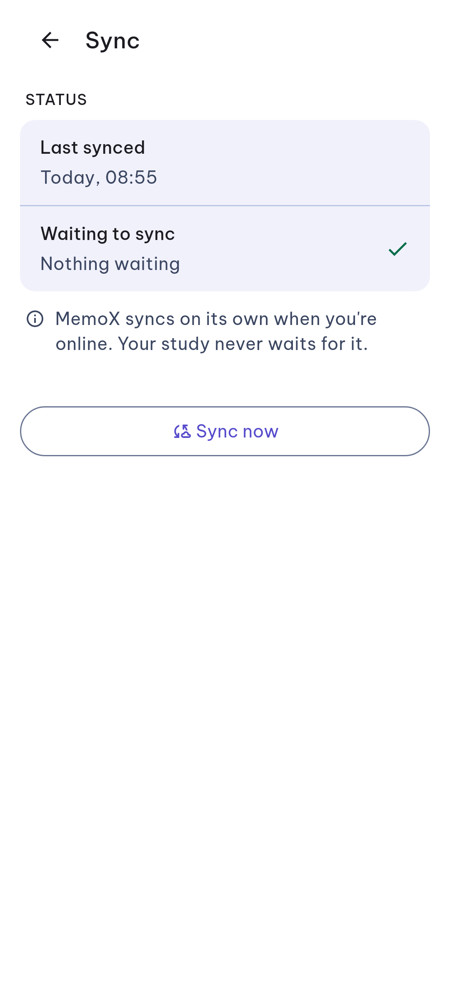 | 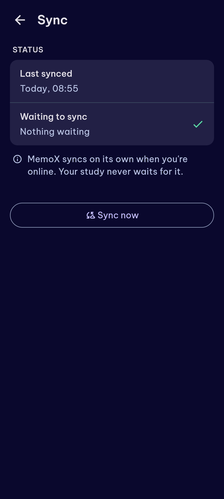 | Golden `sync_synced_*`. |
| neverSynced | 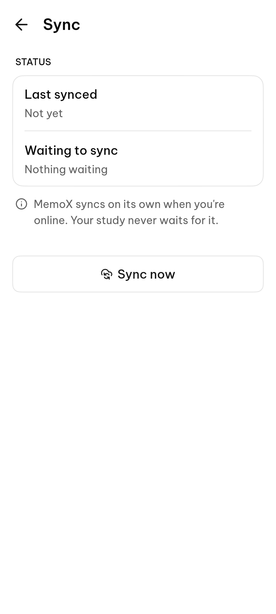 | 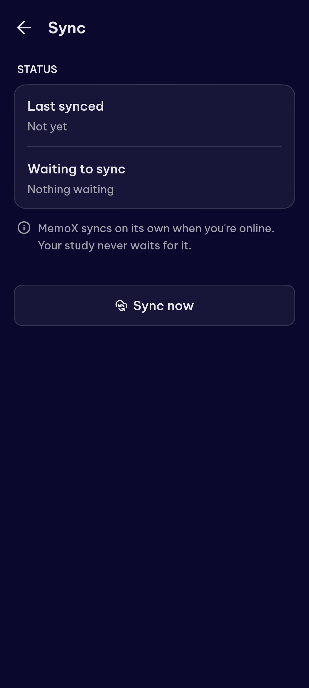 | Golden `sync_never_synced_*`. |
| pending | 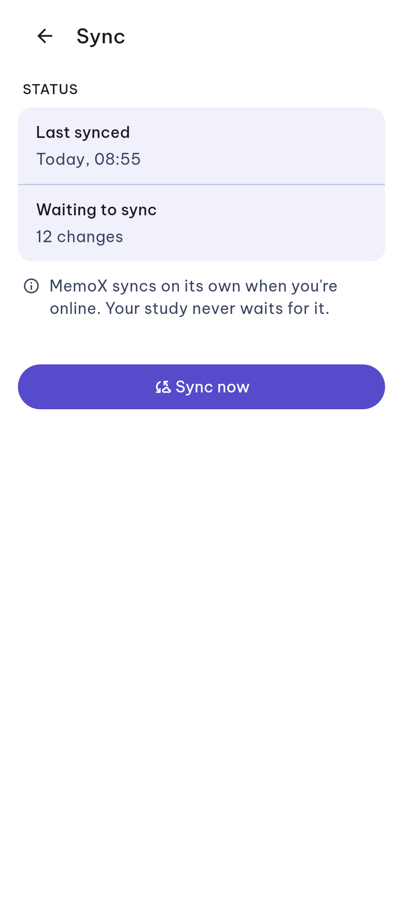 | 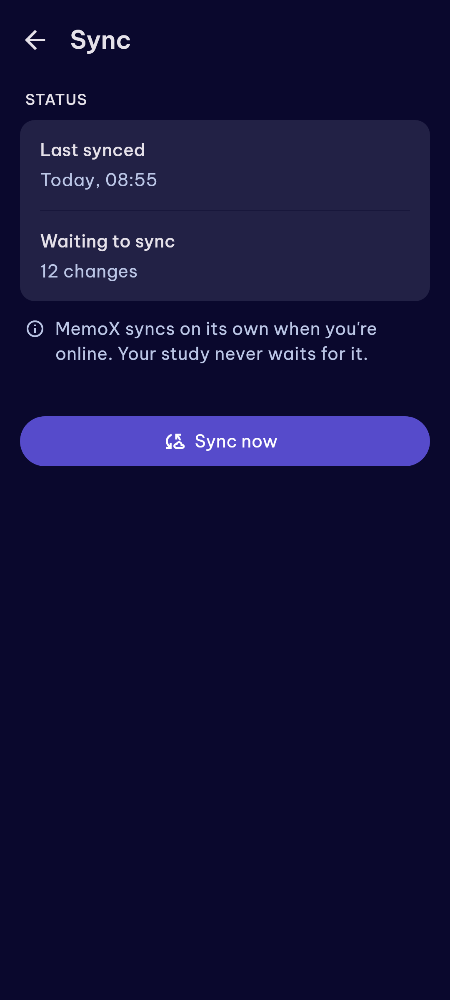 | Golden `sync_pending_*`. |
| failedNetwork | 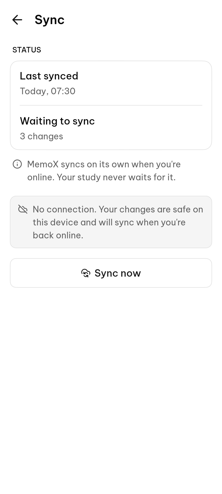 | 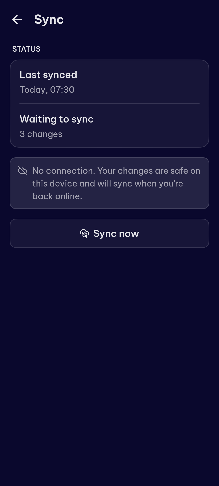 | Golden `sync_failed_network_*`. |
| failedServer | 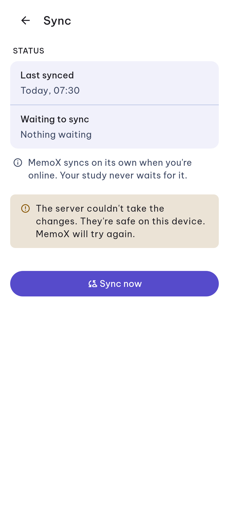 | 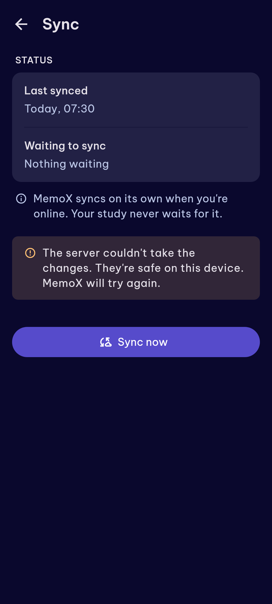 | Golden `sync_failed_server_*`. |
| rejected | 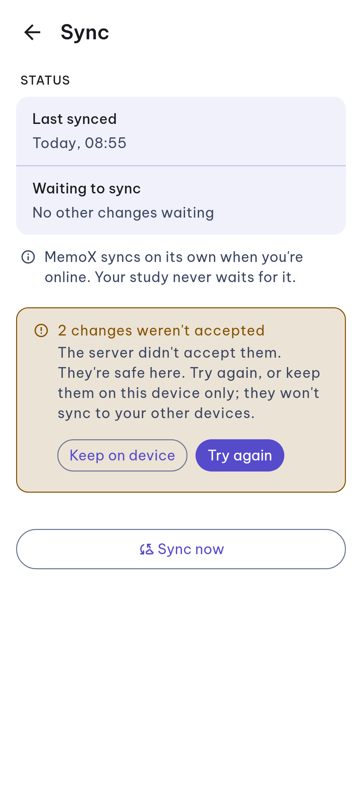 | 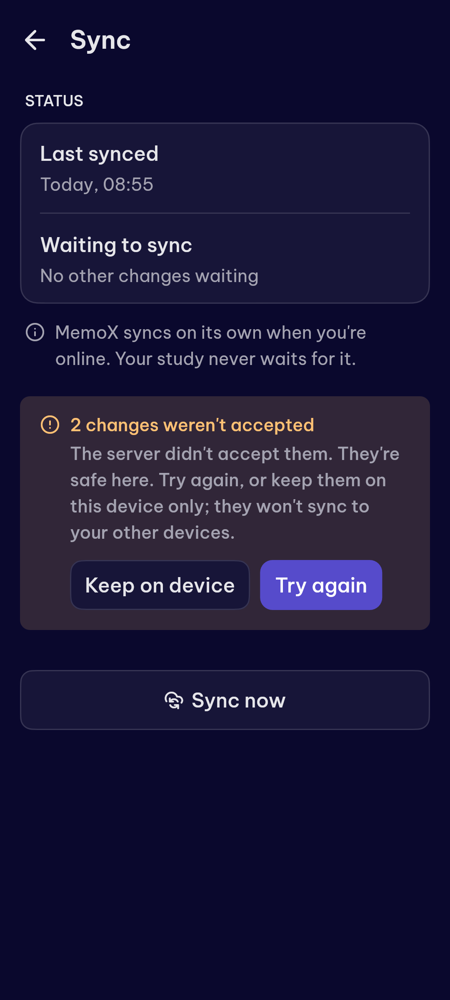 | Golden `sync_rejected_*`. |
| keepDialog | 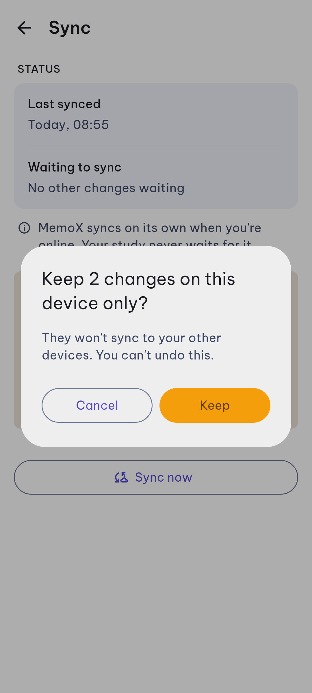 | 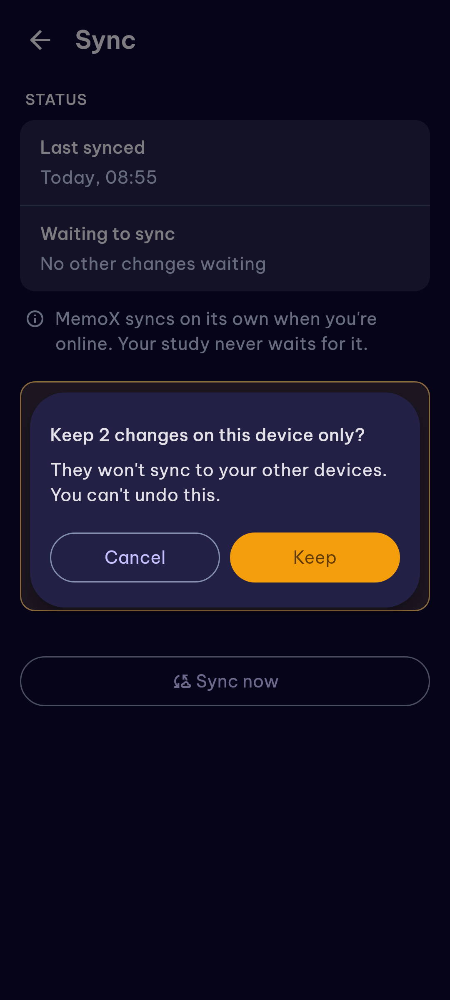 | Golden `sync_keep_dialog_*` (critique 2026-09-30 part 1). |
| syncing | 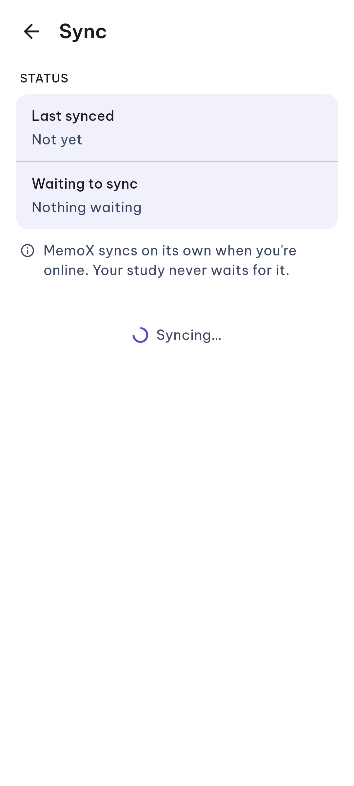 | 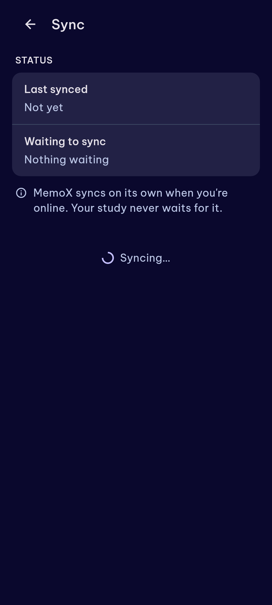 | Golden `sync_syncing_*`. |
| retrying | — | — | After Try again: its button spins and the other two are disabled (`SyncTask.retry`). Code read: `sync_notice_widget.dart`; no golden. |
| keeping | — | — | After Keep in the dialog: its button spins and the other two are disabled (`SyncTask.keep`). Code read: same file; no golden. |
| change failed | — | — | A command threw: toast "Couldn't change that. Nothing was lost." with Retry. Code read: `sync_screen.dart` `_say`; no golden. |
| loading | — | — | `MxSkeletonList`, two rows. |
| read error | — | — | `MxErrorState` "Couldn't open Sync" with the local-first body and Retry (spec §6). |
| unavailable | — | — | A build with no Supabase has no status (the stream is null): a neutral `MxEmptyState` "Sync isn't available" over "This version of MemoX keeps everything on this device. Nothing is lost.", with no Retry and no Sync now (audit 2026-10-17). |

## Transitions

| From | Event | To | Evidence |
|---|---|---|---|
| loading | the status stream emits | synced / neverSynced / pending / failedNetwork / failedServer / rejected | SB-U1. VERIFIED `sync_screen_test.dart::Sync now leads while changes wait (critique 2026-09-30)`, `::Sync now steps back when nothing waits (critique 2026-09-30)`, `::a failure shows its sentence and no code`; labels `sync_labels_test.dart::the status line: refused, then failure, then success, then never` |
| loading | the stream fails, or has no status | read error | spec §6. VERIFIED `sync_screen_test.dart::while a Retry reloads, the error stays and its Retry spins`; a null status (a build without Supabase) shows the same error and is `UNVERIFIED (code read)`, though the screen has no entry then |
| read error | Retry | error with Retry spinning, then the state the read gives | VERIFIED `::while a Retry reloads, the error stays and its Retry spins` |
| any | tap Sync now | syncing: the button becomes a spinner and "Syncing…", Try again and Keep disabled | D5. VERIFIED `::while Sync now runs the screen says Syncing…; the button comes back after (critique 2026-09-30 part 3d-1, D5)` |
| syncing | the run succeeds | synced (or the state the status gives); toast "Synced" | VERIFIED `::Sync now runs and says Synced` |
| syncing | the run does not succeed | the state the status gives, the failure back; toast "Couldn't sync. Nothing was lost." | VERIFIED `::a failed Sync now says nothing was lost`, `::a sync that fails while Syncing… shows brings the button and the failure back (Review Focus 5)` |
| syncing | the command throws | the button back; toast "Couldn't change that. Nothing was lost." with Retry (re-runs Sync now) | `UNVERIFIED (code read)`: `SyncController.run` catches `Object` and sets `SyncChangeFailed`; no test throws from `syncNow` |
| any | a second command while one runs | ignored; the other buttons are disabled | VERIFIED `::a second command waits for the first` |
| rejected | tap Try again | retrying: Try again spins, Sync now and Keep disabled | `UNVERIFIED (code read)`: `isLoading: task == SyncTask.retry`; no golden |
| retrying | the run succeeds | the state the status gives (no banner if nothing is refused); toast "Synced" | `UNVERIFIED (code read)`; the tap reaching `retryRejected` is VERIFIED `::refused rows offer Try again and Keep on device` |
| retrying | the run does not succeed | the banner stays; toast "Couldn't sync. Nothing was lost." | `UNVERIFIED (code read)` |
| rejected | tap Keep on device | keepDialog | R4. VERIFIED `::Keep asks first and keeps only on confirm` |
| keepDialog | Cancel, Back or the scrim | rejected, nothing written | R4. VERIFIED `::dismissing the Keep dialog keeps the refused rows` (Cancel and Back; the scrim is `UNVERIFIED (code read)`) |
| keepDialog | Keep | keeping: Keep spins, Try again and Sync now disabled | R4. VERIFIED `::Keep asks first and keeps only on confirm` for the write; the spinner is `UNVERIFIED (code read)` |
| keeping | the write lands | toast "Kept on this device"; the status then drops the banner and the waiting row reads "No other changes waiting" | VERIFIED `::Keep asks first and keeps only on confirm` for the write and the toast; the status change is the stream's (the fake commands do not move it), `UNVERIFIED (code read)` |
| keeping | the write fails | the banner stays; toast "Couldn't change that. Nothing was lost." with Retry (re-runs Keep, without asking again) | spec §6. `UNVERIFIED (code read)`: `SyncChangeFailed(task).onAction` calls `_run(ref, task)`, which skips the dialog |
| any | the status changes under the screen (a background sync lands, a change is queued) | the same state, relabelled | `UNVERIFIED (code read)`: the body watches `syncStatusProvider` |
| any | the screen is left while a command runs | the command ends; no toast is shown (no listener) | `UNVERIFIED (code read)`: `ref.mounted` guard in `SyncController.run` |
| settled | all is well | no banner; the waiting row ends with a success check | T3. VERIFIED `::settled sync ends the waiting row with a success check (critique 2026-09-30 tone pass, T3)`, `::changes still waiting show no success check (T3)` |
| failedNetwork | | a neutral note, Sync now outline | critique 2026-10-02. VERIFIED `sync_offline_note_test.dart::a network failure is a neutral note, and Sync now steps down to outline even with changes waiting` |
| failedServer | | the warning banner, Sync now primary | VERIFIED `sync_offline_note_test.dart::a server failure stays a warning and Sync now leads` |

## Rulings

- **Owner 2026-10-18 (closing acceptance NEW-1):** a failed-save toast's Retry acts on this screen's controller, so the toast leaves when the screen does (`showMxSnackbar` closes a toast with an action when its route goes). Before, a Retry tapped after leaving threw "Using ref when a widget is unmounted" and wrote nothing. `settings_toast_leave_test.dart`, `mx_snackbar_route_test.dart`.
- **ADR-015, SB-U1 owner rulings R1, R3, R5–R7:** sync has its own screen, and its problems reach other screens as a floating notice (register row 143); on this screen they sit inline under the status, by Sync now (critique 2026-09-30).
- **Critique 2026-09-30 part 1 (spec `2026-09-30-critique-fixes-part1-design.md`), R4:** with refused rows Try again is the one primary, the waiting row never says "Nothing waiting", the banner says why and what Keep costs, and Keep asks first.
- **Spec R6, FE-B5 D9:** times are 24-hour `HH:mm` in every language; dates read "Sep 26" style in English.
- **Critique 2026-09-30 tone pass (spec `2026-09-30-critique-fixes-tone-design.md`), T3:** when sync is settled (synced once, nothing waiting, refused or failed) the waiting row ends with a success check, not read out.
- **Critique 2026-09-30 part 3d-1 (spec `2026-10-01-critique-fixes-part3d1-design.md`):** while Sync now runs, a spinner and "Syncing…" stand in the button's place, announced as a live status (D5).
- **Critique 2026-09-30 part 3d-2 (spec `2026-10-01-critique-fixes-part3d2-design.md`):** the "Syncing…" row is the height of the button it stands in for (`AppSize.buttonRegular`), so the page does not shift when the swap happens.
- **Critique 2026-10-02 (spec `2026-10-02-critique2-fixes-design.md`):** a run that failed for want of a network is a neutral `MxNote` (offline glyph) and Sync now is outline; server, sign-in and unknown failures keep the warning banner. Keep confirms in warning (F8).

## Copy

- App bar: "Sync".
- Refused rows: "{n} changes weren't accepted" · "1 change wasn't accepted" · "The server didn't accept them. They're safe here. Try again, or keep them on this device only; they won't sync to your other devices." · "Keep on device" · "Try again".
- Keep dialog: "Keep {n} changes on this device only?" · "They won't sync to your other devices. You can't undo this." · "Cancel" · "Keep".
- Failures: "No connection. Your changes are safe on this device and will sync when you're back online." · "Couldn't sign in to sync. Your changes are safe on this device. MemoX will try again." · "The server couldn't take the changes. They're safe on this device. MemoX will try again." · "Sync stopped with an error. Your changes are safe on this device. MemoX will try again."
- Status: "Status" · "Last synced" · "Not yet" · "Waiting to sync" · "{n} changes" · "Nothing waiting" · "No other changes waiting" · "MemoX syncs on its own when you're online. Your study never waits for it." · "Sync now".
- Toasts: "Synced" · "Couldn't sync. Nothing was lost." · "Kept on this device" · "Couldn't change that. Nothing was lost." · "Retry".
- Error: "Couldn't open Sync" · "Nothing was lost. Try again in a moment." · "Retry".
- No sync in this build: "Sync isn't available" · "This version of MemoX keeps everything on this device. Nothing is lost."
