<!-- Hand-written screen record. -->

# 28 · Monitoring

The admin's window on the app's logs: the server's, and the device's own buffer. It opens
on the open warnings and errors, newest first, and lets the admin filter and search them,
open one whole, and mark it fixed or reopen it. Shaped by Impeccable before the plan
(2026-09-29).
FE-B8; ADR-018 §6 to §8; spec
[2026-09-29-monitoring-screen-design.md](../../../superpowers/specs/2026-09-29-monitoring-screen-design.md)
§3; plan
[2026-09-29-monitoring-screen.md](../../../superpowers/plans/2026-09-29-monitoring-screen.md).

## Entry points

- Screen 23b (Admin, admin only), Logs, row "Monitoring" (settings hub spec D4). Route `/settings/monitoring`, on the root
  navigator like Sync; Back returns to 23b, since 23b pushes it (`lib/app/router/admin_routes.dart`).
- A row opens its detail at `/settings/monitoring/:id` (`?local=1` for a row of the device
  buffer), nested under the list, so Back climbs one page at a time and the list keeps its
  pages and scroll position.
- The row exists only while the session's account has `app_metadata.role = admin`, and not
  at all in a build with no Supabase. A deep link from any other account, to the list or to
  a log (`?local=1` included), gets "Only an admin can see this" before anything is read:
  the device buffer has no server check behind it. The server still refuses the RPCs with
  `FORBIDDEN`.

## Layout: the list

| Region | Widget | Design |
|---|---|---|
| App bar | `MxAppBar` + back `MxIconButton`; on the Server tab a refresh `MxIconButton` | "Monitoring". "Refresh" reads the first page again, as the pull down does, for TalkBack and a keyboard (audit 2026-10-17); it is off while that read runs. The Not sent tab watches its rows and has none. |
| Tabs | `MxSegmentedTray` | "Server" · "Not sent ({n})"; n is every row of the device buffer. |
| Search (Server) | `MxSearchField` | "Search event or message"; asks 400 ms after the last keystroke. |
| Filters (Server) | `MxChipTrigger` × 5 in a row that scrolls | Level (default warning + error) · Status (default open) · Category · Time · Device / user. A chip that holds a choice shows it, naming one or two and counting from three: "Level · Warning, Error", "Status · Open", "Time · Last 24 hours", "Level · 3"; Device / user counts a pair, since its choices are ids (critique 2026-09-30 part 3b). |
| Count | `MxListSectionHeader` | "{n} logs" with any filter (the chip names the filter); "{n}+ logs" while more pages exist. |
| Rows | `MxListRow` | Leading `MxIconTile` with a glyph per level (debug bug, info circle, warning triangle, error circle) on the tint of its level; title `event`; subtitle the first line of the message, or else of the error message, or else the error type; trailing `HH:mm` today or "Sep 26", and under it an `MxBadge` "Open" / "Fixed" for warnings and errors, except a row whose status is the one the Status filter holds: the chip and the header say it (critique 2026-09-30 part 3b). TalkBack: "{level}, {event}, {time}, {status}". |
| End | `MxSpinner` / `MxInlineBanner` / caption | The next 100 rows load when the last 10 come into view; a spinner while they do; "Couldn't load more logs. What is shown is still correct." with Retry; "No more logs". |
| Refresh failed | `MxInlineBanner` (danger) above the count | A pull down or Refresh that fails keeps the rows and says "Couldn't refresh. What is shown is still correct." with Retry; the next read that lands clears it. A lost admin right replaces the rows instead (audit 2026-10-17). |
| Not sent | the SQL log switch row (`MxSettingsRow` + `MxToggle`, the same row as screen 23's, in an `MxSection` on the screen margin, first, above the note; SQL log switch spec 2026-10-07) + `MxNote` + one `MxChipTrigger` (Level, default warning + error) + rows | "These logs wait on this device. They are sent when MemoX is online." (the tab states how many), then the header "{n} at these levels" over the rows shown (critique 2026-09-30 part 3b). The rows are the device buffer, watched, without a status. |
| Filter sheets | `MxBottomSheet` | Level, Status and Category: a toggle per value (`MxSettingsRow` + `MxToggle`). Time: an `MxOptionRow` per window (last hour, 24 hours, 7 days, 30 days, all time). Device / user: two `MxTextField`s, each painting its name as the label above the box (no placeholder repeats it), and an `MxNote`. Each has Reset (outline) and Apply. |

Choosing Debug or Info, or no level at all (every level), clears the status filter: those rows have no status and it would
hide them. Category rows show the stored code (`db`, `sync`, `network`) and come from
`LogCategory.values`. A pull down on the Server tab, and any filter or search change,
reload from the first page.

## Layout: the detail

| Region | Widget | Design |
|---|---|---|
| App bar | `MxAppBar` + back, action `MxIconButton` | Title: the event. The action copies the whole log as JSON; `MxSnackbar` "Copied". |
| Head | `MxIconTile` + text + `MxBadge` | The level's glyph tile and name, the full time (date and `HH:mm:ss`, local) under it, and "Open" / "Fixed" for a warning or error. |
| Message, Error | `MxListSectionHeader` + `MxCard` | Selectable text. Error: the type on its own line in the row-title weight, then its message. |
| Stack trace, Context | `MxListSectionHeader` + `MxCard`, `code` style | Selectable; one frame per row, its `#n` (`colors.primary`) in a fixed-width cell so a wrapped line hangs under the frame's text; the context is pretty-printed JSON. Hidden when empty. A context can be 256 kB. |
| Details | `MxSection` of label/value rows, last | Fixed by, Fixed at (a fixed log only), Note, Category, Source, Device, App ("8.0.0 (12)"), Platform, User. A short value sits beside its caption label on one 48 row; the note under its label; an id under its label in the `code` style, wrapping between its groups, with its own copy button ("Copy device ID", "Copy user ID"; `MxSnackbar` "Copied"). A row the log does not have is left out. |
| Triage | `MxFooterBar` + `MxButton` (primary, block) | "Mark fixed", or "Reopen" for a fixed one; for a warning or error of the server only. It opens an `MxBottomSheet` titled "Mark fixed" or "Reopen" with an optional note (`MxTextField`) and Cancel · "Save" (DEV-179). |
| Toasts | `MxSnackbar` | "Marked fixed"; "Reopened"; "Couldn't change that. Nothing changed." · Retry. |

## States

The images are the goldens.

| State | Golden (light) | Golden (dark) | App |
|---|---|---|---|
| list, loaded | 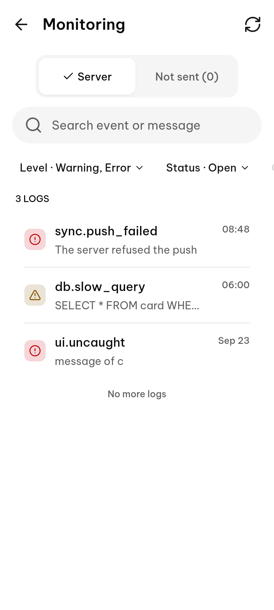 | 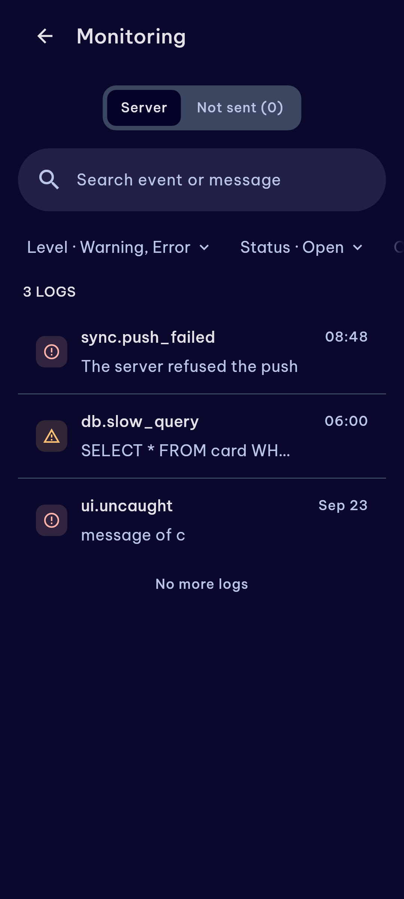 | Golden `monitoring_list_loaded_*`: open warnings and errors. |
| list, every level | 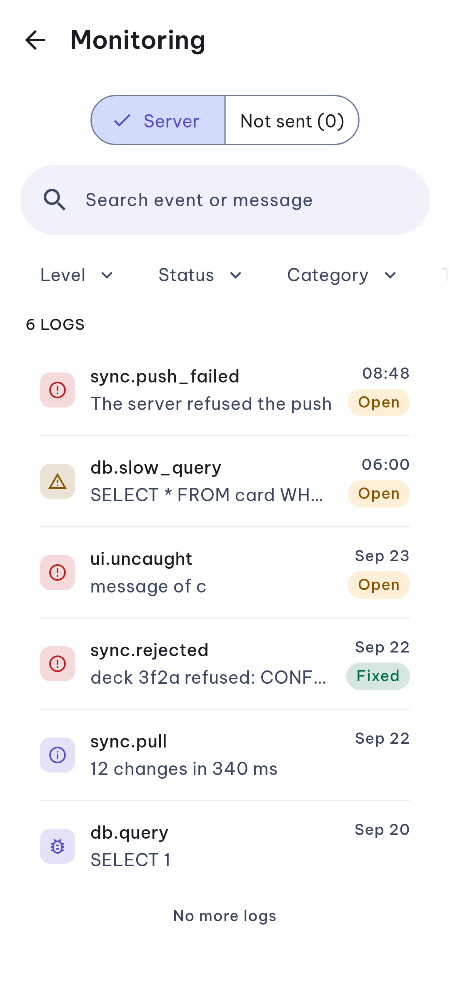 | 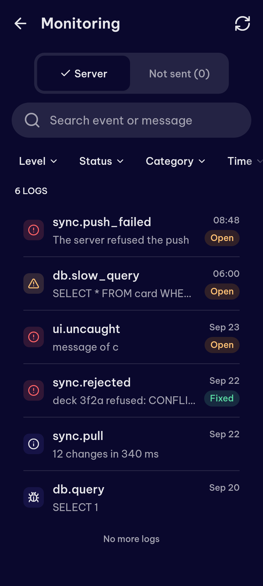 | Golden `monitoring_list_all_levels_*`: the filter widened; four glyphs, both statuses. |
| list, empty | 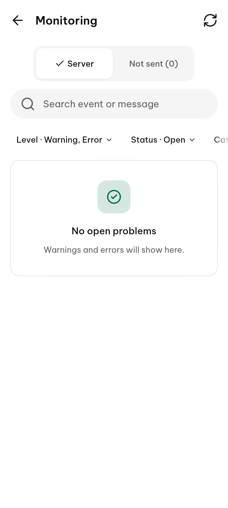 | 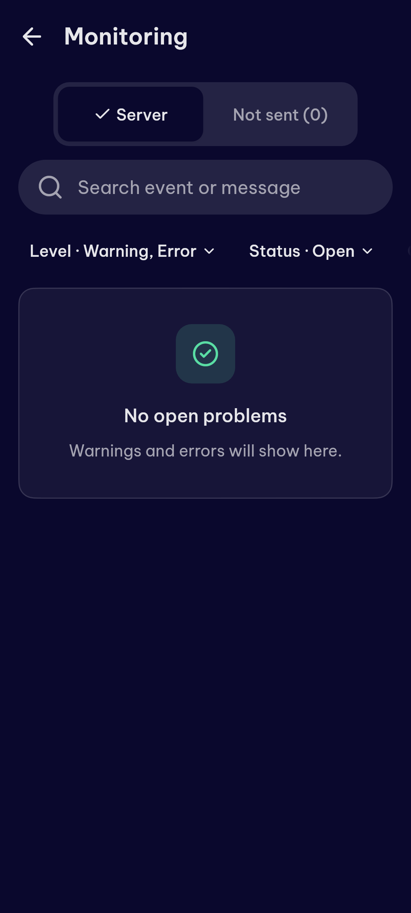 | Golden `monitoring_list_empty_*`. |
| list, offline | 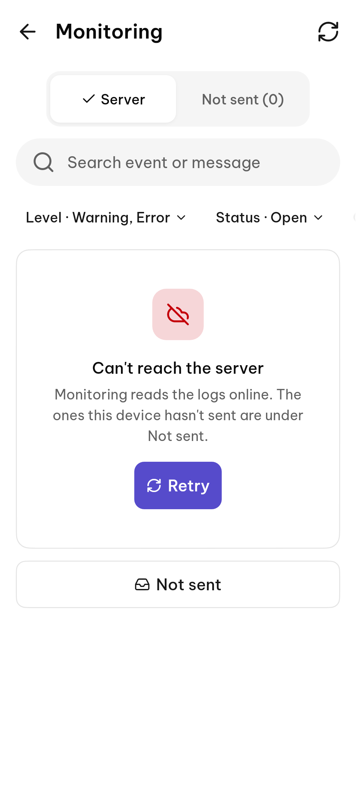 | 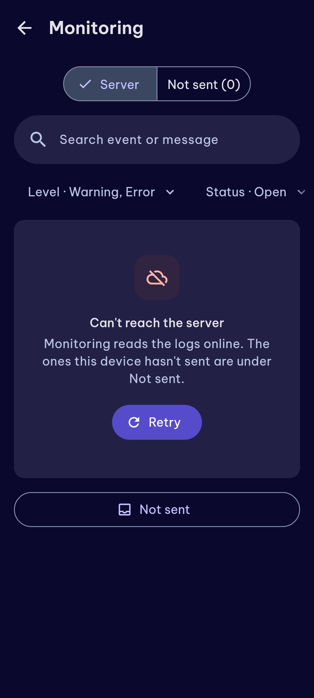 | Golden `monitoring_list_offline_*`. |
| Not sent | 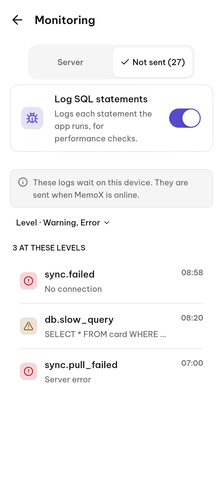 | 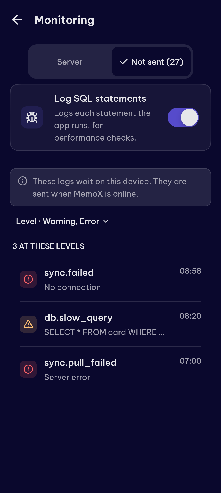 | Golden `monitoring_not_sent_*`. |
| Level sheet | 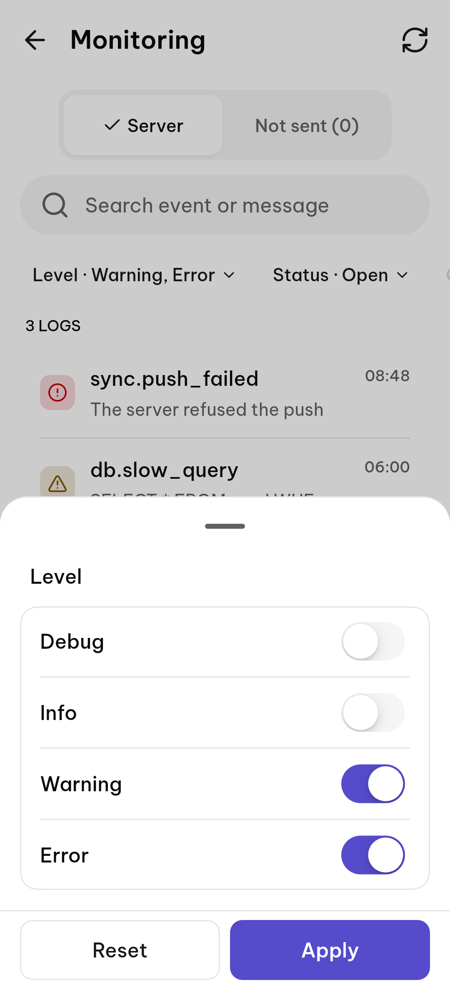 | 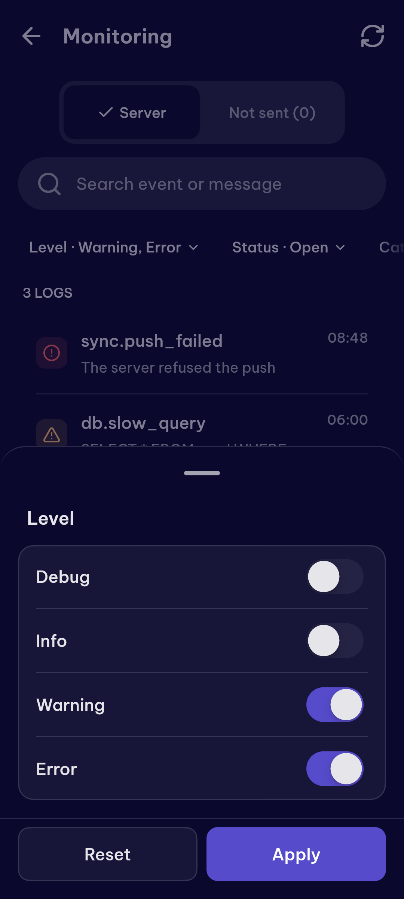 | Golden `monitoring_level_sheet_*`. |
| detail, open error | 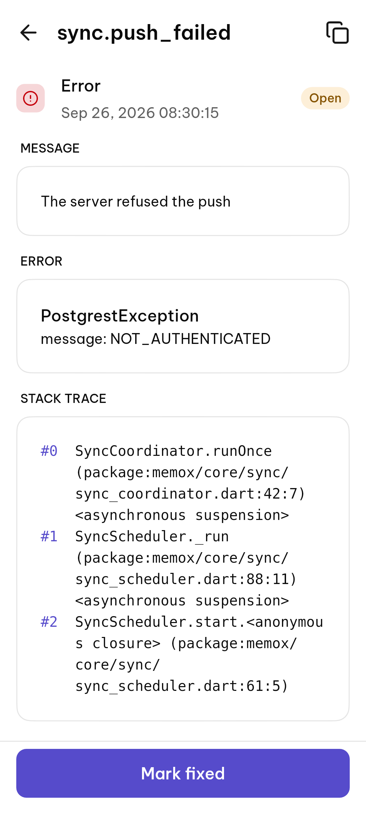 | 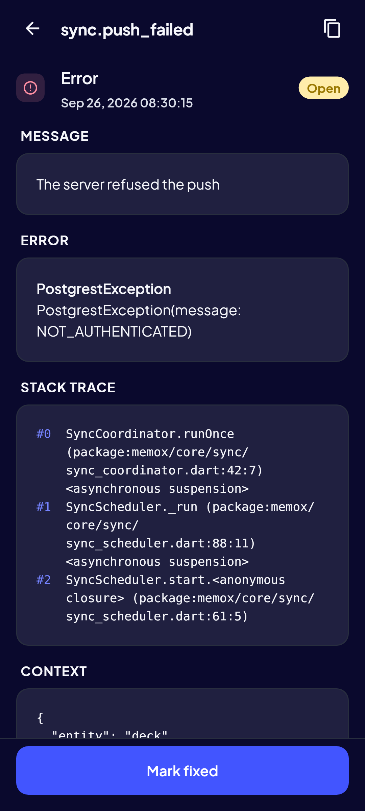 | Golden `monitoring_detail_open_*`. |
| detail, scrolled to the end | 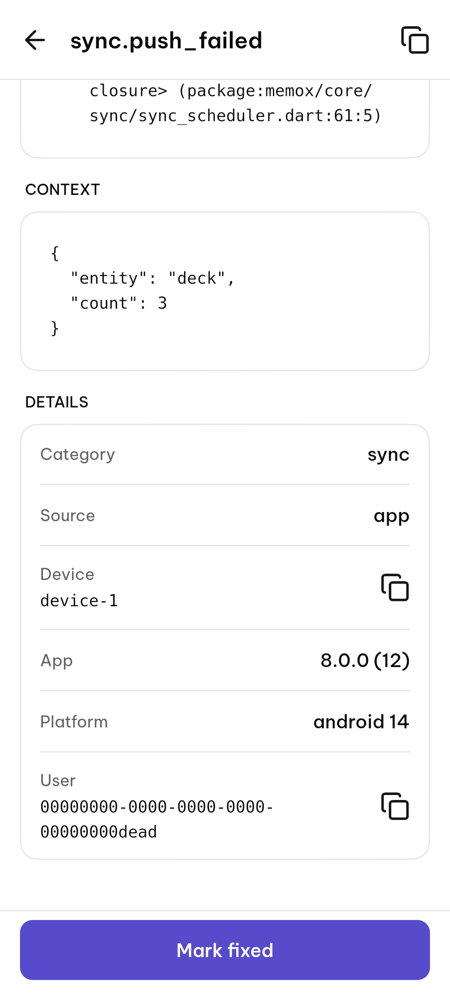 | 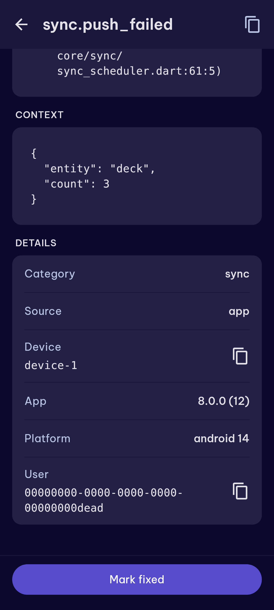 | Golden `monitoring_detail_open_trace_*`: the context in the `code` style and the Details. |
| detail, fixed with a note | 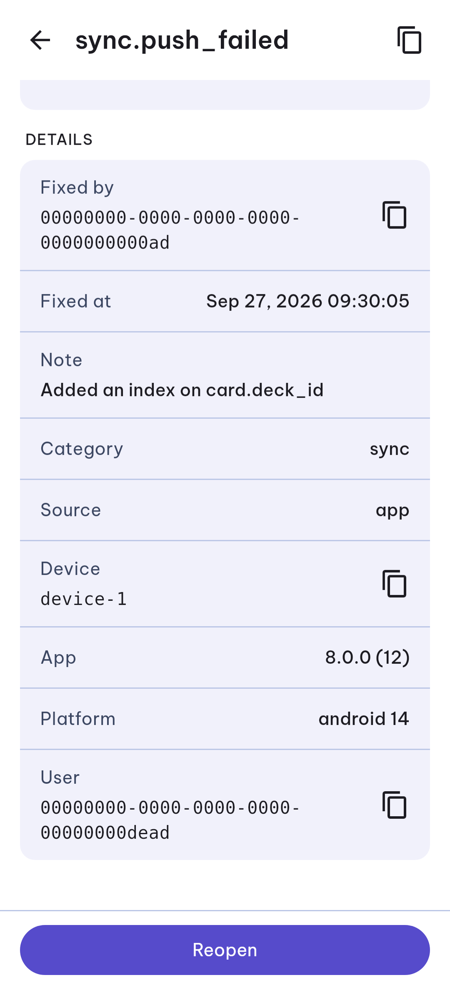 | 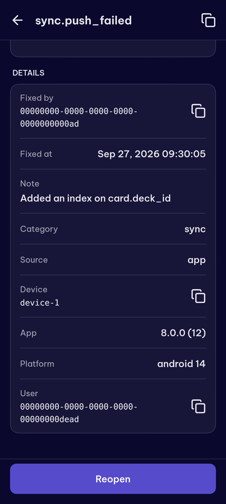 | Golden `monitoring_detail_fixed_*`, scrolled to the Details: Fixed by, Fixed at, the note, Reopen. |
| detail, a row of the buffer | 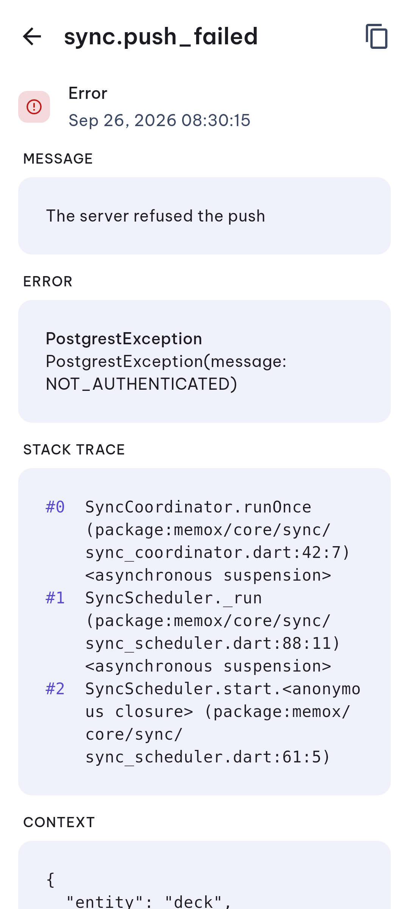 | 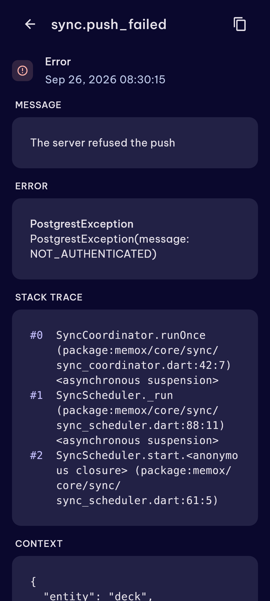 | Golden `monitoring_detail_local_*`: no triage, no user. |
| list, refresh failed | — | — | The rows stay under a danger `MxInlineBanner` "Couldn't refresh. What is shown is still correct." with Retry (executed: `monitoring_screen_test.dart`). |
| list, loading | — | — | `MxSkeletonList`, six rows. |
| list, loading more | — | — | The last rows stay and an `MxSpinner` sits under them while the next 100 load (`MonitoringMore.loading`). Code read: `monitoring_server_list_widget.dart` `_End`; no golden. |
| list, load more failed | — | — | The rows stay; an `MxInlineBanner` (danger) "Couldn't load more logs. What is shown is still correct." with a small Retry replaces the spinner (`MonitoringMore.failed`); no loop on scroll. No golden; `monitoring_screen_test.dart::a failed page keeps the rows and offers Retry, not a loop`. |
| list, end | — | — | "No more logs" caption once `next` is null. `monitoring_screen_test.dart::the next page loads near the end, and the end says so`. |
| Not sent, loading | — | — | The chip stays; below it an `MxSkeletonList`, six rows, until the buffer's first answer (`PendingLogsState.logs` is `AsyncLoading`). Code read: `monitoring_pending_tab_widget.dart`; no golden. |
| Not sent, error | — | — | The chip stays; below it `MxErrorState` "Couldn't load logs" with the local-first body and Retry (the buffer's watch failed). Code read: same file; no golden. |
| Not sent, empty | — | — | "Nothing waiting" (success tone) for an empty buffer, "No logs at these levels" (neutral) when the chosen levels hide every row; the note shows only while logs wait. `monitoring_not_sent_test.dart::Not sent has words for an empty buffer and for a level with no row`. |
| detail, changing | — | — | Mark fixed / Reopen shows a spinner and is disabled while the change runs (`isLoading`); the page stays. Code read: `monitoring_detail_screen.dart` `_triage`; no golden. |
| status sheet | — | — | `MxBottomSheet` "Mark fixed" / "Reopen" with the optional note and Cancel · Save. `monitoring_detail_screen_test.dart::Mark fixed asks for an optional note, says so, and the button becomes Reopen`; no golden. |
| detail, change failed | — | — | The log as it was, toast "Couldn't change that. Nothing changed." with Retry; the toast leaves with the page. `::a change that fails offline says nothing changed and Retry does it`, `::leaving the page takes its failed-change toast with it`. |
| list, no match | — | — | `MxEmptyState` "Nothing matches" with Clear filters. |
| list, error | — | — | `MxErrorState` "Couldn't load logs" with the local-first body and Retry. VERIFIED (closing acceptance 2026-10-18): `monitoring/presentation/monitoring_screen_test.dart::another failure is a local-first error with a Retry` |
| list, not an admin | — | — | `MxEmptyState` "Only an admin can see this" (the server's `FORBIDDEN`). VERIFIED (closing acceptance 2026-10-18): `monitoring/presentation/monitoring_screen_test.dart::FORBIDDEN says only an admin can see this` |
| detail, loading / error / offline / gone | — | — | Skeleton; `MxErrorState` with Retry; offline with Retry; gone: a neutral `MxEmptyState`, "This log is gone" / "It may have been cleaned up." (owner 2026-10-08) VERIFIED (closing acceptance 2026-10-18): `monitoring/presentation/monitoring_detail_screen_test.dart::while it loads the page is a skeleton, with no actions`; `monitoring/presentation/monitoring_state_coverage_test.dart::detail, error: a failure that is neither offline nor FORBIDDEN is the local-first error with Retry and no actions; Retry reads again`; `monitoring/presentation/monitoring_detail_screen_test.dart::offline and other failures offer Retry, not an admin its words`; `monitoring/presentation/monitoring_detail_screen_test.dart::a log that is gone says it may have been cleaned up` |

Goldens: `test/features/monitoring/presentation/goldens/monitoring_{list_loaded,list_all_levels,list_empty,list_offline,not_sent,level_sheet}_{light,dark}.png` and `monitoring_detail_{open,open_trace,fixed,local}_{light,dark}.png`.

## Transitions

| From | Event | To | Evidence |
|---|---|---|---|
| (entry) | the account is not an admin | the gate: "Only an admin can see this", nothing read | ADR-018 §7. VERIFIED `monitoring_admin_gate_test.dart::a settled non-admin is refused`; the wait while the account is confirmed `::while the account is still being confirmed, the gate waits instead of refusing (plan ruling 13)` |
| list, loading | the first page lands | list, loaded / empty / no match | spec §3.4. VERIFIED `monitoring_screen_test.dart::it opens on open warnings and errors, with their count`, `::no open problems is a calm empty state` |
| list, loading | the read fails | list, offline / error / not an admin | spec §3.4. VERIFIED `::offline says so and points at Not sent, with a Retry`, `::another failure is a local-first error with a Retry`, `::FORBIDDEN says only an admin can see this`; the three kinds `monitoring_list_controller_test.dart::a failure is told apart: not an admin, offline, or other` |
| list, offline / error | Retry | list, loading, then the state the read gives | VERIFIED `monitoring_list_controller_test.dart::a retry after a failure asks the first page again` |
| list, offline | tap "Not sent" | Not sent tab | plan ruling 12. VERIFIED `monitoring_not_sent_test.dart::Not sent works while the server tab is offline` |
| list, not an admin | | the search field and filters are not drawn | Impeccable 2026-09-29 F7. `UNVERIFIED (code read)`: `monitoring_server_tab_widget.dart` `isRefused` |
| list, loaded | scroll within ten rows of the end | list, loading more | spec §3.5. VERIFIED `::the next page loads near the end, and the end says so`; `monitoring_list_controller_test.dart::a full page is followed by the next, and a short one ends the list`, `::a second loadMore while one is in flight asks nothing` |
| list, loading more | the page lands | list, loaded (more rows), or the end | same tests |
| list, loading more | the page fails | list, load more failed (rows kept) | VERIFIED `::a failed page keeps the rows and offers Retry, not a loop`; `monitoring_list_controller_test.dart::a failed page keeps the rows and loadMore is its retry` |
| list, load more failed | Retry | list, loading more | VERIFIED same tests |
| list, loading more | a filter or search change lands first | the old page is dropped | VERIFIED `monitoring_list_controller_test.dart::a next page that lands after a filter change is dropped`, `::a slow answer to the old filter never overwrites the new one`, `::an old failure never replaces the new rows` |
| list, loaded | pull down | the rows stay until the first page lands | VERIFIED `::pull to refresh asks the first page again`; `monitoring_list_controller_test.dart::a pull to refresh keeps the rows until the first page lands` |
| list, loaded | the pull to refresh or Refresh fails | list, refresh failed: the rows stay under a danger banner with Retry; a lost admin right replaces them | audit 2026-10-17 MON-1. VERIFIED `monitoring_screen_test.dart::a failed pull to refresh keeps the rows, says so and offers Retry (audit 2026-10-17 MON-1)`; the banner's single gap `monitoring_refresh_test.dart::a failed refresh banner keeps one gap below it, not its own margin on top (closing audit 2026-10-17)` |
| list, refresh failed | Retry | the rows stay until the first page lands, then the banner clears | VERIFIED same test |
| list, loaded | tap Refresh in the app bar | Refresh is off (dimmed, read as disabled) until the first page lands; the rows stay | closing audit 2026-10-17. VERIFIED `monitoring_screen_test.dart::the app bar refreshes the Server tab for a screen reader (audit 2026-10-17 SET-11)`, `monitoring_refresh_test.dart::Refresh is off while its read runs, so the tap is seen and heard (closing audit 2026-10-17)` |
| list, loaded | type in the search | the first page of the search, 400 ms after the last key | VERIFIED `::the search asks once the field has been still for 400 ms`; `monitoring_list_controller_test.dart::a filter change before the search fires keeps the search` |
| list, loaded | apply a filter sheet | list, loading, then the first page of the filter | VERIFIED `monitoring_filters_test.dart::the Level chip shows its choice and its sheet applies it`, `::Reset puts a sheet back to its default, Apply keeps it`; the same filter again asks nothing `monitoring_list_controller_test.dart::the same filter again asks nothing` |
| list, no match | Clear filters | list, loading with the default filter; the search text cleared | VERIFIED `::another filter with no match offers to clear the filters`; `monitoring_list_controller_test.dart::clearing the filters resets every filter and the search` |
| list, loaded | tap a row | detail (`/settings/monitoring/:id`); Back returns with the pages kept | spec §3.5. VERIFIED `::a tap on a row opens its detail`; `test/app/monitoring_routes_test.dart::Settings opens Monitoring above the shell, a row opens its detail, and Back climbs one page at a time` (the list is not asked again after Back); the scroll position kept is `UNVERIFIED (code read)` |
| (deep link) | a log's path, or the list's | the detail / the list; Back lands on the list / the hub; a non-admin gets the gate before anything is read | VERIFIED `test/app/monitoring_routes_test.dart::a deep link to a log opens its detail, and Back lands on Monitoring`, `::a deep link to $name from an account that is not an admin builds nothing and says only an admin can see this`; the list's Back to the hub `test/app/account_routes_test.dart::an admin's deep link to Monitoring returns to the hub, not to 23b (settings hub spec D5)` |
| list | tab to Not sent / Server | the other tab; both controllers live as long as the screen | VERIFIED `monitoring_not_sent_test.dart::switching tabs keeps the pages of the server tab` |
| Not sent, loading | the buffer answers | Not sent, loaded / empty | `pending_logs_controller_test.dart::it watches warnings and errors first, and shows what arrives` (the controller); the skeleton is `UNVERIFIED (code read)` |
| Not sent, loading | the watch fails | Not sent, error | `pending_logs_controller_test.dart::a watch that fails shows its error` (the controller); the screen's `MxErrorState` is `UNVERIFIED (code read)` |
| Not sent, error | Retry | Not sent, loading, then the state the buffer gives | `UNVERIFIED (code read)`: the button calls `ref.invalidate(pendingLogsControllerProvider)`, which rebuilds the controller |
| Not sent | pick other levels | the rows stay until the buffer answers for the new levels | VERIFIED `pending_logs_controller_test.dart::new levels watch again, keep the rows until the answer, and stop the old watch` |
| Not sent | a log is written to the buffer | the rows and the tab count update | VERIFIED `pending_logs_controller_test.dart::every write to the buffer shows` |
| Not sent | tap a row | detail with `?local=1`: no triage, no user | VERIFIED `monitoring_detail_screen_test.dart::a row of the device buffer has no triage and no user` (the page); the tap `UNVERIFIED (code read)` |
| Not sent | flip the SQL log switch | as 23b | `sql_log_row_widget_test.dart::shows the row's value and saves the flipped one` |
| detail, loading | the log lands | detail, loaded | VERIFIED `monitoring_detail_controller_test.dart::a server log is read and shown`, `::a buffered log is read from the buffer, and cannot be triaged`; the skeleton `monitoring_detail_screen_test.dart::while it loads the page is a skeleton, with no actions` |
| detail, loading | the log is gone | detail, gone | VERIFIED `::a log that is gone says it may have been cleaned up`; `monitoring_detail_controller_test.dart::a log that is gone is told so` |
| detail, loading | the read fails | detail, error / offline / not an admin | VERIFIED `::offline and other failures offer Retry, not an admin its words`; `monitoring_detail_controller_test.dart::a read that fails is told apart, and a retry reads again`, `::not an admin is its own failure` |
| detail, error / offline | Retry | detail, loading, then the state the read gives | VERIFIED `monitoring_detail_controller_test.dart::a read that fails is told apart, and a retry reads again` |
| detail, loaded | tap Copy | the log as JSON on the clipboard; toast "Copied" | VERIFIED `::Copy puts the whole log on the clipboard as JSON` |
| detail, loaded | tap Mark fixed / Reopen | status sheet | VERIFIED `::Mark fixed asks for an optional note, says so, and the button becomes Reopen`, `::Reopen says Reopened` |
| status sheet | Cancel or dismiss | detail, loaded; nothing changed | VERIFIED `::cancelling the sheet changes nothing` |
| status sheet | Save | detail, changing | `monitoring_detail_controller_test.dart::a second change waits for the first`; the spinner is `UNVERIFIED (code read)` |
| detail, changing | the server answers | detail, loaded with the new status; toast "Marked fixed" / "Reopened"; the list updates or drops the row | VERIFIED `monitoring_detail_controller_test.dart::marking fixed shows the server's row and says so`, `::the list drops the row when its filter no longer matches` |
| detail, changing | the page is left first | the answer still updates the list | VERIFIED `monitoring_detail_controller_test.dart::a change that lands after the page is left still updates the list`, `::a change with no list open does not open one` |
| detail, changing | the change fails | detail, change failed | VERIFIED `::a change that fails offline says nothing changed and Retry does it`; `monitoring_detail_controller_test.dart::a change that fails changes nothing and offers the same change again` |
| detail, changing | the log is gone | detail, gone | VERIFIED `monitoring_detail_controller_test.dart::a change of a log that is gone leaves the page saying so` |
| detail, changing | a second tap | ignored (the button is disabled) | VERIFIED `monitoring_detail_controller_test.dart::a second change waits for the first` |
| detail, changing | a bug after the change landed (its own state or the list's row) | not a failed change: no change-failed toast and no Retry; the bug surfaces as itself (REG-MONITORING-STATUS) | VERIFIED `monitoring_detail_controller_test.dart::a bug after a landed change surfaces as itself and offers nothing again` |
| detail, change failed | leave the page | the toast is closed | VERIFIED `::leaving the page takes its failed-change toast with it` |
| detail, loaded | the log is a 256 kB context | rendered whole, selectable, in a scroll | VERIFIED `::a 256 kB context renders whole, selectable, in a scroll` |

## Rulings

- **ADR-018 §8, Impeccable shape 2026-09-29:** screen 28 is built from the shared widgets.
- **Plan ruling 1, UI-base row 147:** open and fixed are `MxBadge`s, open in the warning tone and fixed in the success tone (tone pass T7; it was mastery), each with its word; `MxStatusBadge` names a card lifecycle.
- **Plan ruling 2:** Level, Status and Category filter with toggles; only the one-choice Time uses `MxOptionRow`.
- **Plan ruling 3:** a category shows its stored code, from `LogCategory.values`.
- **Plan ruling 4:** the device / user filter is a sheet of two text fields, a device id and a user id.
- **Plan ruling 12:** the offline state offers Retry above Not sent.
- **Plan ruling 13:** rows sit directly in the page's scroll, with no card around them.
- **Owner 2026-09-29, UI-base row 147:** code uses `texts.body` with `AppTypography.monoFamily`, the system monospace.
- **Owner 2026-09-29 (Impeccable audit):** the detail shows the level and status first, then the message, error, trace and context, then compact Details without an Event row.
- **Spec §3.2, §3.5 (ADR-008):** a row shows `HH:mm` today and "Sep 26" before; the detail shows the full date and `HH:mm:ss`, 24-hour in every language.
- **Critique 2026-09-30 tone pass, T7:** a Fixed log is success; the empty lists' success state tints with success.
- **Critique 2026-09-30 part 3d-2 (spec `2026-10-01-critique-fixes-part3d2-design.md`):** the list header counts logs with any filter ("{n} logs" / "{n}+ logs"; the filter chip, e.g. "Status · Open", names the filter); a stack trace lays out one frame per row with the `#n` in a fixed-width cell, so wrapped lines hang under the frame's text, and it stays selectable with the `#n` in `context.accentColor`.

## Copy

- App bar and tabs: "Monitoring" · "Server" · "Not sent ({n})".
- Search and chips: "Search event or message" · "Clear search" · "Level" · "Status" · "Category" · "Time" · "Device / user" · "{label} · {value}"; levels "Debug" · "Info" · "Warning" · "Error"; statuses "Open" · "Fixed"; windows "Last hour" · "Last 24 hours" · "Last 7 days" · "Last 30 days" · "All time"; sheets "Reset" · "Apply" · "Device ID" · "User ID" · "Paste an ID from a log's details." · "That isn't a valid user ID."
- List: "{n} logs" · "{n}+ logs" · "No more logs" · "Couldn't load more logs. What is shown is still correct." · "Couldn't refresh. What is shown is still correct." · "Refresh" · "Retry".
- States: "No open problems" · "Warnings and errors will show here." · "Nothing matches" · "Clear filters" · "Can't reach the server" · "Monitoring reads the logs online. The ones this device hasn't sent are under Not sent." · "Not sent" · "Couldn't load logs" · "Nothing was lost. Try again in a moment." · "Only an admin can see this".
- Not sent: "These logs wait on this device. They are sent when MemoX is online." · "{n} at these levels" · "Nothing waiting" · "Every log on this device has been sent." · "No logs at these levels" · "Try another level."
- Detail: "Log" · "Copy log" · "Copied" · "Copy device ID" · "Copy user ID" · "Details" · "Fixed by" · "Fixed at" · "Note" · "Category" · "Source" · "Device" · "App" · "Platform" · "User" · "Message" · "Error" · "Stack trace" · "Context".
- Triage: "Mark fixed" · "Reopen" · "Note (optional)" · "Save" · "What did you do?" · "Marked fixed" · "Reopened" · "Couldn't change that. Nothing changed." · "Retry".
- Detail states: "Couldn't load this log" · "Nothing was lost. Try again when you're online." · "This log is gone" · "It may have been cleaned up."
