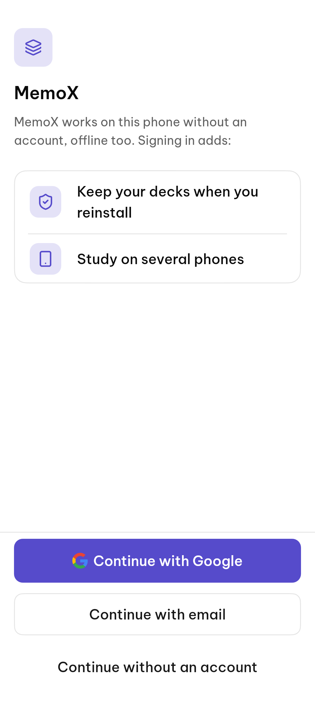
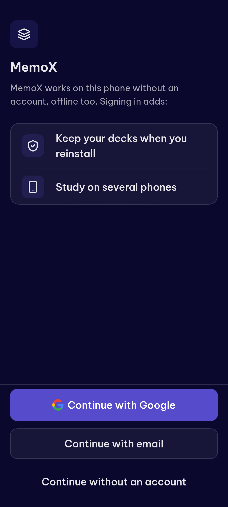
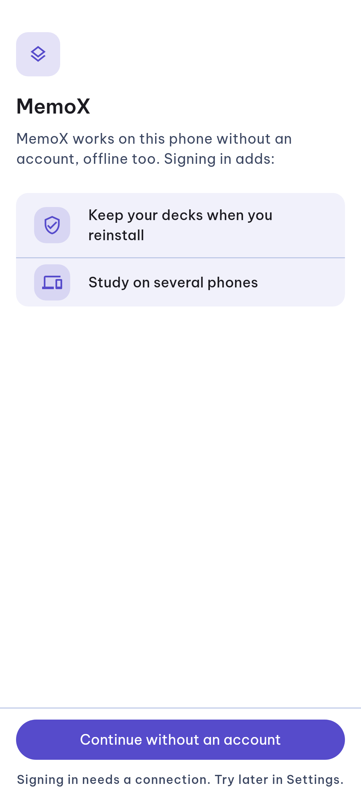
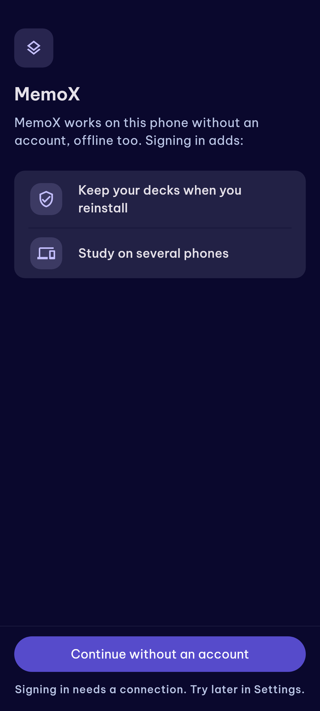

<!-- Hand-written screen record. -->

# 29 · Welcome

The first launch invites an account: the name, one promise, two benefits, and three
ways on in the thumb zone. Shaped by Impeccable before the plan (2026-09-30), redesigned
2026-10-05. SB-A2;
spec [2026-09-30-account-ui-design.md](../../../superpowers/specs/2026-09-30-account-ui-design.md)
§5.1, §6.

## Entry points

- The launch, once per device, on a build that can sign in: `main` reads
  `app_settings.welcome_seen` before the first frame and the router sends any location
  to `/welcome?from=<location>` until Welcome is answered (U1, P3a plan ruling 3).
- No back arrow: Android Back leaves the app, as on any root.

## Layout

| Region | Widget | Design |
|---|---|---|
| Head | `MxIconTile` (large, tinted, deck glyph) | Stands in for the app icon, which is still Flutter's default (U5; UI-base row 149). |
| Name and lead | `texts.screenTitle`; the lead `texts.body` in `mutedForeground` | "MemoX"; "MemoX works on this phone without an account, offline too. Signing in adds:" |
| Benefits | `MxSection` + `MxSettingsRow` × 2 | Shield "Keep your decks when you reinstall"; devices "Study on several phones". Not tappable. "Still works offline" is gone: the lead says it. |
| Actions, can link | `MxFooterBar` + `MxButton` × 3, 12 apart | "Continue with Google" (primary, the G mark: the one fill); "Continue with email" (outline); "Continue without an account" (text). |
| Actions, cannot link | `MxFooterBar` + `MxButton`, caption | "Continue without an account" (primary, block) alone, and the footer caption "Signing in needs a connection. Try later in Settings." When linking becomes possible the footer returns to the three buttons. While the account is still starting (`Booting`, `Bootstrapping`; not `Validating`, which offline with a session lasts until the network returns and then gets the offline caption: closing review 2026-10-17) the three buttons show with the two sign-in ways disabled and no caption, so the footer does not jump when `Ready` arrives; the offline layout is for an account that is unavailable (audit 2026-10-17 ACC-2). There is no mid-page note. |

Every exit answers Welcome first, then goes on: Google and "without" to `from`; email
to Sign-in pushed over `from`, so Back returns there and the email flow also ends at `from`
with "Signed in as {email}" (login navigation review 2026-10-08; it was Sign-in with
Settings under it, ending on 32, P3a plan ruling 4). A Google account that belongs
to another account opens the merge sheet (30) when the phone has decks; its choice also
leaves Welcome. Then, or at once on an empty phone, that Google account signs in to its
account with no second sign-in page; Welcome is answered as soon as that switch starts,
so a phone closed while it runs does not show Welcome again (owner 2026-10-08).

## States

The images are the goldens.

| State | Golden (light) | Golden (dark) | App |
|---|---|---|---|
| ready |  |  | Golden `welcome_ready_*`. |
| starting | — | — | Three buttons, Google and email disabled, no caption (widget test). VERIFIED (closing acceptance 2026-10-18): `account/presentation/welcome_screen_test.dart::while the account starts (Booting), Welcome keeps its three ways, disabled, and never looks offline (audit 2026-10-17 ACC-2)` |
| offline |  |  | Golden `welcome_offline_*`. |
| Google running | — | — | After "Continue with Google": a spinner on that button; "Continue with email" and "Continue without an account" are disabled; the footer never shows the offline caption while it runs, since the sign-in takes the account through `Validating` (final review F2). `welcome_screen_test.dart::while Google signs in, Welcome keeps its ways and never looks offline (final review F2)`; no golden. |
| Google failed | — | — | The three ways again, and a toast with the problem ("No connection. Nothing changed; try again when you're online." or "Couldn't sign in. Nothing changed; try again."); a cancelled pick says nothing. Code read: `welcome_screen.dart` `_google`; no golden. |
| identity taken | — | — | The Google account belongs to another account: the merge sheet (screen 30) opens when the phone has decks; with none the switch starts at once. `welcome_screen_test.dart::a Google account that is another account's asks to merge, and the choice leaves Welcome`; frames: the merge sheet goldens on 30. |

## Transitions

| From | Event | To | Evidence |
|---|---|---|---|
| (launch) | Welcome is due | ready, or offline when the account cannot link | U1. VERIFIED `account_routes_test.dart::Welcome takes the launch while it is due, and Continue without an account lands where it was headed`, `::a deep link while Welcome is due returns there after it (Review Focus 5)` (both in `test/app/`); `test/features/account/presentation/welcome_screen_test.dart::first launch offline: sign-in waits and says why, and without still leaves (Review Focus 1)` |
| ready | tap Continue without an account | Welcome answered for good; the app goes on to `from` | U1. VERIFIED `welcome_screen_test.dart::Continue without an account answers Welcome for good and goes on` |
| ready | tap Continue with email | Welcome answered; screen 30 pushed over `from`; Back returns to `from` | P3a ruling 4. VERIFIED `welcome_screen_test.dart::Continue with email goes to screen 30`; `test/app/account_flow_routes_test.dart::Welcome's email opens the sign-in over where the launch was headed, and Back returns there`, `::Welcome's email, its code, and the flow ends where the launch was headed, saying who signed in` |
| ready | tap Continue with Google | Google running | VERIFIED `welcome_screen_test.dart::while Google signs in, Welcome keeps its ways and never looks offline (final review F2)` |
| Google running | a second tap | ignored: the buttons are disabled and the controller refuses a press while one runs | VERIFIED `sign_in_controller_test.dart::a second press while one runs sends nothing (Review Focus 3)` |
| Google running | the account is attached | toast "Signed in as {email}"; Welcome answered; `from` | SB-A2. VERIFIED `welcome_screen_test.dart::Google attaches the account, says so and goes on` |
| Google running | the pick is cancelled | ready, nothing said | VERIFIED `sign_in_controller_test.dart::a cancelled Google pick says nothing` |
| Google running | the sign-in fails | Google failed: ready again, a toast with the problem | `UNVERIFIED (code read)` for the toast (`welcome_screen.dart`); the problem is VERIFIED `sign_in_controller_test.dart::a Google failure is marked as Google's` |
| Google running | the Google account belongs to another account, the phone has decks | the merge sheet (30) | auth spec #17. VERIFIED `welcome_screen_test.dart::a Google account that is another account's asks to merge, and the choice leaves Welcome` |
| merge sheet | Cancel | ready; the picked Google account is forgotten, so the next press shows the picker | VERIFIED `welcome_screen_test.dart::Cancel on the merge sheet forgets the picked Google account: the next press shows the picker again` |
| merge sheet | Continue | the switch starts; Welcome is answered as it starts; the app goes on to `from` under the transition layer | owner 2026-10-08. VERIFIED `welcome_screen_test.dart::Welcome is answered as soon as the switch starts, so a phone closed meanwhile does not show it again (owner 2026-10-08)` |
| Google running | the Google account belongs to another account, the phone is empty | the switch starts at once with no sheet | owner 2026-10-08. VERIFIED `welcome_screen_test.dart::an empty phone whose Google account is another account's signs in to it at once, without asking (owner 2026-10-08)` |
| offline | the account becomes able to link | ready: the three ways return | VERIFIED `welcome_screen_test.dart::when the account becomes ready, the three ways come back (Review Focus 4)` |
| Google running | the app is closed before the answer | Welcome shows again at the next launch | `UNVERIFIED (code read)`: `dismiss` runs only on the exits, and on the identity-taken path as the switch starts |
| any | Back | the app closes (no back arrow) | `UNVERIFIED (code read)`: Welcome is a root route with no leading widget |

## Rulings

- **U1:** shown once on every device, including one that used the app before the update.
- **U5:** the tile until MemoX has its own icon (UI-base row 149).
- **U6:** Google's G mark on the Google button.
- **P3a plan rulings 3, 4, 6:** only on a build that can sign in; the email exit lands on Sign-in over Settings; sign-in waits, with a note, while the account cannot link yet (now the footer caption, S10).
- **Sign-in redesign 2026-10-05 (spec `2026-10-05-sign-in-flow-redesign-design.md`, S1–S10):** the lead says what works without an account and what signing in adds; the benefits are two; offline the footer shows one usable action, "Continue without an account", as the primary, with the offline note as its caption instead of a note 400 px above two disabled buttons (S10). Welcome asks *which way*, so Google is its fill (S7).

## Copy

- "MemoX" · "MemoX works on this phone without an account, offline too. Signing in adds:"
- "Keep your decks when you reinstall" · "Study on several phones".
- "Continue with Google" · "Continue with email" · "Continue without an account".
- "Signing in needs a connection. Try later in Settings."
- Toast: "Signed in as {email}" (or "Signed in").
