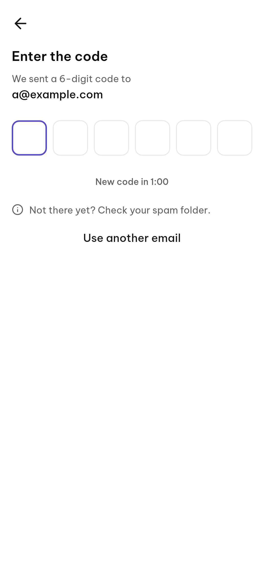
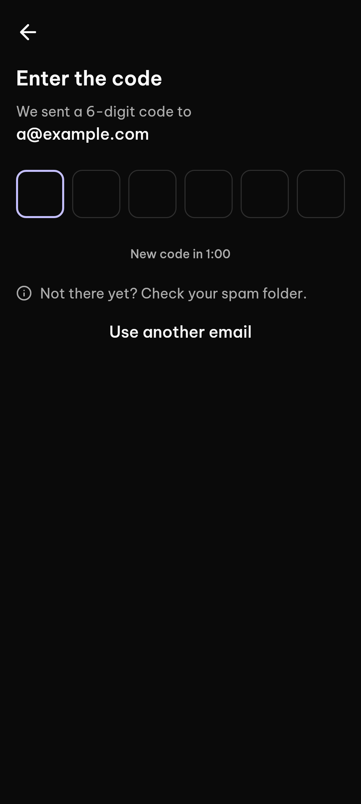
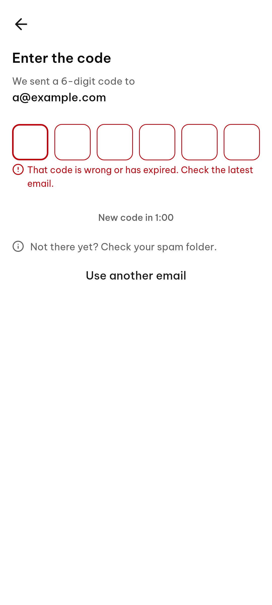

<!-- Hand-written screen record. -->

# 31 · Code

The six digits sent to the address. SB-A2; spec
[2026-09-30-account-ui-design.md](../../../superpowers/specs/2026-09-30-account-ui-design.md)
§5.2, §6.

## Entry points

- Screen 30, "Send code". Route `/settings/sign-in/code?mode=link&email=…`, on the root
  navigator; Back and "Use another email" return to 30.
- The transition layer's target sign-in, on the layer's own navigator.

## Layout

| Region | Widget | Design |
|---|---|---|
| App bar | `MxAppBar` (content) + back | Back only, no title. |
| Title | `screenTitle`, header semantics | "Enter the code". |
| Lead | `texts.body` in `mutedForeground` | "We sent a 6-digit code to", then the email on its own line in `texts.itemTitle` (the foreground colour), so a typo shows. TalkBack reads the lead and the address as one stop (`MergeSemantics`, DEV-168). |
| Code | `MxTextField` (code), `section` (24) under the lead | Six slots over one hidden field (DESIGN.md Inputs): numeric keyboard, one-time-code autofill, TalkBack "Code, 6 digits". Autofocused when the screen opens. Six digits check at once. A wrong code clears the field (plan ruling 11). |
| Status line | 48 dp minimum, `grouped` (12) under the field | While waiting: "New code in 0:42" as a caption (`texts.meta` in `mutedForeground`, no button). When the wait ends: "Resend code" (text button) in a polite live region, so TalkBack says it once (DEV-168); it toasts "A new code is on its way." and starts the wait again; the button spins while resending. While verifying: `MxSpinner` in this line, so nothing below moves. In a re-auth to another account with changes unsent, the resend first asks in screen 30's loss dialog (an even pair, layout balance L2); Cancel sends nothing (P3b minor M7). |
| Hint | `MxNote.hint` | "Not there yet? Check your spam folder." |
| Another email | `MxButton` (text) | "Use another email". |

No footer: the code verifies on its sixth digit, so there is no commit action.

A right code attaches the account, toasts "Signed in as {email}" and closes the flow on
Settings. While `me()` has not confirmed it yet the toast reads "Signed in"; while the
account moves, such as a re-auth switch that stopped on the way, there is none and the layer
says what happened (P3b minor M2).

## States

The images are the goldens.

| State | Golden (light) | Golden (dark) | App |
|---|---|---|---|
| waiting |  |  | Golden `code_waiting_*`. |
| wrong |  |  | Golden `code_wrong_*`. |
| verifying | — | — | The field read-only, the digits at full strength; `MxSpinner` in the status line. |
| resend ready | — | — | The wait is over: "Resend code" (text button) takes the status line as a polite live region, so TalkBack speaks it once. `code_semantics_test.dart::Resend arrives as one labelled live-region button, so TalkBack speaks it when the wait ends (final review I1)`; no golden. |
| resending | — | — | The button spins and is the status line's only content (no "New code in 0:00"); a code typed meanwhile is kept and checked. `code_screen_test.dart::a resend in flight spins on the button, not "New code in 0:00" (final review F1)`, `::a code typed while a new one is on its way is kept and checked`; no golden. |
| resend failed | — | — | A refused resend shows its problem under the field (the field's error text; offline, rate-limited or failed) and leaves "Resend code" available at once, with no new wait. Code read: `code_controller.dart` `resend`; no golden. |
| resend loss dialog | — | — | A re-auth resend to another account names the unsent changes in screen 30's dialog "Lose {n} changes?" · Cancel · "Lose"; Cancel sends nothing. `code_screen_test.dart::a re-auth resend to another address names the unsent changes again (P3b minor M7)`; the dialog's frame is the golden `sign_in_unsent_loss_*` on 30. |

## Transitions

| From | Event | To | Evidence |
|---|---|---|---|
| (entry) | the screen opens | waiting: the field autofocused, "New code in 1:00" counting down | VERIFIED `code_screen_test.dart::the code step leads with its title, the address and the spam hint, and opens on the code`; `code_controller_test.dart::Resend waits a minute, counting down each second` |
| waiting | six digits typed | verifying | SB-A2. VERIFIED `code_screen_test.dart::while six digits are checked a spinner takes the wait line, and nothing under it moves`, `::a code being checked is read-only and its digits stay at full strength` |
| verifying | the code is right | the account attached; toast "Signed in as {email}" (or "Signed in" while unconfirmed, none while the account moves); the flow closes | VERIFIED `::six digits sign in and say so`, `::a sign-in that worked but is not confirmed yet still says "Signed in" (P3b minor M2, final review I1)`, `::a re-auth into another account that stops on the way says no "Signed in"; the layer says what happened (P3b minor M2)`; `code_controller_test.dart::the right code signs in` |
| verifying | the code is wrong or expired | wrong: the field clears, the message sits under it, the keyboard stays | R3, plan ruling 11. VERIFIED `::a wrong code clears the field and says so; the right one then signs in (Review Focus 4)`, `::after a wrong code the field keeps the keyboard`, `::a wrong code no longer asks for a new one while the wait runs`; `code_controller_test.dart::a wrong code says so, and the wait goes on` |
| wrong | type six digits again | verifying | VERIFIED same test as the entry above |
| verifying | the check fails for another reason (offline, rate limit, failed) | the field clears, its message under it | `UNVERIFIED (code read)`: `CodeController.verify` maps through `signInProblemOf`; the mapping is VERIFIED for the form in `sign_in_controller_test.dart::offline says offline`, `::a rate limit says so` |
| waiting | the wait ends | resend ready | VERIFIED `code_screen_test.dart::Resend waits a minute, then sends a new code and waits again` |
| resend ready | tap Resend code | resending | VERIFIED `::a resend in flight spins on the button, not "New code in 0:00" (final review F1)` |
| resending | the code goes out | waiting again; toast "A new code is on its way." | VERIFIED `::Resend waits a minute, then sends a new code and waits again` |
| resending | the resend is refused | resend failed | `UNVERIFIED (code read)` |
| resend ready | tap Resend code (re-auth to another account, changes unsent) | resend loss dialog | P3b minor M7. VERIFIED `::a re-auth resend to another address names the unsent changes again (P3b minor M7)`; the same address asks nothing `::a re-auth resend to its own address asks nothing` |
| resend loss dialog | Cancel | resend ready; nothing sent | `UNVERIFIED (code read)`: `_resend` returns when `confirmUnsentLoss` is false |
| resend loss dialog | Lose | resending with the loss confirmed | VERIFIED the M7 test above |
| waiting / resend ready | tap Use another email, or Back | screen 30 (or the layer's form) | `UNVERIFIED (code read)`: both call `maybePop`; the disabled-while-verifying state of the button is code read as well |
| verifying | tap Use another email | ignored (the button is disabled) | `UNVERIFIED (code read)`: `onPressed: state.isVerifying ? null : …` |
| any | the person leaves while a check or resend runs | the controller ends with no state written | `UNVERIFIED (code read)`: `ref.mounted` guards in `CodeController` |
| any | the screen is read by TalkBack | the title is the route name; the lead and the address are one stop | VERIFIED `::the title names the route for TalkBack`; `code_semantics_test.dart::the lead and the address read as one stop` |

## Rulings

- **R3:** "wrong or expired" is one state: GoTrue answers both alike.
- **P3a plan ruling 11:** a wrong code clears the field.
- **Sign-in redesign 2026-10-05 (spec `2026-10-05-sign-in-flow-redesign-design.md`, S1–S10):** the title and the address move into the body; the code is six drawn slots (S5); the wait is a caption in a 48 dp status line instead of a disabled button, and the wrong-code error no longer says to send a new code while the wait runs; a spam hint is added. Batch A (same day): a wrong code keeps the 2 dp next-slot cue in `error`; the code is read-only, not disabled, while it is checked; the spam hint reads "Not there yet? Check your spam folder."; the title names the route for TalkBack.
- **Polish 2026-10-05 (DEV-168):** the lead and the address are one TalkBack stop; "Resend code" is a live region; the loss dialog's confirm reads "Lose {n} changes" (DEV-179 later shortened it to "Lose").

## Copy

- "Enter the code" · "We sent a 6-digit code to" (then the address) · "Code, 6 digits".
- "That code is wrong or has expired. Check the latest email."
- "New code in {m:ss}" · "Resend code" · "A new code is on its way." · "Use another email".
- "Not there yet? Check your spam folder."
