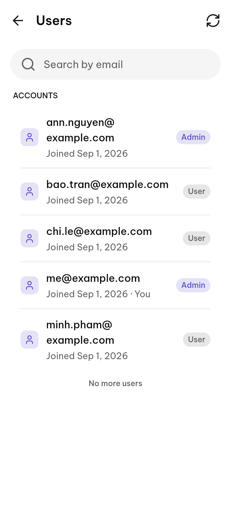
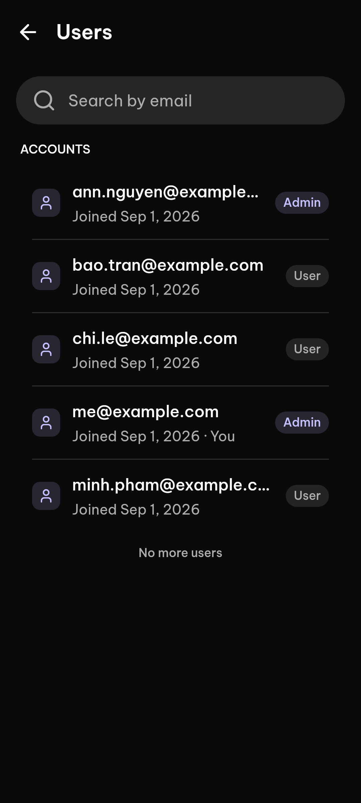
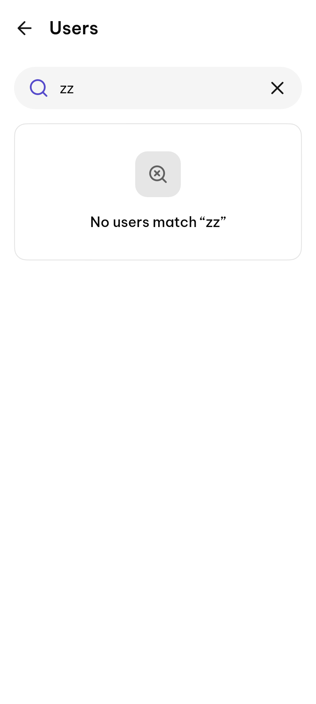
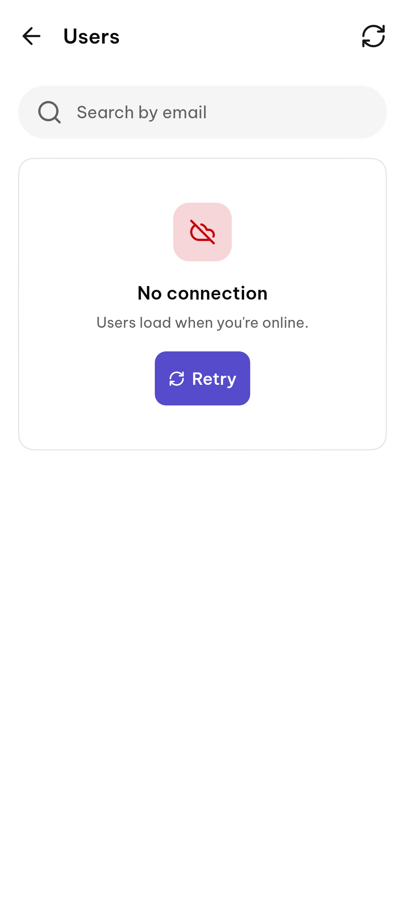
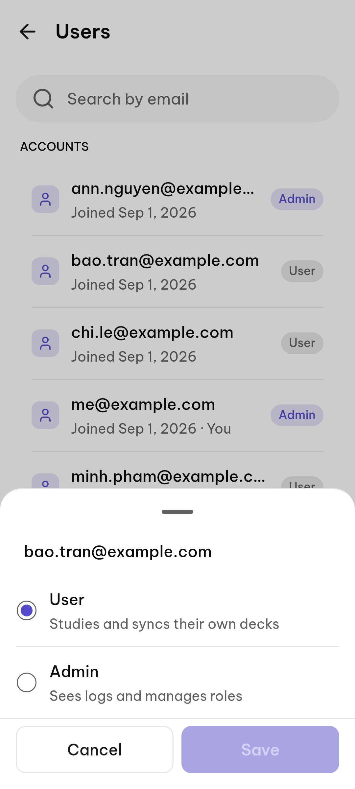
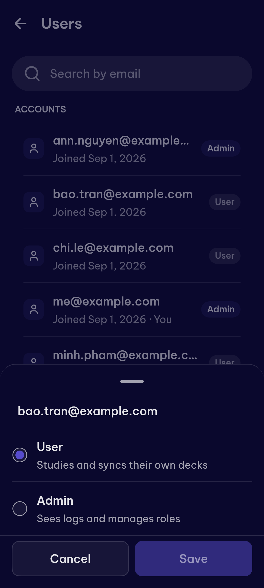
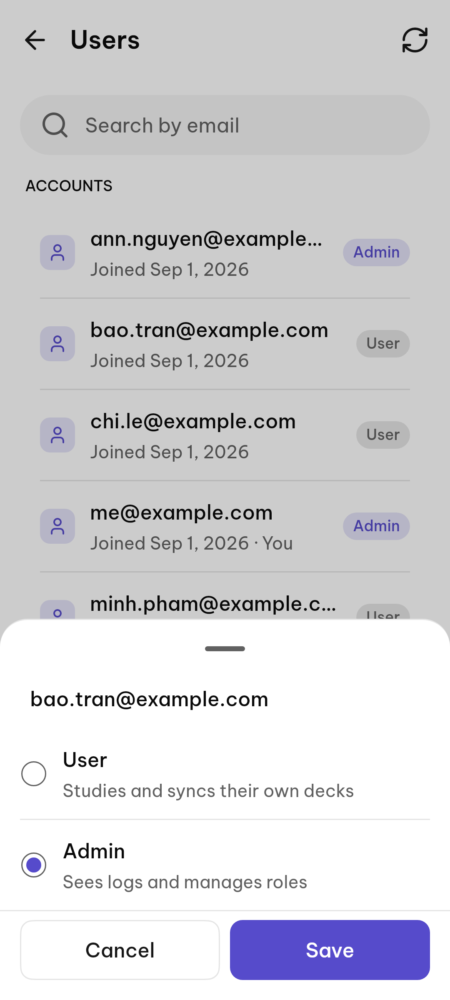
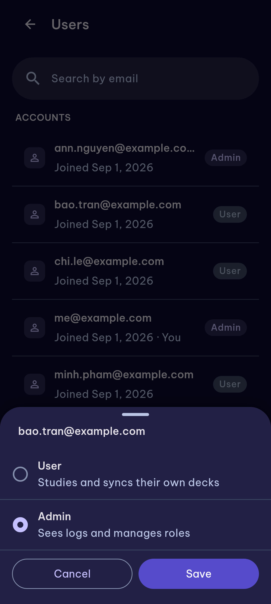
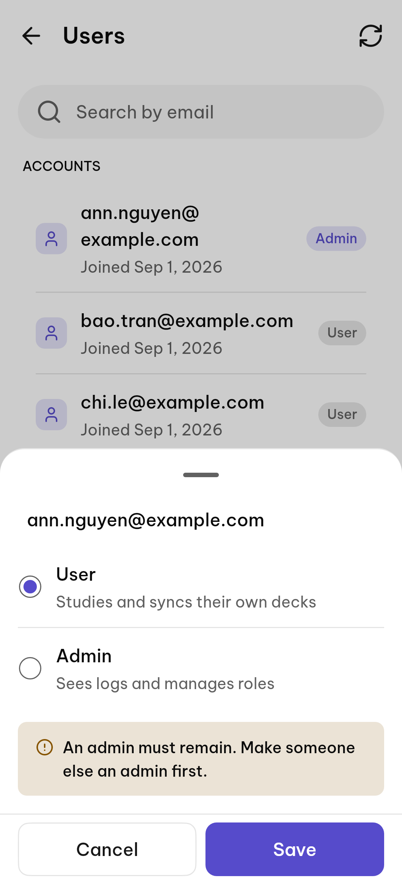
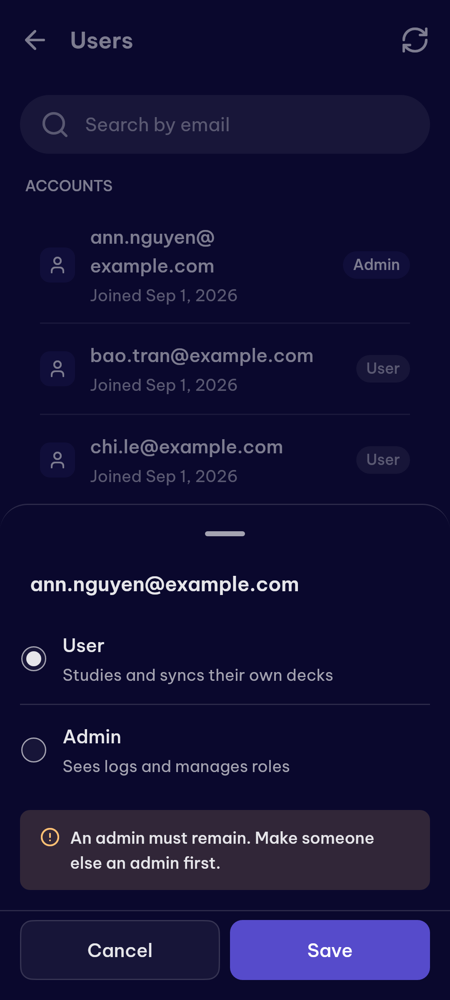

<!-- Hand-written screen record. -->

# 33 · Users (admin)

An admin finds any signed-in account by email and makes it an admin or a user. FE-B11;
auth spec O9; spec
[2026-09-30-users-admin-design.md](../../../superpowers/specs/2026-09-30-users-admin-design.md).

## Entry points

- Screen 23b (Admin, admin only), People, row "Users" · "Who can manage the app" (settings hub spec D4).
  Route `/settings/users`, on the root navigator; Back returns to 23b, which pushes it (`lib/app/router/admin_routes.dart`); a deep link straight to it returns to the hub (settings hub spec D5).
- A deep link meets the admin gate: a non-admin sees "Only an admin can see this" under
  the app bar "Users" (P4 plan ruling 2).

## Layout

| Region | Widget | Design |
|---|---|---|
| App bar | `MxAppBar` (content) + back, and a Refresh `MxIconButton` while the list can be read | "Users". "Refresh" reads the first page again, as the pull down does, for TalkBack and a keyboard; it is off while that read runs (closing review 2026-10-18, as screen 28). |
| Search | `MxSearchField` | "Search by email"; asks 400 ms after the last keystroke, and not at all when only spaces changed (P4 minor M5); hidden on the not-admin state. |
| Overline | `MxListSectionHeader` | "ACCOUNTS" (no count: `role_list` has no total). |
| Rows | `MxListRow` | Person tile (tinted, the same for all), the email, "Joined {date}" (locale medium date), `MxBadge` "Admin" (primary) or "User" (neutral); no chevron. The admin's own row reads "Joined {date} · You" and does not tap (U1); not dimmed. |
| End | as screen 28 | The next page loads near the end; "No more users"; a failed page is a danger `MxInlineBanner` with Retry; a page refused as not an admin turns the screen to the not-admin state (final review I1). |

**Role sheet** (`MxBottomSheet`, the merge sheet's form): the email as title; `MxOptionRow`s
"User" · "Studies and syncs their own decks" and "Admin" · "Sees logs and manages roles", the
current role selected; Cancel · "Save" (primary), enabled only when the choice differs and
spinning while it runs. While it runs the sheet is held: Back, a scrim tap and a drag wait,
so the answer always has a sheet to be said in (P4 minor M3). A save lands over any list
still loading, and "not an admin" over any page in flight (P4 minors M1, M2).

| Outcome | Shows |
|---|---|
| saved | the sheet closes, the badge changes in place, toast "{email} is now an admin" / "… a user" |
| last admin | the sheet stays and says, in a warning `MxInlineBanner` under the options, "An admin must remain. Make someone else an admin first." (final review I2: a toast would sit behind the sheet) |
| anonymous | the sheet stays, banner "This account isn't signed in with an email or Google." |
| gone | the sheet closes, toast "That account no longer exists.", the list reloads |
| not an admin | the sheet closes, the screen shows the not-admin state |
| offline / other | the sheet stays, banner "No connection. Nothing changed." / "Couldn't change the role. Nothing changed."; a new choice clears it |

## States

The images are the goldens.

| State | Golden (light) | Golden (dark) | App |
|---|---|---|---|
| loaded |  |  | Five accounts, the admin's own row with You. Golden `users_loaded_*`. |
| no match |  |  |  Golden `users_empty_search_*`. |
| offline |  |  |  Golden `users_offline_*`. |
| role sheet |  |  | The current role selected; Save disabled. Golden `users_role_sheet_*`. |
| role sheet, changed |  |  | Admin chosen; Save enabled. Golden `users_role_sheet_changed_*`. |
| role sheet, refused |  |  | LAST_ADMIN said inside the sheet. Golden `users_role_sheet_refused_*`. |
| loading | — | — | `MxSkeletonList`. |
| loading more | — | — | An `MxSpinner` under the last row while the next page loads. Code read: `users_list_widget.dart` `_End`; no golden. |
| load more failed | — | — | The rows stay; a danger `MxInlineBanner` "Couldn't load more users." with a small Retry. `users_controller_test.dart::the next page joins the list; a failed page waits for its retry`; no golden. |
| end | — | — | "No more users" once `next` is null. `users_screen_test.dart::the accounts, their join date and role, and the end`. |
| role sheet, saving | — | — | Save spins and is the only live control; the sheet is held (Back, scrim and drag wait). `users_screen_test.dart::a drag while saving keeps the sheet, so a refusal is still said (P4 minor M3)`; no golden. |
| no accounts | — | — | "No accounts yet". |
| error | — | — | "Couldn't load users" + Retry. |
| not an admin | — | — | the lock empty state, no search. |

## Transitions

| From | Event | To | Evidence |
|---|---|---|---|
| loading | the first page lands | loaded / no match / no accounts | users spec §3. VERIFIED `users_screen_test.dart::the accounts, their join date and role, and the end`, `::no match, and no account at all`; `users_controller_test.dart::the first page loads at once` |
| loading | the read fails | offline / error / not an admin | VERIFIED `::offline says so first, with Retry`, `::not an admin: only that is said` |
| offline / error | Retry | loading, then the state the read gives | `UNVERIFIED (code read)` for the tap (`UsersController.retry`); the error is VERIFIED in the test above |
| loaded | type in the search | the first page of the query, 400 ms after the last key; spaces alone ask nothing | P4 minor M5. VERIFIED `users_controller_test.dart::a search waits 400 ms after the last keystroke, then asks once`, `::a search that differs only in spaces does not ask again (P4 minor M5)` |
| loading (a search) | an older answer lands after a newer ask | dropped | VERIFIED `users_controller_test.dart::an older answer never overwrites a newer one (Review Focus 1)` |
| loaded | scroll within ten rows of the end | loading more | VERIFIED `users_controller_test.dart::the next page joins the list; a failed page waits for its retry` |
| loading more | the page fails | load more failed (rows kept) | VERIFIED same test |
| load more failed | Retry | loading more | VERIFIED same test |
| loading more | the answer is "not an admin" | not an admin: the whole screen, not a failed page | final review I1. VERIFIED `users_controller_test.dart::no longer an admin while paging: the screen says so, not a failed page (final review I1)` |
| loaded | pull down | the first page again, the rows kept until it lands | `UNVERIFIED (code read)`: `UsersController.refresh`, `MxPullRefresh`; no test pulls |
| loaded | tap Refresh in the app bar | Refresh is off (dimmed, read as disabled) until the first page lands; the rows stay, then the fresh page shows | VERIFIED `users_refresh_test.dart::Refresh reads the first page again and is off while it runs` |
| loaded | tap an account's row | the role sheet | VERIFIED `users_screen_test.dart::the sheet saves only a different role (Review Focus 3), and the row changes` |
| loaded | tap the admin's own row | nothing (no tap target) | U1. VERIFIED `users_screen_test.dart::the admin's own row says You and opens nothing (Review Focus 2)` |
| role sheet | choose another role | Save enabled | VERIFIED the Review Focus 3 test above |
| role sheet | Cancel, or choose the current role | no change; Save disabled for the current role | `UNVERIFIED (code read)` for Cancel; the disabled Save is VERIFIED in the Review Focus 3 test and the golden `users_role_sheet_*` |
| role sheet | Save | role sheet, saving | VERIFIED `::a drag while saving keeps the sheet, so a refusal is still said (P4 minor M3)` |
| role sheet, saving | saved | the sheet closes, the badge changes in place, toast "{email} is now an admin" / "… a user" | VERIFIED `::the sheet saves only a different role (Review Focus 3), and the row changes`; `users_controller_test.dart::a saved role changes the row in place` |
| role sheet, saving | the last admin | the sheet stays with the warning banner; a new choice clears it | VERIFIED `::the last admin stays, and the sheet says why`; `users_controller_test.dart::the server's refusals leave the list as it was (Review Focus 4)` |
| role sheet, saving | anonymous, offline or another failure | the sheet stays with the banner | `users_controller_test.dart::the server's refusals leave the list as it was (Review Focus 4)` for the controller; the banner texts are `UNVERIFIED (code read)` |
| role sheet, saving | the account is gone | the sheet closes, toast "That account no longer exists.", the list reloads | VERIFIED `::a user gone closes the sheet and says so`; `users_controller_test.dart::a user gone is said, and the list reloads` |
| role sheet, saving | no longer an admin | the sheet closes; the screen shows not an admin | VERIFIED `users_controller_test.dart::no longer an admin: the screen says so, from a save or a list (Review Focus 5)` |
| role sheet, saving | a first-page read in flight lands | the saved role stays | VERIFIED `users_controller_test.dart::a refresh asked before a save does not put the old role back (P4 minor M2)`, `::a list in flight does not bring the rows back over "not an admin" (P4 minor M1)` |
| any | the screen is left while the sheet saves | the sheet is held, so the screen cannot be left from it | `UNVERIFIED (code read)`: `MxBottomSheet.isHeld` |
| (deep link) | a non-admin | the gate titled "Users" | VERIFIED `test/app/account_routes_test.dart::a non-admin's deep link to Users meets the gate, titled Users` |

## Rulings

- **U1–U5** (spec §1): the own row is read-only; Settings owns the Admin section; the slice
  lives in `features/account`; the data source follows Monitoring's; the route sits behind
  the admin gate.
- **Spec §6 (shape):** screen 28 is the pattern: pages load at the end of the scroll, no
  "Load more" button; the role lives in the badge alone.
- **P4 plan rulings 1–6:** errors through core's `classifyAuthError`; the gate takes a
  title; dates with `DateFormat.yMMMd`; the sheet runs the change; `isAdminProvider` gates
  the Admin section; the `users` icon.

## Copy

- "Users" · "Search by email" · "ACCOUNTS" · "Joined {date}" · "Joined {date} · You" · "Admin" ·
  "User" · "No more users" · "No users match “{query}”" · "No accounts yet".
- The sheet's and the toasts' copy is in the tables above.
