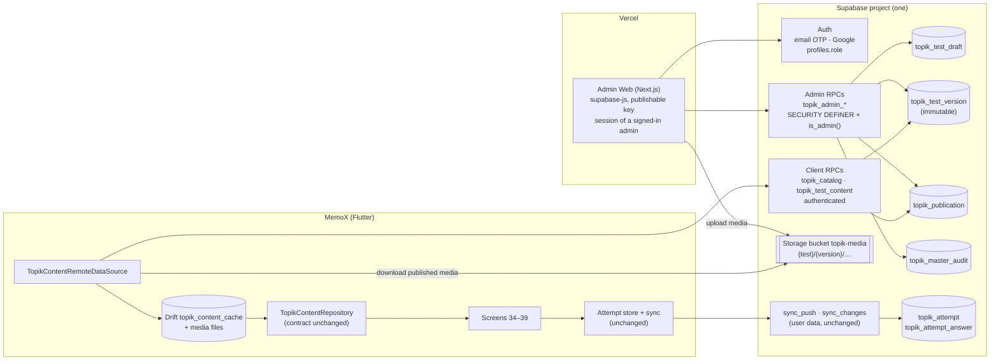

# TOPIK Master Data on Supabase and the Admin Web

Date: 2026-10-16 · Owner decision of 2026-10-16 (during the DEV-394 audit) · Status: draft for owner review. Nothing here is built; no migration runs until the owner approves this spec and its plan.

## 1. Goal

The TOPIK past papers (the **Master Data**: tests, groups, questions, answers, points, explanations, media) move from files bundled in the APK to **Supabase PostgreSQL**, the same project the app already syncs to (ADR-015). A dedicated **Admin Web** (Next.js, hosted on Vercel) manages, reviews, versions, publishes and retires that data. The Flutter app consumes **published** Master Data only, caches it offline in Drift/SQLite, and keeps the learner's data (attempts, answers) exactly as it does today. Ordinary users never modify Master Data.

This spec says what of the TOPIK design of 2026-10-15 ([spec](2026-10-15-topik-practice-design.md), [ADR-023](../../shared/decisions/ADR-023-luyen-de-topik.md)) stays, what changes, how the pieces fit, and in what order they are built. The audit of 2026-10-16 (Linear DEV-394) found the Phase A feature complete and consistent; this decision changes its content layer, not its screens, scoring or sync of attempts.

## 2. Owner decisions (2026-10-16, confirmed)

| # | Decision |
|---|---|
| M1 | TOPIK Master Data lives in Supabase PostgreSQL. |
| M2 | A dedicated Admin Web, Next.js on Vercel, with its own deployment lifecycle. |
| M3 | The Admin Web and the Flutter app use the same Supabase project (Auth and database). |
| M4 | The Admin Web manages, reviews, versions, publishes and retires Master Data. |
| M5 | The Flutter app consumes published Master Data, caches it offline in Drift/SQLite, and keeps user learning data separately. |
| M6 | Master Data is never modified by ordinary mobile users. |
| M7 | No Supabase secret or service-role credential ever reaches a browser; least-privilege grants, RLS and controlled RPCs (ADR-015 #5). |

## 3. What stays and what changes

### 3.1 Decisions that remain valid

| Where | Decision | Why it holds |
|---|---|---|
| ADR-023 #1, #2, #4, #6, #7 | Feature `topik` with audio and images allowed inside it; entry on Study home, four destinations; NIIED sources only; user data in the feature's own tables, completed attempts synced, in-progress attempts device-local; no ads | None of them concerns where the content is stored |
| ADR-015 #1, #4, #5 | One Supabase project; owner is `auth.uid()`; every table RLS on, no policy, no client privilege, RPCs `SECURITY DEFINER` with fixed `search_path`, `EXECUTE` for `authenticated` only | Master Data tables follow the same shape; the Admin Web is "the web that reads and writes through the same RPCs" ADR-015 foresaw |
| ADR-015, `supabase/README.md`, BR-ACCOUNT-019…022 | Two roles `user` and `admin` in `public.profiles`; `private.is_admin()`; admin-only RPCs answer `FORBIDDEN`; anonymous accounts can never be admin; the last admin cannot be demoted | The Admin Web signs in as a normal user of this project and is gated by the same role |
| ADR-013, BR-TOPIK-026…028 | User-data sync: outbox, `sync_push`, `sync_changes`, `topik_attempt` as an immutable synced record, server integrity checks only | Master Data is not user data: it is not pushed, not pulled through `sync_changes`, has no `user_id` and no tombstone per user. The attempt sync is untouched |
| Spec 2026-10-15 §3.1 (second half), §5, §6, §8, §13.1–13.3, §13.5–13.8 | Content is immutable, versioned, validated and held in memory as domain models; attempts snapshot `content_version`; scoring, statistics, screens 34–39, audio player | The content's *origin* changes, its *shape* and the models the screens read do not |
| BR-TOPIK-001…006, -009, -010…028 | Exam structure, points, options, groups, question types, languages, derived tags, lifecycle, scoring, time, statistics, sync, account switch, server checks | Unchanged |
| BR-TOPIK-007 | Every test names its NIIED source; `contentVersion` ≥ 1 and increases on every change | Now enforced by the server: a published version is immutable, a new publication gets the next `content_version` |
| BR-TOPIK-019 | Summary from the snapshot; Review on the current content with a banner when the version differs; continue refused when the test is gone or no longer has the attempt's questions | The same mechanism, now driven by publications instead of app updates: a retired test is "gone", a new publication is "changed" |
| BR-TOPIK-008 (the app half) | Every test the app shows passed `checkTopikTest`; an invalid test is skipped and logged, never an error screen | The app keeps validating what it downloads; the server and the Admin Web add earlier gates (§7) |

### 3.2 Decisions that change

| Where | Was | Becomes |
|---|---|---|
| ADR-023 #3 | Content is JSON, audio and images bundled in `assets/topik/`, checked by one validator at the app and the gate, never loaded into Drift; the MVP bundles one round; downloadable packs are Phase B with their own spec | Content is Master Data in Postgres with media in Supabase Storage, published through the Admin Web; the app downloads published tests and caches each as one document row in Drift (not a relational import); nothing is bundled in the APK. This spec is the "own spec" ADR-023 #3 reserved for downloadable content |
| ADR-023 #5 | This repo holds the content schema, validator, lint and the validated packs; the authoring pipeline lives in `memox-topik-content` | This repo holds the schema, the Dart validator (the reference), the lint for fixtures, and the SQL of the Master Data store. The packs live in the database. The pipeline repo keeps producing pack JSON, which the Admin Web imports |
| Spec D2 | Bundled assets, no refresh button | Published Master Data, refreshed by the app when online (§8.3) |
| Spec D3 | Repo holds the validated packs | Repo holds no packs (fixtures under `test/` stay) |
| Spec D5 | Round 96 arrives as a pack PR | Round 96 is imported and published through the Admin Web |
| Spec D13, §3.1 (first half), §13.4 | Content never in Drift; `TopikContentRepository` reads the `AssetBundle` once per run | Content cached in Drift as documents (`topik_content_cache`, §8.2); `TopikContentRepository.catalog()` keeps its contract and reads the cache; a refresh replaces the cache and re-emits |
| Spec §4.3 "one validator, two callers" | App loader and gate lint run the same Dart code | Three callers of one rule set: the app (Dart, the reference, the last gate), the gate lint on fixtures (Dart), and the Admin Web (TypeScript port, proven equivalent by the shared fixtures, §7). The server checks shape and identity in SQL |
| BR-TOPIK-008 (the gate half) | `test/tools/topik_content_assets_test.dart` lints every pack under `assets/topik/` | The gate lints the fixtures and the validator; packs are no longer in the repo. The BR's text needs the owner's amendment (§11) |
| PRODUCT.md, README topik | "bundled past papers" | "past papers published by the owner through the Admin Web" |

### 3.3 Rejected alternatives

- **Keep bundling, add downloads later (status quo):** the owner has decided otherwise; every new round would need an app release.
- **Master Data in Supabase Storage as JSON files, no tables:** no draft/published states, no audit, no SQL checks, no versions; the Admin Web would be a file manager.
- **A relational import of the content into Drift** (one row per question): the screens read whole tests; a relational cache needs a migration for every content schema change and offers nothing SQL would read (spec 2026-10-15 §3.1's own argument still holds).
- **Service-role key on the Next.js server (Vercel) for admin writes:** forbidden by M7 and unnecessary: the signed-in admin's JWT reaches the same RPCs, and `private.is_admin()` decides.
- **Edge Functions for publishing:** nothing needs a secret or a runtime Postgres lacks; the RPC pattern of ADR-015 is enough. Revisit only if media signing needs a secret (§6.4).
- **Admin Web inside this repository:** its gate (`dod_check.sh`) is Flutter-centric and its deployment is a Vercel pipeline; M2 asks for its own lifecycle. The contract stays in this repo (§9).

## 4. Architecture

Three boundaries:

1. **Master Data** (owner-managed, global): tables `topik_*` in Postgres, media in Storage. Written only by admin RPCs. Read by clients through two RPCs. Never part of `sync_push`/`sync_changes`.
2. **User data** (per account): `topik_attempt`, `topik_attempt_answer`, unchanged. The link is `test_id` and `content_version`, no foreign key: an attempt outlives a retired test (BR-TOPIK-019).
3. **The app's cache**: Drift rows and files that mirror the published Master Data. A cache, not a store of record (unlike the user data, ADR-013 #1): it can be rebuilt from the server, and it is not wiped on account switch (§8.4).

## 5. Master Data model (Postgres)

All tables: RLS on, no policy, `revoke all … from public, anon, authenticated`; reached through RPCs only (ADR-015 #5).

| Table | Columns (key ones) | Rules |
|---|---|---|
| `public.topik_test_draft` | `test_id text pk`, `json jsonb`, `updated_at`, `updated_by uuid`, `last_check jsonb` (the Admin Web's validator report) | One draft per test id. Free-form while drafting; a draft may be invalid. Deleting a draft never touches versions |
| `public.topik_test_version` | `test_id text`, `content_version int`, `json jsonb`, `media jsonb` (paths and checksums of the version's objects), `checksum text` (sha256 of `json`), `published_at`, `published_by uuid`, `note text`; pk `(test_id, content_version)` | **Immutable**: a `BEFORE UPDATE OR DELETE` trigger aborts (as `topik_attempt_completed_immutable`). `content_version` = the JSON's own `contentVersion`; a CHECK ties them. `json->>'testId' = test_id` |
| `public.topik_publication` | `test_id text pk`, `current_version int null`, `status text check in ('published','retired')`, `catalog_version bigint` (global, monotonic), `updated_at`, `updated_by` | What clients see. `published` ⇒ `current_version` not null and exists in `topik_test_version`; `retired` ⇒ clients drop the test. Every change takes the next `catalog_version` from a sequence, so a client pulls "everything since N" |
| `public.topik_master_audit` | `id uuid pk`, `at timestamptz`, `actor uuid`, `action text` (`draft_save`, `draft_import`, `draft_delete`, `publish`, `retire`, `unretire`, `rollback`), `test_id`, `content_version int null`, `detail jsonb` | Append-only (trigger). Written inside the same transaction as the change it records, by the RPC, never by the client |

Versioning rules:

- **Publish** validates the draft (§7), inserts `topik_test_version` with `content_version` = max existing + 1 (the Admin Web sets the JSON's `contentVersion` to that number before the call; the server checks the two agree), sets the publication to `published` at that version, bumps `catalog_version`, audits. The draft stays as the working copy.
- **Retire** sets `status = 'retired'`, keeps every version, bumps `catalog_version`, audits. Clients drop the test from their catalog; attempts keep their snapshots; Review says the test is unavailable (BR-TOPIK-019, already built).
- **Rollback** republishes an earlier version's `json` as a **new** `content_version` (max + 1), with `detail.rolled_back_from = N`. Versions stay monotonic, so a client's cache check (§8.3) stays a simple `>` comparison and BR-TOPIK-007 holds. The pointer never moves backwards.
- **Unretire** sets `status = 'published'` at `current_version`, bumps `catalog_version`, audits.

## 6. RPCs

All functions: `SECURITY DEFINER`, `set search_path = ''`, `revoke all … from public, anon, authenticated`, then `grant execute … to authenticated`; admin functions start with `if not private.is_admin() then raise … 'FORBIDDEN'` (the pattern of `role_set`, migration `20261010000000`). Every error is a code the Admin Web and the app map to copy, never SQL text (BR-CORE-005).

### 6.1 Admin (Admin Web)

| RPC | Does |
|---|---|
| `topik_admin_list()` | Every test id with its draft (updated_at, last_check summary), publication status, current version and the latest version |
| `topik_admin_draft_get(test_id)` / `topik_admin_draft_save(test_id, json, last_check)` / `topik_admin_draft_delete(test_id)` | The working copy. `save` checks the JSON's identity fields match `test_id` (`testId`, `level`, `round`, `section`) and audits |
| `topik_admin_versions(test_id)` / `topik_admin_version_get(test_id, content_version)` | History and one immutable version |
| `topik_admin_publish(test_id, expected_content_version, note)` | §5 publish; refuses when the draft's `contentVersion` ≠ max + 1 (`VERSION_MISMATCH`), when the shape check fails (`VALIDATION_FAILED` with the rule names), when a referenced media object is missing in Storage (`MEDIA_MISSING`) |
| `topik_admin_retire(test_id, note)` / `topik_admin_unretire(test_id, note)` / `topik_admin_rollback(test_id, to_version, note)` | §5 |
| `topik_admin_audit(test_id null, limit, before)` | The audit log, newest first |

### 6.2 Client (Flutter)

| RPC | Does |
|---|---|
| `topik_catalog(since bigint)` | Publications with `catalog_version > since`: `test_id`, `status`, `current_version`, `checksum`, `media` manifest, and the identity fields the list screens need (`level`, `round`, `section`, `titleKo`, derived tags). Paged like `sync_changes` (`next`, `more`). A retired test comes as `status = 'retired'`, which is its tombstone |
| `topik_test_content(test_id, content_version)` | The published `json` of that version, or `NOT_FOUND`. Only versions that are the test's `current_version` are served (a client never downloads a superseded version) |

Both are `authenticated`-only (the app is always signed in, anonymously at least, ADR-015 #4). Master Data is not personal, so nothing filters by `auth.uid()`; the grant is what keeps `anon` out.

### 6.3 Shape checks in SQL

`topik_admin_publish` runs the cheap structural checks that need no Korean text knowledge: required keys and types, `format = pbt`, `source.publishedBy = 'NIIED'`, non-empty `source.url`, `schemaVersion = 1`, question count and numbering for the level and section (BR-TOPIK-001), points sum 100 and the per-level point sets (BR-TOPIK-002), four options with `idx` 1–4 and `answerIdx` in 1–4 (BR-TOPIK-003), every question in exactly one group and every group listed (BR-TOPIK-004), `vi` and `en` present on every multilingual object (BR-TOPIK-006). They mirror the Dart rules `identity`, `metadata`, `numbering`, `points`, `options`, `groups`, `languages` and are pinned by pgTAP against the same fixtures (§7). The question-type map (`questionType`, a warning in Dart) is not checked in SQL.

### 6.4 Media (Supabase Storage)

- Bucket `topik-media`, private. Objects `{test_id}/{content_version}/{file}`, listed in `topik_test_version.media` with checksums; the JSON's `assets.audio` and image paths are these object paths.
- **Write:** the Admin Web uploads through supabase-js with the admin's session. Storage authorises through policies on `storage.objects` (Supabase's own mechanism; tables stay policy-free): `insert`/`update`/`delete` for `private.is_admin()` on this bucket only. This is the one place a policy exists, and §11 asks the owner to confirm the exception to ADR-015 #5's wording.
- **Read:** `select` for `authenticated` on this bucket, limited to objects whose `{test_id}/{content_version}` prefix is a published current version (`exists (select 1 from public.topik_publication p where p.status = 'published' and p.current_version::text = split_part(name, '/', 2) and p.test_id = split_part(name, '/', 1))`). Drafts' media (uploaded before publish) is readable by admins only. The app downloads with its session; no signed URLs, no secret.
- Size: the Free plan holds 1 GB of storage and 5 GB egress a month. One round (two listening files re-encoded mono, low bitrate, plus pictures) is tens of MB; the app downloads a test's media once per version. Enough for a personal app; the plan's limits are noted in `supabase/README.md`.

## 7. One rule set, three gates

BR-TOPIK-008's reason stands: two validators drift. The decision keeps **one reference implementation** and makes the others provably equal to it:

1. **Dart `checkTopikTest`** stays the reference and the last gate: the app validates every downloaded test before it enters the cache; an invalid one is skipped and logged `topik.content_rejected` (as today).
2. **SQL shape checks** in `topik_admin_publish` (§6.3): a subset, so an invalid test cannot be published by mistake.
3. **TypeScript validator** in the Admin Web, for authoring feedback before publish, a port of the Dart rules.

The contract between them is the **fixture set** this repo already has: a structurally complete synthetic test per level and section and one broken variant per rule (spec 2026-10-15 §4.5, `test/support/topik_content_fixtures.dart`). The fixtures are exported as JSON files to `test/fixtures/topik/` (generated by a Dart tool, checked by the gate), the pgTAP suite runs the SQL checks over them, and the Admin Web's CI runs the TS validator over them, asserting the same verdict per fixture. A rule change starts in Dart and the fixtures; the two ports go red until they follow.

## 8. Flutter: consuming published Master Data

### 8.1 Contract kept

`TopikContentRepository.catalog()` keeps returning the valid tests. Screens 34–39, the use cases, the statistics and the attempt store do not change. What changes is below it.

### 8.2 Cache (Drift schema v17 → v18, create only)

| Table | Columns | Notes |
|---|---|---|
| `topik_content_cache` | `test_id text pk`, `content_version int`, `catalog_version bigint`, `json text`, `checksum text`, `media_dir text null`, `fetched_at datetime` | One document per published test. Parsed into `TopikTest` on read; never joined |
| `topik_content_state` | `name text pk`, `value text` | `catalog_cursor` (the last `catalog_version` pulled), `last_refresh_at` |

Media files live under the app's documents directory, `topik/{test_id}/{content_version}/`, and are deleted with the row. The audio door (`PluginTopikAudioPlayerDataSource`) plays a file instead of an asset; `ClippingAudioSource` is unchanged.

### 8.3 Refresh

`RefreshTopikContentUseCase` (data layer, run by the app on start and on return to the foreground when online, with a minimum interval; never from the UI thread of a screen):

1. `topik_catalog(since: cursor)`; for each entry: `retired` → delete the row and its media; `published` with a `(test_id, content_version)` not cached → `topik_test_content`, run `checkTopikTest`, download the media listed in `media` and verify checksums, write the row; cached and equal → nothing.
2. Advance `catalog_cursor` only after every entry of the page is applied (a failed download leaves the cursor, so the next refresh retries).
3. The repository's stream re-emits; screens update in place (UC-TOPIK-001 A2 already covers "status updates in place"; the catalog itself now updates too).

Offline: the cache serves; no error, no refresh. First run offline with no cache: screen 34 shows "No tests yet" with a line saying tests arrive when the phone is online (a new copy string, no new state: `noTests` with a hint). A refresh failure is logged, never a screen error (BR-TOPIK-008's spirit: content problems never crash or block the app).

### 8.4 Account switch and user data

The cache is not user data: `LocalDataReset` leaves it in place (BR-TOPIK-027 covers attempts only). The attempt sync (`TopikAttemptSyncDao`, `sync_push`, `sync_changes`, `pull_entity_types`) is untouched. An in-progress attempt whose test receives a new publication continues on the current content, as today (BR-TOPIK-019: scored at submit on the content of that moment; `contentMismatch` when the question set differs). A retired test turns an in-progress attempt into `contentMissing` with Delete, as today.

### 8.5 What is removed

`assets/topik/` and its `pubspec.yaml` folder, `TopikContentAssetDataSource`, the manifest, and `test/tools/topik_content_assets_test.dart`'s pack walk (the test keeps checking the fixtures). The lint `tools/topik/topik_lint.dart` stays for the content repository and the fixtures.

## 9. Admin Web

- **Repository:** `memox-topik-admin` (its own repo and Vercel project; M2). It depends on this repository's contract: the SQL in `supabase/migrations/`, the RPC names and error codes, the generated Postgres types (`supabase gen types typescript` committed in the admin repo and checked against the migrations in its CI), and the fixtures of §7.
- **Stack:** Next.js (App Router), `@supabase/ssr` with the **publishable key only**; the session is the admin's own (email OTP or Google, the same providers the app uses). Vercel environment holds `NEXT_PUBLIC_SUPABASE_URL` and `NEXT_PUBLIC_SUPABASE_PUBLISHABLE_KEY` and nothing else. No route handler holds a secret; server components call the same RPCs with the user's cookie session.
- **Gate:** the layout calls `me()`; a non-admin sees "This site is for MemoX admins" and nothing else; every RPC refuses non-admins anyway (`FORBIDDEN`).
- **Screens (MVP):** Sign in · Tests (list with draft/published/retired, current and latest version, last check) · Test (draft editor: import JSON, edit JSON with the TS validator's live report, media upload, preview of groups and questions, Publish with a note, Retire/Unretire) · Versions (history, diff of two versions, Rollback) · Audit log.
- **Supabase settings the owner adds:** the Vercel domain in Auth → URL configuration (Site URL and redirect for Google's web flow; the email code flow needs none), and the Storage bucket (§6.4) through a migration.

## 10. Build order (each a plan of its own, after this spec is approved)

| # | Plan | Repo | Depends on |
|---|---|---|---|
| 1 | Master Data store: tables, triggers, admin and client RPCs, Storage bucket and policies, pgTAP (identity, immutability, publish/retire/rollback, audit, FORBIDDEN for non-admins, catalog paging), the fixture export tool and the SQL checks over the fixtures | memox-v8 (`supabase/`) | this spec; owner runs `supabase db push` only after the plan merges |
| 2 | App: `TopikContentRemoteDataSource`, Drift v18 cache, `RefreshTopikContentUseCase`, repository over the cache, media files for the player, removal of the bundled assets, screen 34's offline hint; IT scenarios for refresh, retire, new version, offline first run | memox-v8 | 1 |
| 3 | Admin Web MVP: auth gate, Tests, Test (import, validate, upload, publish, retire), Versions (rollback), Audit; TS validator with the fixture contract test; Vercel preview deployments | memox-topik-admin | 1 (RPC contract), fixtures of §7 |
| 4 | Round 96: import through the Admin Web, validate against the official 정답·배점표, publish; the final check of spec 2026-10-15 §11 | content + admin | 2, 3 |
| 5 | Documents: ADR-024 active, ADR-023 #3 and #5 amended, spec 2026-10-15 D2/D3/D5/D13/§3.1/§4.3/§13.4 annotated, BR-TOPIK-007/-008 amended, PRODUCT.md, README topik, `supabase/README.md` rules and limits, `schema.md` v18 | memox-v8 | 1, 2 |

Plan 2 can ship before any test is published: the catalog is simply empty ("No tests yet") until plan 4.

## 11. Open decisions for the owner

| # | Question | Recommendation |
|---|---|---|
| O1 | Storage authorisation uses policies on `storage.objects` (§6.4), the only mechanism Supabase Storage offers, while ADR-015 #5 says "no policy". Accept as a documented exception limited to bucket `topik-media`? | Yes; ADR-024 records it |
| O2 | Admin Web in its own repository `memox-topik-admin` (M2, §9) or a folder of this repository? | Own repository; the contract (SQL, types, fixtures) stays here |
| O3 | Bundled `assets/topik/` removed entirely (§8.5), or kept as an offline seed for a first install with no network? | Removed: two content sources are two sources of truth; the first-run-offline case is a hint on screen 34 |
| O4 | Rollback as a new version (§5) rather than moving the pointer back? | New version: monotonic `content_version` keeps BR-TOPIK-007 and the cache check simple |
| O5 | Refresh trigger: app start and foreground return with a minimum interval (§8.3), or also a manual "Check for new tests" on screen 34? | Automatic only for the MVP (D2's "no refresh button" still reads well); a manual action is a Phase B item if the owner wants it |
| O6 | `catalog_version` as one global sequence (§5), or per-test versions only? | Global sequence: one cursor per device, paged like `sync_changes` |
| O7 | BR-TOPIK-008 wording "một bộ kiểm tra duy nhất" → "một bộ luật, ba cổng kiểm với cùng fixture" (§7); BR-TOPIK-007 gains "a published version is immutable; the server assigns the next version" | Amend both when ADR-024 becomes active |
| O8 | Media egress and storage on the Free plan (§6.4): acceptable for the owner's own use, or move media to a CDN later? | Acceptable now; note the limits; revisit if a second user appears |
| O9 | Who may be admin of the Admin Web: the same `profiles.role = 'admin'` as the app (so an admin can also manage users and logs) or a separate `content_admin` role? | Same role: one admin, one model; a separate role is a later ADR if the team grows |

## 12. Risks

| Risk | Handling |
|---|---|
| Validator drift between Dart, SQL and TypeScript | The fixture contract (§7); a rule change is a change to the fixtures first |
| A publication while a learner is mid-attempt | Unchanged behaviour (BR-TOPIK-019): the content of the submit moment scores; the question set is fixed per level and section so `contentMismatch` is rare; the version banner on Review |
| Cache and server disagree after a failed download | The cursor advances only after a page is fully applied; checksums on JSON and media |
| Admin Web with a stale RPC contract | Generated types checked in its CI against this repo's migrations; error codes are an enumerated list in both |
| Free plan pause after a week idle | The existing keep-alive workflow (ADR-015 #9) covers the project; the Admin Web adds no new project |
