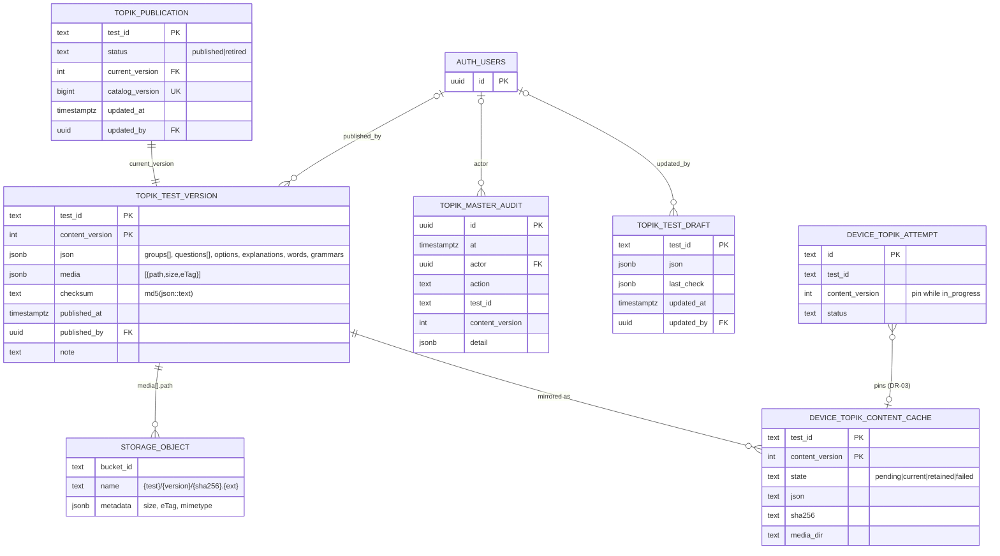

# TOPIK Master Data Architecture: Decision Package

Date: 2026-10-17 · Status: **reviewed by the owner 2026-10-17; rulings recorded in §12 and §15; nothing is built** · Baseline: `master` = `b420592f` (merge of pull request 306 of `ntgptit/memox-v8`); branch `ccr-b0d5b7c9-mlvno2` · Linear: epic DEV-394.

This document is design only. It creates no migration, runs nothing against Supabase, changes no production Dart, Drift or SQL, deploys nothing and uploads no content. Every SQL, DDL and RPC contract below is a **candidate**, written as documentation. The one companion document is [ADR-025](../../shared/decisions/ADR-025-ghim-luot-dang-lam-vao-phien-ban-noi-dung-topik.md), made `active` by the owner's rulings of 2026-10-17 (§12). The business rules it amends (BR-TOPIK-013, BR-TOPIK-019, BR-TOPIK-008) and UC-TOPIK-002/003 change in the PR that changes their code (§11), so documents and code never disagree. [ADR-023](../../shared/decisions/ADR-023-luyen-de-topik.md) and [ADR-024](../../shared/decisions/ADR-024-master-data-topik-tren-supabase-va-admin-web.md) stay `active`. ADR-025 amends ADR-024 #4, #5 and #7 and supersedes neither.

The package builds on the approved design [2026-10-16 Master Data and Admin Web](2026-10-16-topik-master-data-admin-web-design.md) (called **the spec** below) and does not repeat it. Where the package proposes a different answer, the proposal has an ID in the [decision register](#12-decision-register). The spec's text stays the authority until the owner approves the proposal.

**How to read it.** §1 is the summary and §12 lists every decision. §15 holds the questions only the owner can answer. Sections 2–11 hold the evidence and the design. Paths are relative to the repository root, and `M16` means `supabase/migrations/20261016120000_topik_master_data.sql`.

## 1. Executive summary

### 1.1 Approved direction and where the project stands

The owner approved this direction on 2026-10-16 (ADR-024, spec M1–M7, O1–O9):

- Supabase Postgres is the authoritative source of TOPIK Master Data.
- Only admins mutate it, through RPCs gated by `profiles.role`.
- The app consumes immutable, versioned published content through an offline cache.
- Learner data stays separate and owned by each user.

**The server half is built and live.** Pull requests 304 and 305 merged migration M16. The `supabase migrations` workflow pushed it to project `hgacyucfagsvolymlqto` in run 31 (owner-dispatched, 2026-10-17). It holds the following:

- four tables;
- eleven admin RPCs;
- two client RPCs;
- the private bucket `topik-media` with four Storage policies.

It is pinned by 282 + 30 pgTAP assertions.

**The client half is not built.** The app still reads bundled assets, and `assets/topik/manifest.json` is `{"tests": []}`. No TOPIK content has ever reached a device, and no production attempt exists. The Admin Web does not exist yet. The learner-data store is complete and unaffected by this package: `topik_attempt` and `topik_attempt_answer`, Drift v17, completed-attempt sync and account switch.

### 1.2 Recommended implementation architecture

**The shipped Master Data model stays the authoritative model.** Its properties:

- one immutable JSON **document per revision** `(test_id, content_version)`;
- a pointer table with a global commit-ordered `catalog_version`;
- retire as a tombstone and rollback as a new revision;
- an append-only audit;
- media as immutable Storage objects;
- admin writes through `SECURITY DEFINER` RPCs, and Storage gated by policies limited to the bucket.

A normalized question schema is **not** recommended (§4.6). Nothing reads questions with SQL, and the Dart validator is the reference rule set. A relational twin would be a second source of truth for the same revision.

On that baseline the package proposes targeted, additive amendments. Each can be reverted by a follow-up migration or app build:

1. **Pin an in-progress attempt to its starting revision** (DR-03, the critical conflict in §5.6). Today an attempt started on revision 1 and submitted after revision 2 is published is graded on revision 2, and its `content_version` is overwritten (`lib/features/topik/data/repositories/topik_attempt_repository_impl.dart:170-196`). With bundled content that needed an app update in between. With foreground refresh it becomes an ordinary event. This changes two active BRs, so it **requires the owner's approval**.
2. **Cryptographic integrity** (DR-06, DR-21). The document gets a SHA-256 computed by the server over the exact text it serves, using `pg_catalog.sha256`, already used in `20261010000000_accounts.sql:225`. Media become **content-addressed** inside the shipped path contract, as `{test_id}/{content_version}/{sha256}.{ext}`. Today's `md5` checksum and Storage `eTag` are change detectors, not cryptographic hashes. A multipart upload's `eTag` is not even a hash of the bytes.
3. **A device cache keyed by revision with explicit states** (DR-04): `pending`, `current`, `retained` and `failed`. Install follows staging, verify, atomic promote. A failed update never touches the package already in use.
4. **Catalog compatibility metadata** (DR-05): `schemaVersion`, `sha256` and `bytes` in each entry, so an older app skips what it cannot read.
5. **Publish safety extras.**
   - DR-09: bucket MIME and size limits, and a document size ceiling.
   - DR-10: a publish dry-run RPC.
   - DR-22: optimistic locking on draft saves.
6. **One validator implementation** (DR-07). The Admin Web runs the Dart `checkTopikTest` compiled with `dart compile js`, not a hand-written TypeScript port. This amends ADR-024 #5 and **requires the owner's approval**. The fixture contract stays either way.
7. **One media reference type for the audio door** (DR-23). It covers an asset or a file and keeps the single `just_audio` boundary.
8. **Screen 36 keeps History when the test is gone** (DR-11). This is a screen-state change and **requires the owner's approval**.

### 1.3 Major trade-offs

| Choice | Gain | Cost |
|---|---|---|
| Document per revision, not normalized tables | One representation; validator stays in Dart; no schema migration per content-schema change | Cross-revision integrity (same group, same revision) is structural, not FK-enforced; no SQL analytics over questions |
| Pinning in-progress attempts | Learners are graded on what they saw; `content_version` becomes reliable | At most one extra package per open attempt; two BRs change |
| Private bucket, session-authorized downloads | No world-readable NIIED files; no secret | The CDN cannot cache publicly; every download carries a JWT; egress counts per device |
| Every published test downloaded eagerly | No "download" state on screens; offline after the first refresh | Bytes for papers the learner never opens; revisit at about 200 MB (DR-13) |
| Dart compiled to JS for the Admin Web | One rule implementation | A build step and a JS artifact to version |

### 1.4 Critical risks

1. **NIIED redistribution is an explicit dependency** (DR-14, `BLOCKED` on the owner). Every authenticated user can read published media, anonymous sign-ins included.
2. **A publication during an attempt** silently changes what a learner is graded on until DR-03 lands.
3. **Storage and Postgres cannot commit together.** Mitigations are in §5.9: upload before publish, existence check in the publish transaction, immutable objects, and a client verifying every byte.
4. **The workflow's drift check covers `public,private` only**, so a dashboard change to the bucket or its policies goes unnoticed (DR-15).
5. **Storage behaviour is proven only on the real stack.** The local pgTAP stub mirrors `protect_delete` alone.

### 1.5 Owner rulings (2026-10-17)

- **DR-03:** pin an in-progress attempt to its starting revision. Approved.
- **DR-07:** the Admin UI's validator is the Dart code compiled to JS. Approved.
- **DR-14:** published content is readable by **admins only, for now**. This is a stricter answer than the package's options assumed; §6.5 S1 and §7.3 give the design: one gate function, an empty catalog page for everyone else, lifted by one migration.
- **Every other recommendation is approved:** DR-11 (screen 36 History), DR-18 (CLI first), DR-24 (`crypto` dependency) and every `PROPOSED` entry.
- **Still open:** DR-12 (Q-A-8), and when to lift the DR-14 gate (§15).

## 2. Current-state assessment (Deliverable A)

### 2.1 Twelve facts about the built system

1. **Where content comes from.** It comes from bundled assets. `pubspec.yaml:70` declares `assets/topik/`, and `assets/topik/manifest.json` lists pack files. It is empty on every build.
2. **How assets are discovered.** `TopikContentAssetDataSource` reads the manifest with `rootBundle.loadString` and then each listed pack (`lib/features/topik/data/datasources/topik_content_asset_data_source.dart:19-82`). Media existence is checked against `AssetManifest.listAssets()`, wired in `lib/features/topik/di/topik_content_repository_provider.dart:17-19`. File names are free: there is no `{testId}.json` rule.
3. **How JSON is parsed and validated.** Three steps run in order:
   - `topikTestOf` checks the shape: `lib/features/topik/data/mappers/topik_test_mapper.dart:81-364`. It reads known keys only, ignores unknown keys, and rejects unknown level, section and question-type codes.
   - `checkTopikTest` applies 12 rules, with an injectable `assetExists`: `lib/features/topik/domain/models/topik_content_check_model.dart:18-253`.
   - `topikContentOf` keeps the first valid copy of each id and rejects an invalid test on its own: `lib/features/topik/data/mappers/topik_content_pack_mapper.dart:34-69`.
4. **How content is cached in memory.** `TopikContentRepositoryImpl` keeps one `Future<List<TopikTest>>` per app run and resets it only when the load throws (`lib/features/topik/data/repositories/topik_content_repository_impl.dart:10-52`). The interface has `catalog()` only (`lib/features/topik/domain/repositories/topik_content_repository.dart:5-8`). The catalog and detail use cases read it through `Stream.fromFuture`, so a refresh would not re-emit.
5. **How media is resolved and played.** The JSON holds full asset keys. `topikGroupClip` copies `test.audioAsset` into `TopikAudioClip.asset` (`lib/features/topik/domain/models/topik_audio_model.dart:490-499`). The only `just_audio` importer is `lib/features/topik/data/datasources/plugin_topik_audio_player_data_source.dart`, enforced by the guard rule `topik_audio_plugin_has_one_door`. Its single asset-specific line is `:305`, `ClippingAudioSource(child: AudioSource.asset(asset))`. Images use `Image.asset` in three widgets, with no `errorBuilder`.
6. **How attempts reference content.** An attempt stores `test_id` and `content_version`, with no FK (`lib/core/database/tables/topik.drift:5-35`). Every use case resolves the **current** catalog entry by id through `topikTestIn` (`lib/features/topik/domain/usecases/watch_topik_test_detail_use_case.dart:29-37`).
7. **How attempts are scored.** `scoreTopikAttempt` runs inside `submit` against the test passed in, which is the current one (`lib/features/topik/domain/models/topik_attempt_score_model.dart:239-287`; `topik_attempt_repository_impl.dart:153-199`). `_sameQuestions` (`:270-279`) compares the test id and the question-number set only.
8. **How results are snapshotted.**
   - Each answer gets `correct_idx`, `points`, `points_earned` and `question_type`.
   - The attempt gets `score`, `max_score`, `correct_count`, `answered_count`, `question_count`, and `content_version`, overwritten with the current version (`lib/core/database/queries/topik_queries.drift:67-84`).
   - All of it is written in one transaction with the sync outbox row (BR-TOPIK-013, BR-TOPIK-026).
9. **How attempts persist in Drift.** Drift is at v17 (`lib/core/database/app_database.dart:63`, `from16To17` at `:299-311`).
   - Triggers keep a completed attempt and its answers immutable (`topik.drift:72-87`).
   - A partial unique index allows one open attempt per test.
   - CHECKs keep the snapshot all-or-nothing.
10. **How completed attempts sync.** The trigger `topik_attempt_sync_complete` queues an upsert only on `in_progress → completed` (`lib/core/database/tables/sync.drift:222-240`). The adapter is `TopikAttemptSyncDao` (`lib/app/sync_tables.dart:33`). On the server, `topik_attempt_upsert` is insert-only and checks integrity only (`supabase/migrations/20261016000000_topik_attempt_sync.sql:94-139`). It never looks up Master Data.
11. **How account switching resets local data.** `LocalDataReset` deletes every `topik_attempt` row inside one transaction under `applying_remote` (`lib/core/database/local_data_reset.dart:33-41`). Completed attempts return by pull. In-progress attempts are lost (BR-TOPIK-027). On an anonymous-to-account merge, the server moves attempts by `user_id` (`20261016000000_topik_attempt_sync.sql:394-475`).
12. **How Summary and Review behave when content changes.**
    - Summary reads the snapshot only (`watch_topik_summary_use_case.dart`).
    - Review shows the current content. It is unavailable when `topikContentMatchesAttempt` fails, and shows a banner when `contentVersion` differs (`lib/features/topik/domain/models/topik_views_model.dart:36-47, 82-86`). It marks the snapshot's `correct_idx` as right, which is open question Q-A-8.
    - Attempt (37) turns into `contentMissing` with Delete only when the question set or groups differ.
    - Test detail (36) hides History once the test leaves the catalog (`topik_test_detail_screen.dart:86-96`).

### 2.2 Limitations of the current state

- Content can change only through an app release, and no release has carried any.
- There is no notion of a revision on the device, so an attempt cannot be pinned.
- `content_version` on an in-progress attempt is advisory. It is overwritten at submit, and only the Review banner ever compares it.
- Best and Average on screen 36 mix scores across revisions. They are sound only because `max_score` is always 100 (BR-TOPIK-002).
- On the server, the `checksum` is `md5(json::text)` and media integrity is `size` plus `eTag`. Neither is cryptographic, and the client cannot recompute the md5 from a parsed JSON.
- The bucket has no `file_size_limit` and no `allowed_mime_types` (M16:733-735).
- The workflow's schema drift check ignores the `storage` schema (`.github/workflows/supabase-migrations.yml:67-82`).

### 2.3 Components to preserve

The following stay as they are:

- models, mapper and `checkTopikTest`;
- `TopikExamLayout`;
- all use cases, keeping their signatures;
- the attempt store, its triggers and its sync adapter;
- `LocalDataReset`;
- the server `topik_attempt*` tables and dispatch;
- every Master Data table, trigger and RPC already shipped;
- the audio repository and the plugin door;
- screens 34–39 and their state machines;
- routes;
- the fixture contract between Dart and SQL.

### 2.4 Architectural conflicts found

| # | Conflict | Evidence | Resolution here |
|---|---|---|---|
| C1 | "Grade at submit on current content" against versioned, refreshable packages | BR-TOPIK-013 ¶3; spec 2026-10-15 §5.3; spec §8.4, §12 | §5.6, DR-03 (owner) |
| C2 | Cache keyed by `test_id` only (spec §8.2) cannot hold a pinned revision | spec §8.2 | DR-04 |
| C3 | "Cryptographic integrity" against md5 + eTag | M16:486; spec §6.4 | DR-06, DR-21 |
| C4 | One validator rule set against a TypeScript port in the Admin Web | ADR-024 #5; BR-TOPIK-008 | DR-07 (owner) |
| C5 | A retired test hides the learner's History | `topik_test_detail_screen.dart:86-96` | DR-11 (owner) |
| C6 | `contentMismatch` exists in code and screens but in no BR or UC | BR-TOPIK-019; UC-TOPIK-003 | DR-19 |
| C7 | Stale documents describe bundled content | §2.6 | PR-08 |

### 2.5 Impact table

Each component is classed as one of the following:

- **U**: unchanged.
- **E**: extended, with new members and old behaviour kept.
- **I**: internal change, with the same contract and a new implementation.
- **N**: new.
- **O**: obsolete, to be removed.

| Component | Current responsibility | Proposed responsibility | Class | Breaking | Data migration | Compatibility concern | Risk | Required verification |
|---|---|---|---|---|---|---|---|---|
| `TopikContentAssetDataSource`, `assets/topik/`, pubspec folder | Read bundled packs | None (O3) | O | No; one provider consumes it | No (manifest empty) | Gate tests walking `assets/topik/` lose their subject | Low | `test/tools/topik_content_assets_test.dart` re-pointed at fixtures |
| `TopikContentRepository` interface | `catalog()` once per run | `catalog()` kept; `watchCatalog()` and `revision(testId, version)` added | E | No | No | Use cases on `Stream.fromFuture(catalog())` switch to the stream | Medium | Use-case tests with a fake emitting twice |
| `TopikContentRepositoryImpl` | Memo over the asset load | Reads `current`/`retained` rows from Drift, parses on read, re-emits on write | I | No | No | Parse per read (tens to hundreds of KB) | Low | Repository tests on in-memory Drift |
| `TopikContentRemoteDataSource` | — | Catalog paging, document fetch, media download | N | — | — | Supabase errors become codes, never screens | Medium | Unit tests with a fake client |
| `TopikContentInstaller` | — | Staging, verify (SHA-256, size, schema, `checkTopikTest`), promote, sweep | N | — | — | Crash between steps | Medium | Crash-point tests with an injected file system |
| `RefreshTopikContentUseCase` | — | Refresh loop, cursor rule, retries | N | — | — | Off the UI thread; minimum interval | Medium | Tests: retire, new version, failure keeps the old package |
| Drift schema | v17 | v18: `topik_content_cache`, `topik_content_state` (create only) | E | No | No (new tables) | Generated schema v18; migration test | Low | `test/drift/migration_test.dart` |
| Attempt, submit and in-progress Review use cases | Resolve current content | Resolve the **pinned** revision (DR-03) | I | No | No | `topikTestIn` gains a version-aware sibling | Medium | Use-case tests and pin tests |
| `TopikAttemptRepositoryImpl.submit` | Scores the passed test; overwrites `content_version` | Scores the pinned test; `content_version` kept (DR-03); `_sameQuestions` stays | I | No | No | The test "a content correction made before submit is the one that scores" is rewritten with its new meaning, not removed | Medium | Drift repository tests |
| Learner tables, sync DAO, outbox, `sync_push`/`sync_changes`, `LocalDataReset`, server `topik_attempt*` | Learner data | Unchanged | U | No | No | None | None | Existing suites; pgTAP 17 |
| Audio door | `AudioSource.asset` | A `TopikMediaRef` (asset or file) maps to `AudioSource.asset` or `AudioSource.file` (DR-23) | I | Door interface only | No | Fake platform rewrite; one plugin test | Low | Plugin tests; 18 repository tests unchanged |
| Image widgets (3) | `Image.asset` | `Image.file` or `Image.asset` from a `TopikMediaRef`, with an `errorBuilder` | I | No | No | Goldens keep fixtures as assets | Low | Widget tests |
| Screens 34–39 | Detail-file state machines | 34: offline hint in `noTests` (spec §8.3). 36: History stays when the test is gone (DR-11). 37/39: no new state | E | No | No | Detail files 34 and 36; new goldens | Medium | Widget tests, goldens, Impeccable on the touched states |
| `topik_catalog` | Entries without compatibility data | Adds `schemaVersion`, `sha256`, `bytes` (DR-05, DR-06) | E | No (additive keys) | No | pgTAP "entry field set exact" updated | Low | pgTAP 18 |
| `topik_test_content` | Bare jsonb | `{testId, contentVersion, schemaVersion, sha256, document}` with `document` the served text (DR-06) | I | Contract yes, consumers no (none exist) | No | New migration with `create or replace`; spec §6.2 text | Low | pgTAP: `sha256(document)` equals the catalog's |
| `topik_admin_publish`, `topik_admin_draft_save` | As shipped | Publish adds the content-addressed media rule (DR-21); draft save takes `p_expected_updated_at` (DR-22); `topik_admin_check` added (DR-10) | E | Signature of `draft_save` changes (no consumer yet) | No | 04 pins names, not signatures | Low | pgTAP 18 |
| Bucket `topik-media` | Private, no limits | `file_size_limit`, `allowed_mime_types` (DR-09) | E | No | Bucket row update | A new media type needs a migration | Low | pgTAP bucket row |
| Fixture contract | Dart and SQL | Dart, SQL and the JS artifact | E | No | No | Admin repo consumes `test/fixtures/topik/` | Low | Admin CI contract test |
| `tools/topik/topik_lint.dart` | Pack lint | Fixtures and content repository; the pubspec-folder rule becomes optional | I | No | No | None | Low | `test/tools/topik_lint_test.dart` |
| Migrations workflow | pgTAP, push, diff `public,private` | Adds a post-push check of the bucket and policies (DR-15) | E | No | No | Our rows only, never storage-api's | Low | Workflow dispatch |
| Admin Web | — | Spec §9 MVP | N | — | — | Generated types and error codes pinned in its CI | Medium | Its CI |

Nothing is rewritten. Every new component sits below the `catalog()` contract, so the screens and use cases keep their shape.

### 2.6 Stale documents (left for PR-08, except two lines fixed now)

- **Fixed in this branch.** The header of spec 2026-10-16 and ADR-024 "Hệ quả" said the migration was not pushed.
- **Left for PR-08:**
  - spec 2026-10-15 lacks the "thay bởi ADR-024" annotations ADR-024 claims;
  - UC-TOPIK-001…005 "API" lines say "nội dung đóng gói";
  - `docs/features/topik/README.md` still describes bundled content;
  - `PRODUCT.md:52` says "bundled past papers";
  - screen 34 lines 6 and 19 still describe bundled content;
  - BR-TOPIK-008's summary line still says one checker;
  - `docs/features/topik/it-scenarios.md` IT-001/008/013 assume a bundle;
  - no IT scenario covers refresh, retire, a new version or an offline first run.

## 3. Target architecture

### 3.1 Component diagram

```mermaid
flowchart LR
  subgraph AdminRepo["memox-topik-admin (Vercel)"]
    AW["Next.js · publishable key · admin session"]
    VAL["Validator artifact (Dart → JS)"]
    HASH["SHA-256 of each media file"]
  end
  subgraph Authoring["memox-topik-content"]
    PIPE["PDF/MP3 → pack JSON"]
  end
  subgraph Supabase["Supabase project (one)"]
    AUTH["Auth · profiles.role"]
    RPCA["topik_admin_* + topik_admin_check"]
    RPCC["topik_catalog · topik_test_content"]
    T1[("topik_test_draft")]
    T2[("topik_test_version (immutable)")]
    T3[("topik_publication")]
    T4[("topik_master_audit (append-only)")]
    ST[["topik-media (private)\n{test}/{version}/{sha256}.{ext}"]]
    UA[("topik_attempt* (learner)")]
    SYNC["sync_push · sync_changes"]
  end
  subgraph Phone["MemoX (Flutter)"]
    REM["TopikContentRemoteDataSource"]
    INST["TopikContentInstaller\nstaging → verify → promote"]
    CACHE[("Drift topik_content_cache\n(test_id, content_version, state)\n+ files topik/{test}/{version}/")]
    REPO["TopikContentRepository\ncatalog() · watchCatalog() · revision()"]
    ATT["Attempt store (pinned revision)"]
    UI["Screens 34–39"]
    AUD["Audio door (just_audio)"]
  end
  PIPE -->|pack JSON + media| AW
  AW --> AUTH & RPCA
  AW --> HASH -->|upload| ST
  VAL -.same fixtures.- RPCA
  RPCA --> T1 & T2 & T3 & T4
  REM --> RPCC --> T2 & T3
  REM -->|download (session)| ST
  REM --> INST --> CACHE --> REPO --> UI
  UI --> ATT --> SYNC --> UA
  UI --> AUD
  AUD -.file path.- CACHE
```

### 3.2 Data flows

1. **Authoring.** `memox-topik-content` produces pack JSON and media. The Admin Web imports the JSON as a draft (`topik_admin_draft_save`, `p_imported = true`). Then the admin works through these steps:
   - edits and validates with the artifact;
   - uploads media as `{test_id}/{next}/{sha256}.{ext}`;
   - checks with `topik_admin_check`;
   - publishes with `topik_admin_publish`.

   All writes carry the admin's own session.
2. **Distribution.** The app calls `topik_catalog(since)`, then `topik_test_content` for each new revision. It downloads each listed file with its session, verifies it, installs it and re-emits the catalog.
3. **Learning.** The screens read `TopikContentRepository`, and attempts write Drift. Completed attempts sync through `sync_push`/`sync_changes`. Master Data never enters the user sync.

### 3.3 Repository boundaries and responsibilities

| Concern | Server (Supabase) | Client (Flutter) | Admin Web | This repo's tooling |
|---|---|---|---|---|
| Identity, versions, publication pointer, audit | owns | reads | drives | — |
| Shape validation (7 rules) | at publish | — | — | fixtures → pgTAP |
| Full domain validation (`checkTopikTest`) | — | last gate before install | artifact (DR-07) | reference implementation |
| Media bytes | stores, enforces immutability | verifies SHA-256 and size | computes SHA-256, uploads | — |
| Scoring | never (BR-TOPIK-028) | at submit, on the pinned revision | — | — |
| Learner data | integrity checks, sync | owns (Drift-first) | never reads | — |

## 4. Data model (Deliverable B)

### 4.1 Schema placement

The shipped tables live in `public`. Each has RLS enabled, no policy and no client privilege, which is the project's isolation mechanism (ADR-015 #5; pgTAP `01_schema_privileges.sql`, `18_topik_master_data.sql:11-30`). PostgREST exposes `public`, but a role without privileges sees nothing.

A dedicated schema `topik_master` would add nothing the grants do not already give. It would also do three kinds of damage:

- it would force a change to the exposed-schema settings;
- it would break the shipped pgTAP and the README's rule list;
- it would break the types the Admin Web will generate.

**Decision: stay in `public` with the `topik_` prefix** (DR-01).

### 4.2 Table inventory

| # | Object | Status | Role | Granularity |
|---|---|---|---|---|
| 1 | `public.topik_test_draft` | shipped | Working copy; may be invalid; never visible to learners | one per test id |
| 2 | `public.topik_test_version` | shipped | Immutable published revision: document, media manifest, checksum | one per `(test_id, content_version)` |
| 3 | `public.topik_publication` | shipped | Pointer clients follow: current revision, status, global cursor | one per test id |
| 4 | `public.topik_master_audit` | shipped | Append-only record of every management action | one per action |
| 5 | `public.topik_catalog_version_seq` | shipped | Source of `catalog_version` | sequence |
| 6 | `storage.buckets` row `topik-media` and its `storage.objects` | shipped | Media bytes, with `size`/`eTag` metadata | one object per file |
| — | Test identity table, question group, question, option, supporting content, vocabulary, grammar, media metadata, publication history | **not separate tables** | Each is either inside the revision document or already covered by a shipped table, as mapped below | — |

**Where each candidate entity from the brief lives:**

| Candidate entity | Lives in | Why there |
|---|---|---|
| Test identity | `topik_publication.test_id` (once published), `topik_test_draft.test_id` (before) | The id is a natural key derived from level, round and section. A separate identity table would only repeat it |
| Test revision | `topik_test_version` | Shipped |
| Question group, question, option, explanation, translation, vocabulary, grammar, script | `topik_test_version.json` (`groups[]`, `questions[]`) | Always read and written as a whole test. Integrity rules span the whole set (numbering, points sum, membership) |
| Media metadata | `topik_test_version.media` (`{path, size, eTag}`), `storage.objects.metadata`, content-addressed file name (DR-21) | The manifest is per revision and immutable with it |
| Published catalog | `topik_publication` + `topik_catalog` RPC | Shipped |
| Publication history | `topik_master_audit` (actions) + `topik_test_version` (every revision) | History is audit plus versions. A separate history table would duplicate both |
| Administrative audit | `topik_master_audit` | Shipped |
### 4.3 Schema dictionary (fifteen fields per table)

Shipped facts cite M16. Items marked **(P)** are proposals.

#### `public.topik_test_draft` (M16:11-19)

| Field | Value |
|---|---|
| 1 Purpose | The admin's working copy of one test, the only mutable content row. It may be invalid |
| 2 Columns | `test_id text`; `json jsonb`; `last_check jsonb`; `updated_at timestamptz`; `updated_by uuid` |
| 3 Primary key | `test_id` |
| 4 Foreign keys | `updated_by → auth.users(id) on delete set null` |
| 5 Unique | PK only |
| 6 Check | `json->>'testId' = test_id`; **(P)** `octet_length(json::text) <= 4194304` (DR-09) |
| 7 Nullability | `updated_by` null after the admin's account is deleted; all else `not null` |
| 8 Defaults | `last_check '{}'`, `updated_at now()` |
| 9 Indexes | PK |
| 10 Ownership, privileges | Owner `postgres`; `revoke all from public, anon, authenticated` (M16:73-78); written only by `topik_admin_draft_save/_delete` |
| 11 RLS | Enabled, no policy |
| 12 Immutability | None. Deleting a draft touches no revision. **(P)** optimistic lock on save (DR-22) |
| 13 Lifecycle, retention | Created by import or save; kept after publish as the next working copy; deleted by the admin |
| 14 Read/write pattern | Tens of rows; read and written by one admin at a time; whole-document writes |
| 15 Relation to packages | None until published. Its JSON becomes a revision's document at publish |

#### `public.topik_test_version` (M16:22-38)

| Field | Value |
|---|---|
| 1 Purpose | One published, immutable revision: the unit of grading, caching, rollback and audit |
| 2 Columns | `test_id text`; `content_version integer`; `json jsonb`; `media jsonb` (array of `{path, size, eTag}` ordered by path); `checksum text` (`md5(json::text)`); `published_at timestamptz`; `published_by uuid`; `note text` |
| 3 Primary key | `(test_id, content_version)` |
| 4 Foreign keys | `published_by → auth.users on delete set null`. None to the draft |
| 5 Unique | PK |
| 6 Check | `content_version > 0`; `json->>'testId' = test_id`; `(json->>'contentVersion')::integer = content_version`; `jsonb_typeof(media) = 'array'`; **(P)** document size ceiling |
| 7 Nullability | `published_by`, `note` nullable; all else `not null` |
| 8 Defaults | `media '[]'`, `published_at now()` |
| 9 Indexes | PK. `topik_media_can_modify` scans `media` of every row. At hundreds of rows this is fine, and a GIN index on `media` is the remedy if it ever is not |
| 10 Ownership, privileges | Owner `postgres`; no client privilege; inserted only by `private.topik_publish_version` (publish, rollback) |
| 11 RLS | Enabled, no policy |
| 12 Immutability | Trigger `private.topik_version_immutable` blocks UPDATE, DELETE and TRUNCATE. Its only carve-out lets `published_by` become null (M16:85-104) |
| 13 Lifecycle, retention | Kept forever (§5.4 Q9). Legal withdrawal follows the purge runbook (DR-25) |
| 14 Read/write pattern | Written once per publish or rollback. Read by the catalog (current only), content RPC (current only) and admin history |
| 15 Relation to packages | **Is** the package's document and manifest. A device package mirrors exactly one row |

#### `public.topik_publication` (M16:40-53)

| Field | Value |
|---|---|
| 1 Purpose | What clients see of each test: one current revision, its status, and its place in the global cursor |
| 2 Columns | `test_id text`; `status text`; `current_version integer`; `catalog_version bigint`; `updated_at timestamptz`; `updated_by uuid` |
| 3 Primary key | `test_id` |
| 4 Foreign keys | `(test_id, current_version) → topik_test_version(test_id, content_version)`; `updated_by → auth.users on delete set null` |
| 5 Unique | `catalog_version` |
| 6 Check | `status in ('published', 'retired')` |
| 7 Nullability | `updated_by` nullable |
| 8 Defaults | `updated_at now()` |
| 9 Indexes | `idx_topik_publication_catalog (catalog_version)` for `since` paging |
| 10 Ownership, privileges | No client privilege. Written by `private.topik_publish_version` and `private.topik_set_status` |
| 11 RLS | Enabled, no policy |
| 12 Immutability | Mutable by design, since it is the pointer. Every change takes a new `catalog_version` under advisory lock 7102, so the cursor follows commit order |
| 13 Lifecycle, retention | Created at first publish; a retired row stays as the tombstone, forever |
| 14 Read/write pattern | One write per publish, retire, unretire or rollback. One indexed range read per catalog page |
| 15 Relation to packages | Selects which package is `current` on devices; a retired row tells devices to drop theirs |

#### `public.topik_master_audit` (M16:55-67)

| Field | Value |
|---|---|
| 1 Purpose | Who did what, when, recorded in the same transaction as the change |
| 2 Columns | `id uuid`; `at timestamptz` (`clock_timestamp()`); `actor uuid`; `action text`; `test_id text`; `content_version integer`; `detail jsonb` |
| 3 Primary key | `id` |
| 4 Foreign keys | `actor → auth.users on delete set null`. None on `test_id`, so the audit outlives a deleted draft |
| 5 Unique | PK |
| 6 Check | `action in (draft_save, draft_import, draft_delete, publish, retire, unretire, rollback)`; **(P)** `check` added when DR-10/DR-25 add actions |
| 7 Nullability | `actor`, `content_version` nullable |
| 8 Defaults | `at now()`, `detail '{}'` |
| 9 Indexes | `(at desc, id desc)`, `(test_id, at desc)` |
| 10 Ownership, privileges | No client privilege. Inserted only by `private.topik_audit` |
| 11 RLS | Enabled, no policy |
| 12 Immutability | Trigger `private.topik_audit_append_only`; its only carve-out lets `actor` become null |
| 13 Lifecycle, retention | Forever (admin actions only, small) |
| 14 Read/write pattern | One insert per admin action; paged reads newest first |
| 15 Relation to packages | Records which revision each publish made current |

#### `public.topik_catalog_version_seq` (M16:43)

The sequence is the global cursor source. Only `private.topik_next_catalog_version()` calls `nextval`, under lock 7102. No client privilege. It is never reset.

#### Bucket `topik-media` (M16:733-783)

| Field | Value |
|---|---|
| 1 Purpose | Media bytes of every revision |
| 2 Columns | `storage.objects` (`bucket_id`, `name`, `metadata` with `size`, `eTag`, `mimetype`) |
| 3 Key | `name` = `{test_id}/{content_version}/{file}`; **(P)** `{file}` = `{sha256}.{ext}` (DR-21) |
| 4–6 Constraints | **(P)** bucket `file_size_limit = 52428800` (50 MiB), `allowed_mime_types = {audio/mpeg, image/jpeg, image/png, image/webp}` (DR-09) |
| 7–9 | Managed by storage-api |
| 10 Ownership, privileges | Hosted owner `supabase_storage_admin`; policies managed by `postgres` |
| 11 RLS | Four policies, all `to authenticated`, all limited to the bucket: read (`topik_media_can_read`), insert (`can_write`), update and delete (`can_modify`) |
| 12 Immutability | An object listed in any revision's `media` cannot be updated or deleted, even by an admin. storage-api's `protect_delete` refuses direct SQL deletes |
| 13 Lifecycle, retention | Listed objects are kept forever. Unlisted uploads are orphans the admin may delete (§5.9) |
| 14 Read/write pattern | Written by admin uploads; read once per device per revision |
| 15 Relation to packages | The package's media files |

### 4.4 The brief's integrity requirements, mapped

| Requirement | How it holds | Where | Proven by |
|---|---|---|---|
| A test has a stable identity | `test_id` natural key, checked to equal `{level}-{round}-{section}` | `identity` rule (Dart `topik_content_check_model.dart:44`; SQL M16:130-244) | pgTAP 18, 19; Dart tests |
| A test can have many revisions | PK `(test_id, content_version)` | `topik_test_version` | pgTAP 18 |
| Every revision has a unique, deterministic version | Server assigns `max + 1` under per-test lock 7101; the draft must already state it (`VERSION_MISMATCH`) | `private.topik_next_version`, `topik_admin_publish` | pgTAP 18:301-332 |
| Questions and groups belong to the same revision | They are members of one document; no reference can leave it | document model | structural |
| A question cannot reference an option or group of another revision | Options are nested in the question; `groupId` must name a group of the same document | `groups` rule (Dart, SQL) | Dart tests, pgTAP 19 fixture `groups-unknown-group` |
| Official question numbers intact | Sorted number array must equal the exact layout range (TOPIK I reading 31–70) | `numbering` rule (M16:166-180; Dart `_checkNumbering`) | fixture `numbering-missing-question` |
| Answer indices valid | `idx` exactly {1,2,3,4}, `answerIdx` in 1–4 | `options` rule | fixture `options-answer-5` |
| Official points preserved | Per-layout point sets, sum 100 | `points` rule | fixture `points-three` |
| No duplicate question numbers | A duplicate makes the sorted array differ from the range | `numbering` rule | pgTAP 18 |
| Only valid content publishes | Shape rules in the publish transaction; full rules in the Admin Web and again on the device | `topik_admin_publish`, DR-07, installer | pgTAP 18:293-298 |
| Published content cannot be edited | Triggers; no UPDATE path in any RPC; media `can_modify` | M16:85-122, 738-783 | pgTAP 18:33-51, 698-781 |
| Historical revisions remain available | No delete path; retention forever; legal purge only by runbook | §5.4 Q9, DR-25 | trigger tests |

The document model enforces cross-revision isolation **by construction** rather than by FK. A normalized schema would need composite FKs `(test_id, content_version, group_id)` on every child row to reach the same guarantee.

### 4.5 ERD



The revision document has the following shape (spec 2026-10-15 §4.1; `test/support/topik_content_fixtures.dart`):

```
test (testId, schemaVersion, contentVersion, level, round, section, format, form, titleKo, officialTimeLimitSec, source, assets.audio)
 ├─ groups[]   (groupId, instructionKo, questionNos[], passage{textKo,image}, audio{startMs,endMs,playCount}, script, scriptTranslation{vi,en})
 └─ questions[] (no, groupId → groups[].groupId, questionType, points, stemKo, answerIdx,
                 options[4] (idx 1–4, textKo | image), explanation{vi,en}, translation{vi,en},
                 words[] (ko, vi, en, pos), grammars[] (pattern, vi, en))
```

### 4.6 Alternatives considered

| Option | What it is | Verdict and evidence |
|---|---|---|
| **A. Document per revision (shipped)** | One jsonb per `(test_id, content_version)`; SQL checks the shape; Dart is the reference validator | **Recommended.** It matches every consumer: screens read whole tests through `TopikTest`, the Admin Web edits and diffs JSON, and the fixtures are documents. It keeps one source of truth per revision and 312 shipped assertions |
| B. Normalized schema (`test`, `revision`, `question_group`, `question`, `option`, `word`, `grammar`, `media_asset`), with the document generated at publish | Rows with composite FKs | Rejected. It would cost roughly 8 tables and composite FKs to restate what the document holds. Set-level rules (points sum 100, contiguous numbering, every question in exactly one group) are not FK-expressible and stay in validators anyway. It creates two representations of one revision, and every content-schema change becomes a migration. Revisit only as a **read projection** generated from the document, for question-level analytics or a question editor |
| C. Documents as files in Storage, no tables | — | Rejected in spec §3.3: no states, no audit, no SQL checks |
| D. Document plus a `topik_media_object` registry table | — | The `media` array is the registry, and a table would only add an index |
| E. Dedicated `topik_master` schema | — | §4.1 |

### 4.7 Candidate DDL (documentation only; the real text belongs to PR-02)

```sql
-- PR-02 candidate · a NEW migration file; the pushed M16 is never edited.

alter table public.topik_test_draft
  add constraint topik_test_draft_size check (octet_length(json::text) <= 4194304);
alter table public.topik_test_version
  add constraint topik_test_version_size check (octet_length(json::text) <= 4194304) not valid;
  -- NOT VALID: existing rows are not rescanned (immutable table; none expected yet).

update storage.buckets
  set file_size_limit = 52428800,
      allowed_mime_types = array['audio/mpeg', 'image/jpeg', 'image/png', 'image/webp']
  where id = 'topik-media';

-- Integrity hash of a revision, computed on serve over the exact text served (DR-06).
create function private.topik_document_sha256(p_json jsonb) returns text
language sql immutable set search_path = '' as $$
  select encode(pg_catalog.sha256(convert_to(p_json::text, 'UTF8')), 'hex')
$$;

-- topik_catalog: a published entry adds
--   'schemaVersion', (json->>'schemaVersion')::integer,
--   'sha256', private.topik_document_sha256(json),
--   'bytes', octet_length(json::text) + coalesce(sum of media[].size, 0)
-- topik_test_content returns
--   {testId, contentVersion, schemaVersion, sha256, document: json::text}

-- Publish, media rule (DR-21): the file segment is a SHA-256 and a known extension.
--   split_part(path, '/', 3) ~ '^[0-9a-f]{64}\.(mp3|jpg|jpeg|png|webp)$'  else VALIDATION_FAILED detail 'media'

-- topik_admin_draft_save gains p_expected_updated_at timestamptz default null (DR-22):
--   not null and <> the row's updated_at  → raise 'VERSION_MISMATCH'

-- topik_admin_check(p_test_id text) returns jsonb (DR-10): require_topik_admin(); the
--   publish checks on the draft, without writing:
--   {testId, nextContentVersion, issues[], mediaInvalid[], mediaMissing[]}
```

Device, Drift v18, create only (PR-04):

```sql
CREATE TABLE topik_content_cache (
  test_id TEXT NOT NULL,
  content_version INTEGER NOT NULL CHECK (content_version > 0),
  state TEXT NOT NULL CHECK (state IN ('pending', 'current', 'retained', 'failed')),
  schema_version INTEGER NOT NULL,
  catalog_version INTEGER NOT NULL,
  sha256 TEXT NOT NULL,        -- of the document text, from the catalog entry
  bytes INTEGER,               -- announced size, for the storage check
  json TEXT,                   -- the verified document; NULL unless current or retained
  media_dir TEXT,              -- relative: topik/{test_id}/{content_version}
  attempts INTEGER NOT NULL DEFAULT 0,
  last_error TEXT,             -- a code (§7.6), never shown
  updated_at DATETIME NOT NULL,
  PRIMARY KEY (test_id, content_version),
  CHECK ((state IN ('current', 'retained')) = (json IS NOT NULL AND media_dir IS NOT NULL))
);
CREATE UNIQUE INDEX idx_topik_content_one_current ON topik_content_cache (test_id) WHERE state = 'current';
CREATE TABLE topik_content_state (
  name TEXT NOT NULL PRIMARY KEY,   -- catalog_cursor, last_refresh_at
  value TEXT NOT NULL
);
```

The cache stores whole documents, not relational rows. It holds no question, option or group table.
## 5. Versioning and publication (Deliverables C and E)

### 5.1 Identity model

| Concept | Identifier | Lives in | Rule |
|---|---|---|---|
| Test | `test_id` = `topik{1|2}-{round}-{section}`, for example `topik2-96-reading` | document `testId`, every key | Natural key, never renamed. `form` (홀수형/짝수형) is a field, not part of the id (BR-TOPIK-003) |
| Revision | `revision_id` ≡ `(test_id, content_version)` | `topik_test_version` PK | No surrogate id. The pair is already unique, immutable and readable. `content_version` is per test, server-assigned `max + 1`, never reused |
| Content schema | `schemaVersion` (integer, `1` today) | document; **(P)** catalog entry and cache row | Bumped when an older app would reject or misread the document: a new enum value (level, section, question type), a removed or retyped field, or new meaning for a field. Additive optional fields do **not** bump it, because the mapper reads known keys only (`topik_test_mapper.dart`) |
| Catalog position | `catalog_version` (global bigint) | `topik_publication` | Orders publication events, not content. The only cursor a device keeps |
| Question | `(test_id, question_no)` across revisions; `(test_id, content_version, question_no)` within one | document `questions[].no` | Official numbers never change across revisions (BR-TOPIK-001). A revision may change a question's text, key or points under the same number |
| Answer key | `questions[].answerIdx` of a revision | document | The device snapshots it into `topik_attempt_answer.correct_idx` at submit |
| Document hash | `sha256` of the served document text (DR-06); `checksum` = `md5(json::text)` kept for admin views | computed on serve; `topik_test_version.checksum` | The client verifies `sha256` over the exact bytes received |
| Media hash | SHA-256 of the file bytes, as the file name (DR-21) | object name `{test}/{version}/{sha256}.{ext}`; `media[].size` | The client verifies `sha256(bytes) = name` and `size` |
| Active publication | `topik_publication` with `status = 'published'` and `current_version` | server | Exactly one current revision per test |
| Device package | `(test_id, content_version)` + `state` | `topik_content_cache` | `current` serves the catalog; `retained` serves a pinned attempt |

**The chain from a test to an attempt:**

```
test_id ──1:n── (test_id, content_version)                     revision (immutable document)
                    └─1:n── question_no                           question within the revision
                              └─ answerIdx, points, questionType  key of that revision
topik_attempt (test_id, content_version) ─1:n─ topik_attempt_answer (question_no, selected_idx,
                                                   snapshot correct_idx, points, points_earned, question_type)
```

An attempt names its revision. While the attempt is in progress, this name is the pin (DR-03). Once it is completed, the name is the revision it was scored on. Each answer names its question by `question_no` within that revision. The snapshot copies the key, so the score never depends on the revision still existing.

### 5.2 State machines

**Draft (per test id):**

| From | Event | To | RPC | Audit |
|---|---|---|---|---|
| (none) | import or save | draft | `topik_admin_draft_save` | `draft_import` / `draft_save` |
| draft | save | draft | same; **(P)** `VERSION_MISMATCH` on a stale `p_expected_updated_at` | `draft_save` |
| draft | delete | (none) | `topik_admin_draft_delete` | `draft_delete` |
| draft | publish | draft (kept as the next working copy) + new revision | `topik_admin_publish` | `publish` |

**Revision:** a revision is born `published` by publish or rollback, and it has no other state. It never changes or returns to draft. Whether clients see it is decided by the publication pointer, not by the revision.

**Publication (per test id):**

| From | Event | To | Precondition | Error |
|---|---|---|---|---|
| (none) | publish v1 | published @ v1 | draft valid, media present | `VERSION_MISMATCH`, `VALIDATION_FAILED`, `MEDIA_MISSING` |
| published @ n | publish | published @ n+1 | as above | as above |
| published @ n | rollback to k < n | published @ n+1 (document of k) | k exists, k ≠ n | `NOT_FOUND`, `INVALID_STATE`, `VALIDATION_FAILED`, `MEDIA_MISSING` |
| published @ n | retire | retired @ n | — | `INVALID_STATE` if already retired |
| retired @ n | unretire | published @ n | — | `INVALID_STATE` if published |
| retired @ n | publish or rollback | refused | — | `INVALID_STATE` |

Every transition takes a new `catalog_version`.

### 5.3 Versioning rules (shipped)

- **Publish** gives `max + 1`, and the draft's `contentVersion` must already say so.
- **Retire** writes a tombstone entry and keeps every version.
- **Unretire** is explicit and audited.
- **Rollback** creates a new revision, re-checks its shape, and records `rolledBackFrom`.
- **Publish and rollback on a retired test** are `INVALID_STATE`.
- **Rollback to the current revision** is `INVALID_STATE`.

All of these are proven in `supabase/tests/database/18_topik_master_data.sql`.

### 5.4 Eleven questions about corrections and lifecycle

1. **An admin corrects a wrong answer.** The admin edits `answerIdx` in the draft and publishes revision n+1. Devices install it on the next refresh.
   - Completed attempts keep their snapshot. Summary and score are unchanged (BR-TOPIK-013).
   - Review shows the banner "updated after this attempt" (BR-TOPIK-019). Which option it marks is Q-A-8.
   - An in-progress attempt keeps revision n under DR-03. Today it would be graded on n+1.
2. **An admin edits a translation.** The edit gives a new revision, the same as Q1. BR-TOPIK-007 says every change increases `contentVersion`, and a revision is immutable. The cost is one document download per device. Media are reused because the paths do not change.
3. **An admin changes an audio file.** The new file is uploaded under the next version's prefix with its SHA-256 name. The document points at the new path, and a new revision is published. The old object stays, because an older revision lists it. Devices download only the new file. A rollback to the old revision reuses the old object.
4. **An admin changes a question type.** This also gives a new revision. Completed attempts keep their snapshot `question_type`, so per-type statistics do not move (BR-TOPIK-024). A type code unknown to an older app needs a `schemaVersion` bump, or the old app rejects the whole test (§5.1).
5. **An admin publishes an incomplete revision.** It cannot happen through the RPC. The shape check refuses it (`VALIDATION_FAILED` with rule names), as does a missing media object (`MEDIA_MISSING`). Anything the SQL subset misses is caught twice:
   - by the full Dart rules in the Admin Web (DR-07);
   - by the device's `checkTopikTest` before install. An invalid test never activates; it stays `failed` with `INVALID_CONTENT` and the previous package keeps serving.
6. **A published revision cannot return to Draft.** Revisions are immutable. To keep editing, the admin edits the draft row, which publish leaves in place, or loads an old revision into the draft (`topik_admin_version_get`, then `_draft_save`).
7. **A previously published revision can become active again only as a new revision.** Rollback republishes its document as `max + 1`. The pointer never moves backwards.
8. **Rollback and monotonicity are consistent.** Monotonicity is what rollback preserves. Devices compare versions with `>` and never see a smaller `content_version` for a test. Attempts that pinned the old number keep it, and nothing renumbers.
9. **Old revisions are never garbage-collected by default.**
   - Storage cost is small: documents of tens to hundreds of KB, and media reused across revisions.
   - History, rollback and Q-A-8 all rely on old revisions.
   - Immutability is enforced by trigger.
   - Orphaned **uploads** (objects no revision lists) are the only thing collected, by the admin.
   - Removing a published revision is a legal or integrity purge (Q11), never routine.
10. **Bookmarks and notes after a revision change.** These are Phase B and have no tables now. They key on `(test_id, question_no)`, which is stable across revisions, and record the `content_version` they were made on. After a change they still point at the same official question. The UI may flag "updated since you saved this" by comparing versions, as Review does (§8.4).
11. **Content withdrawn for legal or integrity reasons.**
    - **Step 1, retire** (`topik_admin_retire`). Each device drops the test at its next refresh. An attempt in progress on it becomes `contentMissing` with Delete. Completed attempts keep Summary from the snapshot.
    - **Step 2, if the bytes must leave the server: the purge runbook** (DR-25, `PROPOSED`). A reviewed one-off migration lifts the immutability trigger inside its own transaction. It deletes the revisions and the publication row, writes an audit row of action `purge`, and puts the trigger back. A local script, holding the service key on the owner's machine and never in a client, then deletes the objects through the Storage API.
    - **Devices that never come online keep their copy.** An offline-first app cannot recall bytes, and the decision must accept it (DR-14).

### 5.5 Garbage collection and retention summary

| Object | Kept | Removed when |
|---|---|---|
| Draft | until deleted | admin deletes |
| Revision | forever | purge runbook only |
| Publication row | forever (tombstone) | purge runbook only |
| Audit row | forever | never |
| Listed media object | forever | purge runbook only |
| Unlisted media object (orphan) | until swept | admin deletes (allowed by `can_modify`) |
| Device `current` package | while published | retire tombstone, or replaced by a newer `current` that is not pinned |
| Device `retained` package | while its in-progress attempt exists | attempt submitted or deleted; account switch (attempt wiped); retire |
| Device `failed` row | until it succeeds | success, retire |

### 5.6 The critical conflict: a publication during an attempt

**What is built and approved today.** An attempt started on revision 1 continues on whatever the catalog holds. At submit it is graded on the current revision. `content_version` and `max_score` are overwritten with that revision's values (`topik_attempt_repository_impl.dart:170-196`; `topik_queries.drift:80-83`). Only a changed question-number set is refused, as `contentMismatch`. Four documents state the rule:

- BR-TOPIK-013: "bản sửa nội dung có trước lúc nộp là bản dùng để chấm";
- spec 2026-10-15 §5.3;
- spec §8.4;
- spec §12.

The test `test/features/topik/data/topik_attempt_repository_submit_test.dart` ("a content correction made before submit is the one that scores") pins the rule.

With bundled content the case could only happen across an app update and restart, so it was never seen. With a cache refreshed on foreground, it is normal for anyone who pauses mid-paper.

| Criterion | 1. Grade on latest (status quo) | **2. Pin to the starting revision** | 3. Pin with fallback to current | 4. Freeze the key at start |
|---|---|---|---|---|
| Correctness | The key may differ from the one in force when the learner answered | Graded on exactly what was shown | As 2, unless the package is lost, then as 1 | Graded on the start key, but the text shown may be newer |
| User expectation | Stems or options can change mid-paper with no notice | Nothing changes mid-paper; the banner after submit says the test was updated | A one-time notice in a rare case | Confusing: the text and the key can disagree |
| Historical stability | `content_version` at start is lost | `content_version` is both "started" and "scored on" | Mostly | Stable |
| Offline | Works | Works once the package is on the device | Works | Works |
| Cache retention | None | At most one extra package per open attempt (BR-TOPIK-011 caps one per test) | Same | None |
| BR changes | None; spec §8.4 needs the mid-attempt case spelled out | BR-TOPIK-013 ¶3, BR-TOPIK-019 bullet 3 | Same, plus a new state on 37 | Breaks BR-TOPIK-013 "nothing about correctness while in progress" and the Drift snapshot CHECKs |
| Data migration | None | None: same columns, sharper meaning; no production attempt exists | None | Schema change to learner tables |
| Tests | Unchanged | One submit test rewritten; new pin, retention and retire tests | More | Large |

**Recommendation: option 2, strict.** If the pinned revision is gone from the device (retire, reinstall, cleared data) or no longer matches the attempt's questions, Continue is refused and Delete is offered. This is the same dead end BR-TOPIK-019 already applies to a test that is "gone".

- It is the only option that keeps content stable **while** the learner answers, which is where the harm happens.
- It needs no change to learner tables, sync or the server.
- `content_version` stops being overwritten, which gives Review, Q-A-8 and Phase B a reliable fact.
- The retention cost is bounded.
- The dead end only follows a local data loss, and in-progress attempts are already device-bound and lost on account switch (BR-TOPIK-027).

**Proposed wording.** These replace the current text only after the owner approves DR-03:

- **BR-TOPIK-013 ¶3:** "While the attempt is `in_progress`, nothing about correctness is stored. At submit the attempt is graded on the revision it started on (`content_version`), which the device keeps until the attempt ends."
- **BR-TOPIK-019 bullet 3:** "Continue is refused, with an offer to delete, when the attempt's revision is no longer on the device or no longer matches the attempt's questions."
- The submit-time `contentMismatch` refusal stays as defence in depth and is written into BR-TOPIK-019 and UC-TOPIK-003 (DR-19).
- **Completed attempts: no change** to scoring, Summary or Review.

**A retired test with an open attempt.** The retire tombstone deletes `current` and `retained` packages of that test, and the attempt becomes `contentMissing` with Delete. A retire means the paper must not be practised, so this is consistent. The alternative is to let the attempt finish on the retained copy. It is open question 2 in §15.

**Until the owner rules,** the status quo stands and PR-05 does not start. PR-04's cache fits either answer: under option 1, the `retained` state is never used.

### 5.7 Publishing pipeline

| Step | Actor | Inputs | Preconditions | Validation | State transition | Data changes | Error behaviour | Rollback | Audit | Retry / idempotency |
|---|---|---|---|---|---|---|---|---|---|---|
| 1 Create draft | Admin Web | pack JSON from `memox-topik-content` | admin session | `testId` = key (server); full rules (artifact) shown | none → draft | `topik_test_draft` row | `VALIDATION_FAILED`, `FORBIDDEN`; nothing written | delete draft | `draft_import` | Same JSON re-saved: same row, new audit row |
| 2 Edit | Admin Web | edited JSON, **(P)** `p_expected_updated_at` | draft exists | artifact report saved as `last_check`; server returns shape issues | draft → draft | row replaced | **(P)** `VERSION_MISMATCH` on a stale editor; nothing written | previous JSON in the editor's history; or restore from a revision | `draft_save` | Last-write-wins today; **(P)** compare-and-set |
| 3 Validate | Admin Web; **(P)** `topik_admin_check` | draft | draft exists | full Dart rules (artifact); SQL shape; media rule; existence | none | none | report only | — | none | Pure; repeatable |
| 4 Build | Admin Web | validated JSON, media files | step 3 clean except media | each file hashed (SHA-256); paths rewritten to `{test}/{next}/{sha256}.{ext}`, or to an existing object for unchanged media | none | draft JSON updated (a step-2 save) | — | — | `draft_save` | Deterministic: same bytes give the same names |
| 5 Upload | Admin Web via supabase-js Storage | files | admin; **(P)** bucket MIME and size limits | Storage policy `insert` (`can_write`); upsert off | none | `storage.objects` rows with `size`, `eTag`, `mimetype` | 4xx per file; a partial upload leaves orphans | admin deletes orphans (unlisted, so `can_modify` allows it) | none (Storage) | Same name and same bytes: "already exists", treated as success after comparing `size` |
| 6 Verify | `topik_admin_check` | draft + bucket | uploads done | every listed path exists; name pattern; same checks as publish | none | none | report: `mediaMissing[]`, `mediaInvalid[]`, `issues[]` | — | none | Repeatable |
| 7 Publish | `topik_admin_publish(test_id, expected, note)` | draft | draft valid; media present; not retired; `expected = max + 1` | all checks again **inside** the transaction, before any write | publication → published @ n+1 | revision row, publication row, `catalog_version`, audit, in **one** transaction | `VERSION_MISMATCH`, `VALIDATION_FAILED`, `MEDIA_MISSING`, `INVALID_STATE`, `NOT_FOUND`; nothing written | `topik_admin_rollback` to a prior revision, or retire | `publish` with `catalogVersion` | Retry with the same `expected` after success gives `VERSION_MISMATCH`, never a duplicate |
| 8 Activate | implicit | — | step 7 committed | — | visible on clients' next refresh | — | — | — | — | — |

**Mandatory properties:**

| Property | How it holds |
|---|---|
| Drafts never in the learner catalog | `topik_catalog` joins `topik_publication` to `topik_test_version`; drafts are another table with no client RPC; draft media are unreadable (policy requires a published test and an existing version segment) |
| Invalid content cannot publish | Shape rules in the publish transaction; full rules in the Admin Web; the device's `checkTopikTest` is the last gate |
| Published revisions immutable | Triggers; no UPDATE path; media `can_modify` |
| Media immutable or content-addressed | Both: listed objects are immutable, and **(P)** names are SHA-256 (DR-21) |
| Cryptographic package integrity | **(P)** document SHA-256 on serve (DR-06); file SHA-256 as name (DR-21); `size` per file |
| Atomic pointer change | Publication row and revision row in one transaction |
| Incomplete packages never visible | Server: publish refuses missing media. Device: a package is visible only after every file and the document verify (§7.8) |
| A failed publication leaves the previous version working | Every check precedes every write; an exception rolls the transaction back; the previous publication row is untouched |
| Concurrent publishing consistent | Per-test lock 7101 then global lock 7102, held to commit; `expected_content_version` turns a race into `VERSION_MISMATCH` |
| Retry-safe | `expected_content_version`; retire and unretire refuse a no-op with `INVALID_STATE` |
| Orphan cleanup | Orphans are unlisted, so admins may delete them. The Admin Web shows "uploaded, not in any revision" from a Storage list compared with `topik_admin_versions` media |

### 5.8 Validation strategy: one contract, layered gates

| Layer | What it checks | Where | Implementation | Authority |
|---|---|---|---|---|
| Database integrity | Keys, CHECKs (`testId`, `contentVersion`, media array), immutability, FK pointer | Postgres | DDL | constraints |
| Structural (shape) | JSON types and required keys; seven rules: identity, metadata, numbering, points, options, groups, languages | publish transaction | `private.topik_master_shape_issues` (SQL) | **subset** of the reference |
| Full domain | All 12 `TopikContentRule`s, including audio ranges, play counts, question-type map (warning), assets | Admin Web (author time) and device (install time) | Dart `checkTopikTest`: in the app directly; in the Admin Web through `dart compile js` (DR-07) | **the reference** |
| Media existence and integrity | Each path exists (server); size and SHA-256 match (device) | publish; installer | SQL `topik_media_exists`; installer | — |
| Publication readiness | All of the above, plus `expected = max + 1`, not retired | `topik_admin_check`, `topik_admin_publish` | SQL | — |

**The single contract** is the fixture set exported from `test/support/topik_contract_fixtures.dart` to `test/fixtures/topik/` (15 today), and it binds three implementations:

- Dart produces the expected verdicts.
- The SQL subset is pinned by the generated `supabase/tests/database/19_topik_master_fixtures.sql`.
- The JS artifact runs the same fixtures in the Admin repo's CI.

With DR-07 the artifact **is** the Dart code, so its equivalence is by construction and the CI only proves that the build is fresh.

**Version compatibility.** The artifact carries `schemaVersion` support and a build id. The Admin Web refuses to publish a document whose `schemaVersion` its artifact does not support. The device skips catalog entries with an unsupported `schemaVersion` (DR-05). A rule change starts in Dart and the fixtures. SQL and the artifact follow in the same PR series.

**Not chosen:** a TypeScript port (ADR-024 #5 as written). It is a second implementation kept equal only by fixtures, and every rule change must be written twice. It is the fallback if the owner rejects DR-07.

### 5.9 Postgres and Storage consistency

Postgres and Storage cannot commit atomically. The object **rows** are in Postgres, but the **bytes** live in the object store and are written by storage-api outside any transaction of ours. The design avoids needing atomicity:

1. **Upload first, publish second.** Bytes exist before any row references them. A failed upload leaves only unlisted orphans, which no learner can read and the admin can delete.
2. **Publish checks existence inside its transaction** (`storage.objects` rows) and records `size`/`eTag` from the same rows. If an object is missing, publish fails (`MEDIA_MISSING`) and nothing is written.
3. **Once listed, an object cannot be modified or deleted.** A narrow race remains: an admin deletes an object between the publish check and the commit, while the revision row is not yet visible to the policy. Two mitigations apply:
   - **(P)** publish locks the listed rows with `select … for share`, so a concurrent delete waits for the commit and is then refused by the policy. Whether storage-api's delete path honours the lock is unproven locally and must be shown on the real stack.
   - The device's SHA-256 and size check catches a missing or changed file. The install fails and the previous package keeps serving.
4. **Rows without bytes** would only come from a Storage backend fault. They surface on devices as `failed (MEDIA_HTTP)` and are retried. The admin re-uploads under the same name, which `can_write` allows once the object is gone.
5. **Device side:** the package becomes visible only after every byte has been verified locally (§7.8).

### 5.10 Integration with `memox-topik-content`

- **The authoring repo keeps one job:** turning NIIED PDFs and MP3s into pack JSON and media files (ADR-023 #5, ADR-024).
- **It produces bundled-era paths today** (`assets/topik/...`). The Admin Web import rewrites them to content-addressed Storage paths in step 4, so the authoring repo needs no Supabase knowledge.
- **It may run the same JS validator artifact** (DR-07) or `tools/topik/topik_lint.dart` before handing files over. This repo's fixtures and the content schema (spec 2026-10-15 §4.1) are the contract between the two.
- **Nothing is published from the authoring repo.** A CLI path (DR-18) would call the same admin RPCs with an admin session, never a service key.
## 6. Security (Deliverable D)

### 6.1 Principals and how the server recognises them

| Principal | Postgres role and checks | Who it is |
|---|---|---|
| Anonymous (no session) | `anon` | A request without a JWT. The app signs in anonymously at start (ADR-015 #4), so the app never sends one |
| Authenticated learner | `authenticated`; `auth.uid()`; `private.require_current_profile()` requires a `profiles` row (`20261010000000_accounts.sql:87-100`) | Every app user, **anonymous sign-ins included** (`supabase/config.toml:177`) |
| Admin | `authenticated` with `profiles.role = 'admin'`, read live by `private.is_admin()` (`accounts.sql:48-52`) | The owner, through the Admin Web, the CLI or the app's admin screens. Never an anonymous user (`role_set` raises `ANONYMOUS_USER`) |
| Trusted service | `postgres` / `service_role` | The migrations workflow (`db push`) and the owner's SQL console or a local script. **Never** a client, a Next.js route, an Edge Function or the CLI |

### 6.2 Access matrix

Shipped unless marked **(P)**. "Own" means rows whose `user_id = auth.uid()`.

| Operation | Anonymous | Authenticated learner | Admin | Trusted service |
|---|---|---|---|---|
| Read draft | denied | `FORBIDDEN` | `topik_admin_draft_get`, `_list` | SQL |
| Create or edit draft | denied | `FORBIDDEN` | `_draft_save` (**(P)** compare-and-set) | SQL |
| Delete draft | denied | `FORBIDDEN` | `_draft_delete` | SQL |
| Upload media | denied | denied (no insert policy) | bucket `topik-media` only; **(P)** MIME and size limits | Storage API |
| Replace or delete media | denied | denied | only objects no revision lists | Storage API (purge runbook) |
| Validate | denied | `FORBIDDEN` | **(P)** `topik_admin_check`; Admin Web or CLI locally | — |
| Publish | denied | `FORBIDDEN` | `_publish` | SQL (never used) |
| Unpublish (retire) / unretire | denied | `FORBIDDEN` | `_retire`, `_unretire` | SQL |
| Roll back | denied | `FORBIDDEN` | `_rollback` | SQL |
| Read published catalog | denied | `topik_catalog` (needs a profile row) | same | SQL |
| Download published content | denied | `topik_test_content` (current revision); media of published tests, any existing version segment | same, plus draft media | Storage API |
| Read historical revisions | denied | denied (`NOT_FOUND` for superseded); a pinned revision comes from the device cache | `_versions`, `_version_get` | SQL |
| Read user attempts | denied | own, through `sync_changes` | **own only**: no RPC reads another user's attempts | SQL |
| Modify user attempts | denied | own, through `sync_push` (insert-only, final tombstone) | own only | SQL |
| Direct table access to `topik_*` | denied | denied (RLS, no policy, no grant) | denied: an admin is still `authenticated` | yes |

**Admins do not get learners' private data.** No `topik_admin_*` RPC reads `topik_attempt`, `sync_*` or `profiles`. The admin-wide RPCs that do exist are separate and audited by their own design (`log_query`, `role_list`, ADR-018). This package adds none.

### 6.3 Authorization architecture: options compared

| Option | Shape | Strengths | Weaknesses | Verdict |
|---|---|---|---|---|
| 1. Direct table access with RLS policies | `select` for learners on published rows; `all` for admins | Fewer functions; PostgREST filtering | Breaks ADR-015 #5 and pgTAP 01/18; exposes raw rows and column names; mass assignment through PostgREST (`updated_by`, `published_by`, `content_version` writable); no single transaction for publish (revision + pointer + audit) | Rejected |
| **2. Privileged RPCs** | `SECURITY DEFINER`, `search_path = ''`, `EXECUTE` for `authenticated` only, `require_topik_admin()` first | One entry per operation; server-set actor and version; multi-row transactions; enumerable error codes; pgTAP pins the callable list | Every read is a function; paging written by hand | **Recommended (shipped)** |
| 3. Edge Functions with a service key | Deno runtime calling the database | A place for secrets or heavy work | Needs a service key in a runtime; a second deploy and test surface; nothing here needs a secret | Rejected now. Revisit if a future feature truly needs a secret (spec §3.3) |
| **4. Hybrid: RPCs for tables, Storage policies for the bucket** | As shipped | Storage offers no other mechanism; policies call security-definer helpers, so each verb's logic is one SQL function | The documented exception to ADR-015 #5 (O1); helpers are callable as RPCs | **Recommended (shipped, O1)** |

### 6.4 Concerns addressed

| Concern | Design |
|---|---|
| Server-side role validation | `private.is_admin()` reads `public.profiles` on every call. No client claim is trusted |
| Revoked admin privileges | `role_set(user, 'user')` takes effect on the **next statement**. RPCs and Storage policies both call `is_admin()` live. Last-admin and anonymous guards come from `role_set` |
| JWT lifetime and stale claims | The role is not in the JWT. No custom access-token hook exists (`config.toml:301` commented out). `jwt_expiry = 3600` matters only for a deleted user, whom `require_current_profile()` refuses (`UNAUTHORIZED`), as does `topik_media_can_read` |
| Least-privilege grants | Tables, sequence and `private` functions are revoked from `public`, `anon` and `authenticated` (M16:73-79, :789). Public functions are `revoke all` then `grant execute to authenticated`. `anon` may run only `ping` (pgTAP 04) |
| Exposed vs non-exposed schemas | `public` is exposed but grant-less. `private` is not exposed and its `USAGE` is revoked. A non-exposed `topik_master` schema adds nothing (§4.1) |
| `SECURITY DEFINER` safety | Every definer function sets `search_path = ''` and schema-qualifies every object. No dynamic SQL. Inputs are typed parameters. Helpers in `private` are invoker functions callable only from definers |
| Unauthorized function execution | pgTAP 04 pins exactly which names `authenticated` may run. A new function that is not revoked fails the suite |
| Mass assignment and ownership spoofing | RPCs take explicit parameters. `actor`, `updated_by`, `published_by`, `published_at`, `content_version`, `catalog_version` and `checksum` are server-set. The draft's `testId` must equal the key. The stored JSON's `contentVersion` is overwritten at publish |
| Concurrent admin changes | Publish: per-test lock 7101, global lock 7102, `expected_content_version`. Retire and unretire: row lock `for update` on the publication. Drafts: **(P)** `p_expected_updated_at` compare-and-set (DR-22) |
| Optimistic locking | `expected_content_version` (publish, shipped); `p_expected_updated_at` (draft, DR-22) |
| Audit trail | `topik_master_audit` row in the same transaction as each change, `actor = auth.uid()`, append-only by trigger |
| Direct unauthorized writes | RLS with no policy and no grant on every table. Storage insert, update and delete policies are admin-only and immutable for listed media. storage-api refuses direct SQL deletes |
| Transactional execution | Each admin RPC is one statement and therefore one transaction. Every check (lock, version, shape, media, state) runs before the first write, and any `raise` rolls everything back. pgTAP proves "nothing written" after each refusal (18:293-298, :337-350, :439-447) |
| Hidden UI controls | Never relied on. The Admin Web gate is cosmetic; every RPC re-checks |

### 6.5 Abuse and security scenarios

| # | Scenario | Outcome | Status |
|---|---|---|---|
| S1 | An anonymous-sign-in user scripts downloads of every paper and audio | **Closed by the owner's DR-14 ruling (2026-10-17): published content is readable by admins only, for now.** PR-02 adds `private.topik_can_read_content()`, which returns `private.is_admin()`. `topik_catalog` returns an empty page (`entries = []`, `next = since`, `more = false`) when it is false, so a learner's device stores nothing, logs nothing and keeps its cursor at 0. `topik_test_content` answers `NOT_FOUND`, and `topik_media_can_read` requires the gate. Lifting it later (to every non-anonymous user, or to all) is one migration replacing the function body; devices then pull everything from cursor 0 on their next refresh | `APPROVED` (owner 2026-10-17) |
| S2 | Correct answers are readable on the client | Unavoidable for offline grading; the server never grades (BR-TOPIK-028). The papers and keys are public NIIED material. No obfuscation | Accepted (ADR-023 #4) |
| S3 | `topik_media_can_*` called as RPCs | They return booleans. `can_modify(name)` reveals whether a revision lists a path, for paths the caller may often read anyway | Accepted, documented in the README |
| S4 | An admin uploads an executable or a huge file | **(P)** bucket MIME and size limits (DR-09) | `APPROVED` (owner 2026-10-17) |
| S5 | A dashboard edit changes the bucket or its policies | The drift check ignores `storage`. **(P)** a post-push check of the bucket row and the four policy names (DR-15) | `APPROVED` (owner 2026-10-17) |
| S6 | A deleted user's live JWT | Refused by `require_current_profile()` and by `can_read` | Done |
| S7 | A demoted admin keeps a Vercel session | The next RPC returns `FORBIDDEN` | Done |
| S8 | Two admins publish the same test at once | One wins; the other gets `VERSION_MISMATCH` or waits on lock 7101. No two-session test exists in pgTAP | Accepted; noted in the verification matrix |
| S9 | An admin uploads outside the path contract | Harmless: unreadable by learners, and refused at publish. **(P)** the CLI and Admin Web upload only under the next version's prefix | Accepted |
| S10 | Admin RPCs reached with no profile or no uid | Untested today (only the client RPCs are). **(P)** add asserts | `APPROVED` (owner 2026-10-17) |
| S11 | Unbounded document size | **(P)** 4 MiB CHECK | `APPROVED` (owner 2026-10-17) |
| S12 | A service key in a client | M7: the Admin Web env holds the URL and publishable key only. The CLI signs in with email OTP. **(P)** the CI of both greps for `service_role` and `sb_secret_` | `APPROVED_DIRECTION` |
| S13 | A tampered byte on the CDN path or on disk | **(P)** SHA-256 per file and per document on the device (DR-06, DR-21) | `APPROVED` (owner 2026-10-17) |

### 6.6 pgTAP security matrix

✓ means shipped; ＋ means proposed (PR-02).

| Assertion | anon | learner | admin | File |
|---|---|---|---|---|
| Master tables: RLS on, no policy, no grant | ✓ | ✓ | ✓ | 18:11-30 |
| `topik_catalog`, `topik_test_content` | ✓ denied | ✓ ok; ✓ `UNAUTHORIZED` without a profile | ✓ | 18:508-573 |
| Every `topik_admin_*` | ＋ permission denied | ✓ `FORBIDDEN`; ＋ `UNAUTHORIZED`; ＋ `NOT_AUTHENTICATED` | ✓ | 18:213-220, 281-286 |
| ＋ `topik_admin_check` writes nothing | ＋ | ＋ `FORBIDDEN` | ＋ no version or audit row after the call | new |
| ＋ `_draft_save` with a stale `p_expected_updated_at` | — | — | ＋ `VERSION_MISMATCH`, row unchanged | new |
| ＋ A demoted admin is refused on the next call | — | — | ＋ `FORBIDDEN` after `role_set(…, 'user')` | new |
| Storage read policy | ✓ nothing | ✓ published prefix, existing version only; retired and unpublished denied; malformed names denied | ✓ whole bucket | 18:714-781 |
| Storage insert | ✓ denied | ✓ denied | ✓ bucket only | 18:736-781 |
| Update or delete of a listed object | — | ✓ 0 rows | ✓ 0 rows | 18:698-713 |
| ＋ Bucket row limits | — | — | — | new |
| ＋ Catalog entry has `schemaVersion`, `sha256`, `bytes`; `sha256(document) = sha256` | — | ＋ | — | new |
| ＋ Publish refuses a non-hash media name | — | — | ＋ `VALIDATION_FAILED` detail `media` | new |
| ＋ Anonymous-sign-in caller (`is_anonymous` claim) on the catalog | — | ＋ documents S1 either way | — | new |
| Version and audit immutability; actor nulling | ✓ | ✓ | ✓ | 18:33-71 |
| Callable list | ✓ | ✓ | ✓ | 04 (list updated with `topik_admin_check`) |
| Learner tables untouched by any admin RPC | — | — | ＋ an admin call leaves `topik_attempt` row counts unchanged | new |
## 7. Offline distribution (Deliverables F and G)

### 7.1 Catalog API

**`topik_catalog(since bigint) → {entries[], next, more}`** (shipped):

- 500 entries per page, ordered by `catalog_version`.
- `next` is the last `catalog_version` of the page, and equals `since` on an empty page.
- `more` is false when exactly 500 remain.

| Entry kind | Keys |
|---|---|
| published | `testId`, `status`, `catalogVersion`, `contentVersion`, `checksum` (md5), `media[{path,size,eTag}]`, `level`, `round`, `section`, `titleKo`, `tags[]`, **(P)** `schemaVersion`, `sha256`, `bytes` |
| retired (tombstone) | `testId`, `status`, `catalogVersion` |

**`topik_test_content(testId, contentVersion)`** (shipped returns the bare jsonb):

- **(P)** returns `{testId, contentVersion, schemaVersion, sha256, document}`, where `document` is `json::text`.
- It serves only the current revision of a published test; anything else is `NOT_FOUND`.

**Revision token.** The device keeps one `catalog_cursor`. It identifies a revision by `(testId, contentVersion)`, and its integrity by `sha256`.

### 7.2 Package and manifest

A **package** is one revision as installed on a device:

- the verified document text;
- its media files;
- the cache row that makes it visible.

The catalog entry is its **manifest**. It lists identity, `schemaVersion`, document `sha256`, total `bytes`, and every media file with its path (the file name is its SHA-256, DR-21) and `size`.

| Manifest field | Used for |
|---|---|
| `testId`, `contentVersion` | Package identity and folder `topik/{testId}/{contentVersion}/` |
| `schemaVersion` | Compatibility: skip if unsupported |
| `sha256` | Verify the document text |
| `bytes` | Storage pre-check and logging |
| `media[].path` | Download list; the stem is the SHA-256 |
| `media[].size` | Verify each file; `null` skips that check only |
| `media[].eTag` | Informational; not trusted for integrity (multipart eTags are not content hashes) |

**Package alternatives:**

| Alternative | Why not now |
|---|---|
| One zip per revision, built at publish | A second artifact to keep equal to the revision row; needs a builder (Edge Function or Admin upload) and its own hash; loses per-file reuse and resume. Worth it only past a few dozen files per revision (today: one or two audio files and a handful of images) |
| Media on demand, document eagerly | Fewer bytes; adds download states to screens 35/36 and a "not downloaded" refusal on Start. Deferred (DR-13; revisit at about 200 MB total or a second user) |
| A relational cache in Drift | Rejected (spec §3.3; brief invariant C) |

### 7.3 Storage security and distribution

| Question | Answer |
|---|---|
| Public or private bucket | **Private** (shipped). A public bucket would make every NIIED file world-readable by URL, which DR-14 must rule on first |
| Signed URLs | Not used. Downloads go through supabase-js or `supabase_flutter` Storage with the user's JWT and the read policy. Signed URLs would add a server call per file and a lifetime to manage, with no gain while readers are authenticated |
| Anonymous access | `anon` has no policy. Anonymous **sign-ins** are `authenticated` and can read: see S1 / DR-14 |
| Offline reuse | Once installed, nothing is fetched. No credential is needed per question or per play |
| CDN caching | Supabase Storage sits behind its CDN; private objects are authorised per request. Egress on the Free plan is 5 GB a month (O8). One round is tens of MB, downloaded once per device per changed file |
| Media licensing | NIIED publishes past papers for study (ADR-023 #4). Nothing in the repository grants redistribution to third parties. **The owner ruled (DR-14, 2026-10-17): admins only, for now** (S1). Widening the audience is a separate owner decision |
| Correct answers on the client | S2: accepted |

### 7.4 Flutter components

All live in `lib/features/topik/data/` unless noted; names are indicative.

| Brief's component | Design | Notes |
|---|---|---|
| Remote published catalog data source | `TopikContentRemoteDataSource.catalog(since)`, `.content(testId, version)` | `supabase_flutter` RPC; errors mapped to codes (`supabase_auth_errors.dart` pattern) |
| Bundled fallback data source | **Rejected (O3, approved).** Two content sources would be two sources of truth. The first-run-offline case is a hint on screen 34 | `TopikMediaRef.asset` stays for tests and fixtures (§7.10) |
| Downloaded content data source | `TopikContentCacheDao` over `topik_content_cache` + files | Drift |
| Local cache metadata | `topik_content_cache`, `topik_content_state` | §4.7 |
| Content repository orchestration | `TopikContentRepositoryImpl`: `catalog()`, `watchCatalog()` over `current` rows; `revision(testId, version)` over `current` or `retained` | Contract kept |
| Download manager | `TopikContentInstaller.download` with sequential files, per-file retry (3, backoff), and staging | No new dependency: Storage download through `supabase_flutter` |
| Integrity checker | `TopikPackageVerifier`: SHA-256 per file and per document (`package:crypto`, today only a transitive entry in `pubspec.lock`; declaring it is DR-24, owner approval per CLAUDE.md); size; `schemaVersion`; `topikTestOf` + `checkTopikTest` with `assetExists` = staged file exists | Reuses the reference validator |
| Revision resolver | `TopikContentRepository.revision(testId, version)` | For pinned attempts (DR-03) |
| Active-version selector | The unique `current` row per test (`idx_topik_content_one_current`) | Server decides; device mirrors |
| Cache eviction manager | Part of the installer: demote or delete on promote, delete on retire, sweep at start | §7.9 |
| Media resolver | `TopikMediaResolver.resolve(revision, documentPath) → TopikMediaRef.file(absPath)` | §7.10 |
| Repository invalidation and refresh | `RefreshTopikContentUseCase` → Drift writes → `watchCatalog()` re-emits | Off the UI thread; app start and foreground with a minimum interval (O5) |
| Error and availability states | §7.6 | Logged as `topik.content_install_failed`, never shown as a screen error |

### 7.5 Storage decision

| Option | Offline | Reliability | Performance | Complexity | Verdict |
|---|---|---|---|---|---|
| Raw JSON and media as app-managed files only | yes | Needs a hand-made index and state file; no transactions | Fine | Medium | No |
| Parsed content persisted in Drift (relational) | yes | Transactional | Fine | A Drift twin of the content schema; a migration per content change | No (invariant C) |
| **Hybrid: document text and state in Drift, media as files** | yes | State changes are Drift transactions; files are immutable per folder | One parse per read of a test; audio and images played from paths | Low | **Recommended** |

### 7.6 Cache states

Each brief state below maps to a row state and an `installPhase`. The phase is held in memory and is not persisted.

| Brief state | Row state / phase | Visible to `catalog()` | User can |
|---|---|---|---|
| Bundled and available | N/A: nothing bundled (O3) | — | — |
| Downloaded and available | `current` | yes | start, continue, review |
| Update available | `current` (n) and `pending` (n+1) | n | everything on n; n+1 appears once active |
| Downloading | `pending`, phase `downloading` | no | as above |
| Verifying | `pending`, phase `verifying` | no | as above |
| Activating | `pending` → `current`, in one Drift transaction | switches at commit | — |
| Download failed | `failed`, `last_error = NETWORK` / `MEDIA_HTTP` | previous `current`, if any | nothing new; retried next refresh |
| Invalid content | `failed`, `last_error = CHECKSUM_MISMATCH` / `SIZE_MISMATCH` / `INVALID_CONTENT` / `SCHEMA_UNSUPPORTED` | previous `current` | as above; logged with the first rule |
| Insufficient storage | `failed`, `last_error = INSUFFICIENT_STORAGE` (a `FileSystemException` with `ENOSPC`, or a free-space pre-check if a plugin is approved) | previous `current` | as above |
| Offline with available content | `current` rows; refresh skipped | yes | everything |
| Offline without required content | no `current` row | no | screen 34 `noTests` with the hint "Tests arrive when your phone is online" (spec §8.3); a deep link to 36 gives `testMissing` |
| Revision pinned by an in-progress attempt | `retained` | no (`revision()` only) | continue and submit that attempt (DR-03) |
| Withdrawn or unavailable | row deleted after the retire tombstone | no | completed attempts: Summary; Review unavailable; open attempt: `contentMissing` → Delete; 36: History (DR-11) |

### 7.7 Transitions

| From | Event | To | Side effects |
|---|---|---|---|
| absent | published entry, version newer than `current`, `schemaVersion` supported | pending | row written; staging folder |
| absent | published entry, `schemaVersion` unsupported | failed (`SCHEMA_UNSUPPORTED`) | nothing downloaded; retried after an app update |
| pending | every check passes | current | rename staging → final; previous `current` → `retained` if pinned, else deleted with its folder |
| pending | any check fails | failed | staging deleted; `attempts + 1`; `last_error` |
| pending | process killed | pending (stale) | sweeper at start: staging deleted; row → failed (`INTERRUPTED`) |
| failed | next refresh | pending | retry; after 5 attempts, retry only once a day (logged) |
| current | retired entry | absent | row and folder deleted; `retained` rows of the test deleted too |
| current | newer published entry | retained or absent | only **after** the newer one is `current`, so no gap |
| retained | its attempt submitted or deleted | absent | row and folder deleted |
| retained | its attempt wiped by an account switch | absent | sweeper: no in-progress attempt references it |
| retained | unretire or rollback announces it as current | current | promoted |
| any | `catalog()` | — | reads `current` only |

**Cursor rule.** This refines spec §8.3 step 2. Each entry must reach a terminal outcome (`current`, `failed`, deleted) before the cursor advances past it. A `failed` row is retried by scanning `failed` rows, so one broken file never blocks later entries. Nothing unverified is ever served.

### 7.8 Atomic installation and crash survival

A package activates only when all of the following hold:

1. Every file listed in `media` is in staging.
2. Each file's SHA-256 equals its name and its size equals `size`.
3. `sha256(document) = sha256` from the catalog.
4. `schemaVersion` is supported.
5. `topikTestOf` and `checkTopikTest` pass, with `assetExists` resolving every document media path to a staged file.
6. The staging folder is renamed to `topik/{testId}/{contentVersion}/` (an atomic rename on one file system).
7. One Drift transaction sets the row to `current` with `media_dir` and `json`, and demotes or deletes the previous `current`.

| Crash point | State left | Recovery at the next start |
|---|---|---|
| During download or verify | staging folder; row `pending` | sweeper deletes staging; row → failed; retried |
| After rename, before the transaction | final folder; row `pending` | sweeper: folder without a `current`/`retained` row → re-verify the files' SHA-256; promote if all match, else delete and mark failed |
| After the transaction, before deleting the old folder | old folder without a row | sweeper deletes it |
| Corrupted file later (disk, user) | `current` row, bad bytes | detected when audio or an image fails to load (`topik.audio_failed`): the resolver re-hashes, marks the row failed, and the refresh re-installs; the previous revision is not kept, so the test is unavailable until then |

A failed update never touches the package in use: the old `current` is demoted only inside the transaction that promotes a verified replacement.

### 7.9 Eviction and retention

- **Deletable:** `current` of a retired test; `current` superseded and not pinned; `retained` whose attempt is gone; `failed` rows of retired tests; orphan folders.
- **Pinned:** `current` (it serves the catalog) and `retained` referenced by an in-progress `topik_attempt (test_id, content_version)`.
- **Active attempts:** keep their revision (DR-03); BR-TOPIK-011 caps them at one per test per device.
- **Historical Review:** a completed attempt's Review reads the `current` revision with the banner (BR-TOPIK-019). Superseded revisions are not kept for Review: that would need every old revision on every device or a server read of history, and Q-A-8 decides what Review should show.
- **Account switching:** the cache is not user data. `LocalDataReset` leaves it (spec §8.4). The sweeper deletes `retained` packages whose attempts the reset removed.
- **Corruption:** §7.8.
- **Storage limits:** none enforced at the planned volume. `INSUFFICIENT_STORAGE` is a failure state, not an eviction trigger; a cap is a Phase B item with DR-13.

### 7.10 Media and audio integration

- **One reference type.** `TopikMediaRef` (domain, sealed) is either `asset(String key)` or `file(String absolutePath)` (DR-23). The resolver builds `file` refs from the package folder and the document path. Tests and fixtures keep `asset` refs, so the goldens stay unchanged.
- **The single audio door stays.** `TopikAudioPlayerDataSource.setClip({TopikMediaRef media, startMs, endMs})`. The only `just_audio` importer maps `asset` → `AudioSource.asset` and `file` → `AudioSource.file`, inside the same `ClippingAudioSource`. No second engine, and the guard rule `topik_audio_plugin_has_one_door` is unchanged. `TopikAudioClip.asset` becomes `TopikAudioClip.media`, and equality follows the ref.
- **Images.** A small widget in the feature maps the ref to `Image.asset` or `Image.file`, with an `errorBuilder` that shows a neutral placeholder and logs once.
- **Tests that change:**
  - `test/features/topik/data/plugin_topik_audio_player_data_source_test.dart:75-84`, which checks the source type;
  - `test/support/fake_just_audio_platform.dart:204-213`, the uri rewrite.

  The 18 audio repository tests are unchanged.
## 8. Existing MemoX integration (Deliverable H)

### 8.1 Per-rule impact

| Rule | Current behaviour | Proposed behaviour | Reason | Backward compatibility | Migration | Tests | Approval |
|---|---|---|---|---|---|---|---|
| BR-TOPIK-007 | Published immutable, server-assigned version | unchanged; adds "a document change bumps `schemaVersion` only when an older app would misread it" | §5.1 | — | none | pgTAP 18 | with PR-08 docs |
| BR-TOPIK-008 | Three gates, TypeScript in Admin Web | Third gate is the Dart code compiled to JS (DR-07); the CLI (DR-18) runs Dart natively | one rule implementation | fixture contract either way | none | Admin CI, CLI tests | **owner** |
| BR-TOPIK-011 | One open attempt per test per device | unchanged; bounds retention | — | — | — | existing | none |
| BR-TOPIK-013 | Graded on current content at submit; `content_version` overwritten | Graded on the pinned revision; `content_version` kept | §5.6 | completed attempts unchanged; wire row unchanged | none (no production attempt) | submit tests rewritten with their new meaning; pin tests | **owner** (DR-03) |
| BR-TOPIK-019 | Summary snapshot; Review current + banner; continue refused when gone or invalid | Same for completed attempts; continue refused when the **pinned revision** is gone or mismatched; `contentMismatch` written in | §5.6, C6 | — | none | use-case, views and widget tests | **owner** (DR-03, DR-19) |
| BR-TOPIK-020/021/022 | Progress, history and status from snapshots; `max_score` 100 always | unchanged | `max_score` constant makes cross-revision means sound | — | — | existing | none |
| BR-TOPIK-023/024 | Summary from the snapshot | unchanged | — | — | — | existing | none |
| BR-TOPIK-026 | Only completed attempts sync | unchanged | — | — | — | convergence tests | none |
| BR-TOPIK-027 | Switch wipes TOPIK attempts | unchanged; cache kept; orphan `retained` packages swept | cache is global | — | none | `local_data_reset_test` + sweep test | none |
| BR-TOPIK-028 | Server checks integrity only; `content_version > 0` | unchanged; no Master Data lookup | server never grades | — | none | pgTAP 17 | none |
| UC-TOPIK-001 | Catalog from bundled content | Catalog from the cache; updates in place after a refresh; offline hint when empty | spec §8.3 | — | none | widget tests | none (approved spec) |
| UC-TOPIK-002 E1 | `testMissing` hides History | History stays (no Start) when the test is gone and attempts exist (DR-11) | a retire is now routine | screen 36 detail file | none | widget + golden | **owner** |
| UC-TOPIK-003 | Current content | Pinned revision | DR-03 | — | none | use-case tests | **owner** |
| UC-TOPIK-004 | Snapshot | unchanged | — | — | — | — | none |
| UC-TOPIK-005 | Current content + banner; Q-A-8 open | unchanged here | Q-A-8 is the owner's | — | — | — | Q-A-8 open |

### 8.2 Learner data, history and accounts

- **`topik_attempt`, `topik_attempt_answer`:** no column changes. While an attempt is in progress, its existing `content_version` becomes the pin, and the Drift CHECKs already allow that.
- **Snapshots:** unchanged. A completed attempt's `content_version` equals the version it started on and was scored on, so the two are one fact.
- **History and Overall Progress:** unchanged formulas. With DR-11, History stays reachable for a retired test.
- **Summary:** snapshot only. **Review:** current revision with the banner.
- **Account switching:** attempts are wiped and re-pulled. The content cache is shared across accounts on the device and kept, because Master Data is not personal (ADR-024 #6).
- **Anonymous users:** same reads as any authenticated user (S1).
- **Linking:** same `user_id`, nothing moves. **Merging:** `merge_user_data` moves attempts by `user_id` and never reads content (`20261016000000_topik_attempt_sync.sql:394-475`).
- **Completed-attempt sync:** unchanged. The wire carries `testId` and `contentVersion` with no FK, so an attempt on a retired or never-published test still syncs and still has a Summary.
- **Cross-device consistency:** two devices may pin different revisions for their own in-progress attempts, which never sync. Completed attempts carry their own revision, so history is consistent everywhere.
- **Known gap, unchanged here:** a pulled attempt with an unknown level, section or mode is skipped and not retried after the cursor advances (`lib/features/topik/data/datasources/topik_attempt_sync_dao.dart:79-86`). It is listed in §15.

### 8.3 Screen states (34–39)

| Screen | Change | Detail file |
|---|---|---|
| 34 TOPIK home | `noTests` gains a hint line when offline and nothing is cached (copy only, spec §8.3) | lines 6, 19, 28 |
| 35 test list | none; status and catalog update in place | — |
| 36 test detail | **(P)** when the test is gone and attempts exist: History and Summary/Review links, no Start, no Overview figures that need content (DR-11) | `testMissing` row |
| 37 attempt | none: pinning is invisible; `contentMissing` now also covers "pinned revision gone" | wording |
| 38 summary | none | — |
| 39 review | none (Q-A-8 open) | — |

The navigation, routes and Study home slot are unchanged.

### 8.4 Phase B data readiness (conceptual; no tables now)

| Item | Owner | Key | Revision handling | Sync | Integration |
|---|---|---|---|---|---|
| Question bookmarks | learner | `(user, test_id, question_no)` | stores `content_version` seen; flags "updated since" by comparison | as learner rows (outbox, insert/delete) | survives retire; shows "unavailable" like Review |
| Notes | learner | `(user, test_id, question_no)` | as bookmarks | yes | text only |
| Personal question progress (Needs Review, Score Trend) | derived from attempts | — | per attempt revision | no (derived) | BR-TOPIK-029/030 drafts |
| Vocabulary → flashcards | learner, through **existing deck/card contracts** (`lib/features/deck`, `lib/features/card`) | one deck per test or level; one card per `TopikWord` | the card copies `ko`/`vi`/`en`/`pos` at creation and is the learner's from then on | existing deck/card sync | no TOPIK-specific flashcard system |

User-authored data never goes into Master Data tables, and Master Data never enters user sync.

## 9. Migration and compatibility (Deliverable I)

| # | Point | Answer |
|---|---|---|
| 1 | Existing bundled packs | **None.** `assets/topik/manifest.json` is empty on every build; no device has TOPIK content |
| 2 | Content identifiers | Kept: `topik{1|2}-{round}-{section}` everywhere (document, server keys, attempts) |
| 3 | Content version numbering | Per test, server-assigned from 1. Bundled versions never shipped, so nothing to reconcile |
| 4 | Drift schema | v17 → v18, create-only; `from17To18` adds no row changes and no outbox seed; generated `schema_v18.dart`, migration test |
| 5 | Supabase schema | Additive, in a **new** migration (CHECKs `not valid` on the immutable table, bucket update, `create or replace` of two client RPCs, one new admin RPC, one changed admin RPC signature). M16 is never edited |
| 6 | Completed attempts stored | No production attempt exists. Schema and wire are unchanged anyway |
| 7 | In-progress attempts | Device-local; none in production. Under DR-03 an existing in-progress row would be read as pinned to its recorded `content_version` |
| 8 | Account switching and sync | Unchanged; the cache survives switches |
| 9 | Downgrade and rollback | Server: follow-up migration reverting the additions. App: a build without PR-04 ignores the v18 tables (forward-only migrations; the tables stay harmless). Content: retire or rollback RPCs |
| 10 | First launch after upgrade | v18 creates empty tables; the first refresh pulls the catalog from cursor 0 and installs every published revision |
| 11 | Fresh install offline | No content; screen 34 `noTests` with the offline hint; the first online foreground triggers a refresh |
| 12 | Partially completed downloads | Staging plus sweeper (§7.8); the cursor rule retries `failed` rows |
| 13 | Old app versions and new content | Pre-PR-04 apps never call the RPCs. Post-PR-04 apps skip entries with an unsupported `schemaVersion` (DR-05) and pick them up after updating, because the `failed (SCHEMA_UNSUPPORTED)` rows are retried |

**Rollout and rollback gates per stage:**

| Stage | Rollout gate | Rollback gate |
|---|---|---|
| PR-02 server | pgTAP green locally (`tools/supabase/image_pgtap.sh`); PR merged; workflow: pgTAP on the real CLI stack, `db push`, drift check, **(P)** storage check | Workflow fails before `db push` (nothing applied); otherwise a revert migration |
| PR-04 app cache | `dod_check.sh`; goldens reviewed; IT refresh, retire, new version and offline first run executed on host; the server already carries PR-02 | Withdraw the build; the cache stays inert |
| PR-05 pinning | DR-03 and DR-11 approved; repository and use-case tests; gate | Revert to status quo behaviour (tests show both) |
| PR-03 CLI | Unit tests over a fake HTTP server; dry-run against a local stack | Tool only; delete |
| PR-06 round 96 | DR-14 ruled; validation against the official 정답·배점표; `topik_admin_check` clean; device install verified | `topik_admin_retire` within one refresh interval; `topik_admin_rollback` |
| PR-07 Admin UI | Separate approval; its CI incl. fixture contract | Vercel rollback |

## 10. Admin management functional scope (Deliverable J)

In the document model, most editing workflows are **edits of one draft document**, saved with `topik_admin_draft_save`. They differ in which part of the document changes and which rules check it.

| Workflow | Preconditions | Input → output | Mutation | Authz | Errors | Concurrency | Audit | Acceptance | First surface |
|---|---|---|---|---|---|---|---|---|---|
| List or search tests | admin | filter → `topik_admin_list` items (draft, status, current and latest version) | none | `require_topik_admin` | `FORBIDDEN` | — | none | every test id with its state | CLI, later UI |
| Create test | admin; id not taken | pack JSON → draft | draft row | same | `VALIDATION_FAILED` (id) | — | `draft_import` | new id appears with issues listed | CLI |
| Create draft revision | publication exists | revision n → draft (`_version_get` then `_draft_save`) | draft row | same | `NOT_FOUND` | DR-22 | `draft_save` | draft equals revision n | CLI |
| Edit groups | draft | group JSON (`groupId`, `questionNos`, passage, audio range) → draft + issues | draft | same | as save | DR-22 | `draft_save` | `groups` and `audio` rules clean | UI later (CLI: edit the file) |
| Edit questions and options | draft | stems, options 1–4 → draft + issues | draft | same | as save | DR-22 | `draft_save` | `options` rule clean | UI later |
| Manage official answers and points | draft; source 정답·배점표 | `answerIdx`, `points` → draft + issues | draft | same | as save | DR-22 | `draft_save` | `points` sum 100 per layout | CLI with a table import |
| Explanations and translations | draft | `{vi,en}` objects → draft | draft | same | as save | DR-22 | `draft_save` | `languages` rule clean | UI later |
| Vocabulary and grammar | draft | `words[]`, `grammars[]` → draft | draft | same | as save | DR-22 | `draft_save` | `languages` rule clean | UI later |
| Upload or replace media | draft | file → `{test}/{next}/{sha256}.{ext}`; document path updated | Storage object; draft | Storage `insert` policy | 4xx (type, size); existing name | none needed (content-addressed) | `draft_save` (path change) | object exists; name equals hash | CLI |
| Validate draft | draft | → report (artifact or Dart) + `topik_admin_check` | none | same | — | — | none | report equals publish's verdict | CLI |
| View validation report | draft | `last_check` + check result | none | same | — | — | none | rules named per issue | CLI, UI |
| Publish revision | check clean | expected version, note → revision n+1 | revision, publication, audit | same | §5.7 | locks + expected | `publish` | catalog entry appears; device installs | CLI |
| Publication history | publication | → `_versions` (checksum, media, note) | none | same | `NOT_FOUND` | — | none | newest first | CLI, UI |
| Unpublish or roll back | publication | retire, unretire, rollback(k) | publication (+ revision on rollback) | same | `INVALID_STATE`, `NOT_FOUND` | locks | `retire`/`unretire`/`rollback` | device drops or re-installs | CLI |
| Inspect audit history | admin | filter, cursor → rows | none | same | — | — | none | newest first, paged | CLI, UI |

**CLI or UI.** A secure CLI in this repository (`tools/topik/`, DR-18) can run every workflow above for the first rounds:

- It is written in Dart with the existing `http` package.
- It signs in with email OTP as the admin and calls the same RPCs and Storage endpoints.
- It runs `checkTopikTest` natively, so it needs no JS artifact.
- It needs no service key and no new server code.

The document-editing workflows need the Admin UI only for **comfortable** editing: structured forms, previews and diffs. Correctness does not depend on it. The UI comes later, with its own approval (spec §9; PR-07).
## 11. Implementation roadmap

The brief's starting sequence is revised by three dependencies found in the repository:

- The server schema, admin backend and catalog RPCs already exist (plan 1). Their remaining changes are small and belong in **one** server PR.
- The catalog API is server-side, so "catalog and distribution" and "Flutter cache" collapse into one client PR.
- Round 96 can be imported with a **CLI** before any Admin UI exists. The CLI reuses the Dart validator natively.

Each PR gets a plan through `writing-plans` after the owner approves this package and the register entries it depends on. Nothing below starts in this session.

| PR | Repo | Scope | Depends on | Acceptance criteria | Verification gate | Tier |
|---|---|---|---|---|---|---|
| **PR-01** Architecture and ADR | memox-v8 | This package; draft ADR-025; two stale lines fixed | — | Owner rules on the register | `tools/docs/check.py` | 0 |
| **PR-02** Master schema additions, privileges, database tests | memox-v8 `supabase/` | DR-05, DR-06 (catalog and content RPC), DR-09 (bucket, size CHECKs), DR-10 (`topik_admin_check`), DR-21 (media name rule), DR-22 (draft compare-and-set), DR-14 read gate (`private.topik_can_read_content()`), S10 asserts, stale comment M16:382-383, spec §6 text, `supabase/README.md`; the owner runs the workflow after merge. Built on branch `ccr-b0d5b7c9-mlvno2` (plan `docs/superpowers/plans/2026-10-17-topik-master-data-contract.md`). Descoped with reasons: the assertion "an admin call leaves `topik_attempt` row counts unchanged" (no admin RPC names those tables, so it could not fail) and the stale comment at `20261016120000_topik_master_data.sql:382-383` (a pushed migration is never edited). | PR-01 | Every ＋ row of §6.6 is green | `image_pgtap.sh`; workflow run (pgTAP real stack, push, drift check) | 1 |
| **PR-03** Admin backend tool and publishing workflow (CLI) | memox-v8 `tools/topik/` | Dart CLI: OTP sign-in as admin; import, save, check, hash, upload, publish, retire, rollback, versions, audit; uses `checkTopikTest` natively; `http` only, no service key | PR-02 pushed | Synthetic fixtures publish end to end on a local stack; a broken fixture is refused with its rule | unit tests with a fake HTTP server; a run against the local stack; grep for secrets | 1 |
| **PR-04** Flutter offline cache, distribution and media | memox-v8 | Drift v18; remote data source; installer, verifier, sweeper; refresh use case; `watchCatalog()`; `TopikMediaRef` + audio door + images; removal of `assets/topik/` and the asset data source; screen 34 hint; IT scenarios | PR-02 pushed; DR-04, DR-23, DR-24 | §13 Flutter rows green | `dod_check.sh`; goldens; host IT; Impeccable on screen 34 state | 2 |
| **PR-05** Attempt pinning and screen 36 | memox-v8 | `revision()`; pinned use cases; `content_version` kept; retention; BR-TOPIK-013/019, UC-TOPIK-003, spec wording; screen 36 History (DR-11) | PR-04; DR-03 and DR-11 approved 2026-10-17 | §13 Attempt rows green | `dod_check.sh`; goldens; Impeccable on 36/37 states | 2 |
| **PR-06** Official content import and end-to-end verification | content + CLI | Round 96 through the CLI; checked against the official 정답·배점표; installed on a device; a known-answer attempt scores per the official table (epic condition) | PR-03, PR-04 released; NIIED files; DR-14 ruled (admins only): the known-answer run uses an admin account | Score of the known-answer attempt equals the official table | runbook + device run | runbook |
| **PR-07** Admin UI (when separately approved) | memox-topik-admin | Spec §9 screens; validator artifact (DR-07) or TS port; generated types; CI contract test; no secret | PR-02; owner approval of the UI work | Spec §9 acceptance; fixture contract in CI | its CI; Vercel preview | external |
| **PR-08** Documents and governance | memox-v8 | ADR-025 → `active` if approved; ADR-024 amended; spec 2026-10-15 annotations; UC "API" lines; README; `PRODUCT.md:52`; `schema.md` v18; BR-007/008 summaries; IT catalogue; DR-15 workflow storage check | each PR carries its own docs; PR-08 is the final sweep | `tools/docs/check.py` clean; no stale "bundled" statement (`rg -n "bundled\|đóng gói" docs PRODUCT.md`) | docs check | 0 |

Parallelism:

- PR-03 and PR-04 can run in parallel after PR-02.
- PR-05 follows PR-04.
- PR-06 needs PR-03, a released PR-04 and the files. PR-05 should land before PR-06, so that no live attempt sees the old grading rule.
- PR-07 is independent once PR-02 is live.

## 12. Decision register

Statuses are defined as follows:

- `APPROVED_DIRECTION`: decided by the owner (ADR-024, spec 2026-10-16) and reaffirmed here.
- `PROPOSED`: new and within the approved direction.
- `REQUIRES_OWNER_APPROVAL`: changes an approved document, an active BR, a screen, or a dependency.
- `BLOCKED`: needs an input only the owner has.
- `APPROVED`: ruled on by the owner on 2026-10-17, after review of this package.

| ID | Problem | Options evaluated | Recommendation | Evidence | Trade-offs | Compatibility impact | Status |
|---|---|---|---|---|---|---|---|
| DR-01 | Physical model of Master Data | document per revision; normalized tables; files in Storage; registry table; separate schema | Document per revision in `public.topik_*` | M16; spec §5; §4.4–§4.6 | No FK-level question integrity; validators cover it | none (shipped) | `APPROVED_DIRECTION` |
| DR-02 | Unit of offline distribution | revision files; zip per revision; media on demand | Revision = document + files listed in `media` | §7.2 | More HTTP requests than a zip | none | `APPROVED_DIRECTION` |
| DR-03 | v2 published while a v1 attempt is in progress | grade on latest; pin strict; pin with fallback; freeze key at start | Pin strict | `topik_attempt_repository_impl.dart:170-196`; BR-TOPIK-013; §5.6 | One retained package per open attempt | BR-TOPIK-013 ¶3, BR-TOPIK-019, UC-TOPIK-003, spec 2026-10-15 §5.3, spec §8.4/§12, one submit test | `APPROVED` (owner 2026-10-17) |
| DR-04 | Device cache identity and states | `test_id` key (spec §8.2); revision key with states | `(test_id, content_version)` + `pending/current/retained/failed`; `failed` terminal for the cursor | §7.6–§7.8 | One more column and index | amends spec §8.2/§8.3 before they are built | `APPROVED` (owner 2026-10-17, as recommended) |
| DR-05 | Old apps vs new content | no signal; `minAppVersion`; `schemaVersion` | `schemaVersion` (+ `sha256`, `bytes`) in catalog entries | mapper rejects unknown enum codes; §5.1 | none | additive keys | `APPROVED` (owner 2026-10-17, as recommended) |
| DR-06 | Document integrity | md5 `checksum` (shipped); SHA-256 column; SHA-256 on serve | SHA-256 over the served text, computed on serve; content RPC returns the text | M16:486; `accounts.sql:225` uses `pg_catalog.sha256` | Hash computed per read (cheap) | content RPC return shape changes (no consumer) | `APPROVED` (owner 2026-10-17, as recommended) |
| DR-07 | Third validator gate | TypeScript port; Dart → JS artifact; server-side Dart | Dart compiled to JS | ADR-024 #5; BR-TOPIK-008; `topik_content_check_model.dart` | Build step and JS artifact | ADR-024 #5, spec §7, BR-TOPIK-008 wording | `APPROVED` (owner 2026-10-17) |
| DR-08 | Authorization architecture | RLS direct; RPCs; Edge Functions; hybrid | RPCs for tables + Storage policies for the bucket | ADR-015 #5; O1; §6.3 | Hand-written paging | none | `APPROVED_DIRECTION` |
| DR-09 | Unbounded uploads and documents | none; bucket limits; CHECKs | Bucket 50 MiB + MIME list; 4 MiB document CHECK | M16:733-735 | A new media type needs a migration | additive | `APPROVED` (owner 2026-10-17, as recommended) |
| DR-10 | Validate before publish without writing | publish and see; dry-run RPC | `topik_admin_check` | §5.7 step 6 | One more RPC to pin | additive (04 list) | `APPROVED` (owner 2026-10-17, as recommended) |
| DR-11 | History disappears when a test is gone | keep `testMissing`; History without Start | History and Summary/Review links, no Start | `topik_test_detail_screen.dart:86-96` | One more screen look | screen 36 detail file, UC-TOPIK-002 E1 | `APPROVED` (owner 2026-10-17) |
| DR-12 | Which option Review marks after a key change | snapshot `correct_idx`; current `answerIdx` | Owner's (Q-A-8) | screen 39 line 86 | — | — | `BLOCKED` |
| DR-13 | Eager or on-demand download | eager; on-demand media | Eager now; revisit at ~200 MB or a second user | spec §8.3 | Bytes for unopened papers | none | `APPROVED_DIRECTION` |
| DR-14 | NIIED redistribution to every authenticated user | allow (personal app); non-anonymous only; admins only | **Admins only, for now** (owner): gate function `private.topik_can_read_content()` = `is_admin()`; empty catalog page for others | ADR-023 #4; `config.toml:177`; no licence text in the repo | Learners other than admins see no tests until the gate is lifted | one gate function in PR-02; lifting is one migration | `APPROVED` (owner 2026-10-17) |
| DR-15 | Bucket and policies not drift-checked | accept; post-push query; usage workflow row | Post-push query of the bucket row and policy names | workflow `:67-82` | One more CI step | none | `APPROVED` (owner 2026-10-17, as recommended) |
| DR-16 | In-progress attempts | device-local; synced | Device-local | ADR-023 #6; BR-TOPIK-026/027 | Lost on switch | none | `APPROVED_DIRECTION` |
| DR-17 | Phase B ownership | TOPIK tables; existing deck/card | Learner rows keyed on `(test_id, question_no)` + version; vocabulary through deck/card | §8.4 | — | none now | `APPROVED` (owner 2026-10-17, as recommended) |
| DR-18 | Admin surface for the first rounds | Admin UI first; CLI first | CLI in `tools/topik/` first (Dart, `http`, OTP, no secret); Admin UI later | spec §9–§10; `pubspec.yaml:30` (`http`) | Terminal editing for early rounds | reorders spec §10 plans 3–4 | `APPROVED` (owner 2026-10-17, as recommended) |
| DR-19 | `contentMismatch` only in code and screens | leave; write into BR/UC | Write into BR-TOPIK-019 and UC-TOPIK-003 with DR-03 | C6 | — | docs | `APPROVED` (owner 2026-10-17, as recommended) |
| DR-20 | Progress tracking | keep on DEV-394; new epic | New epic once the package is approved (one spec, one epic) | CLAUDE.md | — | Linear | `APPROVED` (owner 2026-10-17, as recommended) |
| DR-21 | Media integrity and immutability | size + eTag (shipped); SHA-256 column; SHA-256 as file name | File name = SHA-256 within the shipped path contract | spec §6.4; multipart eTags are not hashes | Admin tools hash before upload | publish gains a name rule (no published content yet) | `APPROVED` (owner 2026-10-17, as recommended) |
| DR-22 | Two editors overwrite a draft | last write wins; compare-and-set | `p_expected_updated_at` on `_draft_save` | M16:310-330 | Editors must resend `updated_at` | signature change (no consumer yet) | `APPROVED` (owner 2026-10-17, as recommended) |
| DR-23 | Audio door assumes assets | file-only; asset-or-file ref | `TopikMediaRef.asset \| .file`, one door | `plugin_topik_audio_player_data_source.dart:305` | One sealed type | door interface | `APPROVED` (owner 2026-10-17, as recommended) |
| DR-24 | SHA-256 on device and CLI; storage errors | `package:crypto` direct dependency; hand-rolled; `ENOSPC` catch vs a disk-space plugin | `crypto` as a direct dependency (already in `pubspec.lock` transitively); catch `ENOSPC`, no plugin | `pubspec.lock:260` | One declared dependency | `pubspec.yaml` | `APPROVED` (owner 2026-10-17) |
| DR-25 | Legal or integrity withdrawal of bytes | retire only; purge runbook | Retire first; purge runbook (one-off migration + local Storage script) only on a legal need | §5.4 Q11 | Offline devices keep their copy | none until used | `APPROVED` (owner 2026-10-17, as recommended) |

## 13. Verification and acceptance matrix (Deliverable K)

Nothing proposed has run. "✓" means shipped and green at `b420592f`.

### 13.1 Database (pgTAP)

| Case | Pass criterion | Status |
|---|---|---|
| Referential integrity | Publication → existing revision FK; a delete of a pointed revision is refused | ✓ (18) |
| Unique constraints | Duplicate `(test_id, content_version)` and `catalog_version` rejected | ✓ |
| Revision isolation | A revision's document `testId`/`contentVersion` equal its keys; CHECK rejects mismatches | ✓ |
| Published immutability | UPDATE, DELETE, TRUNCATE of a revision or audit raise; only null-ing of actors passes | ✓ 18:33-71 |
| Publication transaction safety | After each refused publish: 0 new revisions, 0 audit rows, publication unchanged | ✓ 18:293-350, 439-447 |
| Concurrent admin operations | Two sessions publishing the same test: one `VERSION_MISMATCH`, one success, `catalog_version` strictly increasing | ☐ not expressible in single-session pgTAP; PR-02 adds a two-connection script under `tools/supabase/` run by hand on the local stack |
| RLS and privilege escalation | anon, learner and admin cannot `select/insert/update/delete` any `topik_*` table | ✓ 18:11-30 |
| Revoked admin | After `role_set(u,'user')`, the next admin RPC is `FORBIDDEN` and a Storage insert is denied | ☐ PR-02 |
| Unauthorized client writes | Learner `FORBIDDEN` on every admin RPC; learner Storage insert/update/delete affect 0 rows | ✓ |
| Callable list | Exactly the pinned names, plus `topik_admin_check` | ✓ / ☐ |
| Content RPC integrity | `sha256(document)` equals the catalog's `sha256` for every published entry | ☐ PR-02 |

### 13.2 Publishing

| Case | Layer | Pass criterion | Status |
|---|---|---|---|
| Valid publication | pgTAP; CLI test on a local stack | Revision n+1, publication published @ n+1, one audit `publish`, catalog entry present | ✓ / ☐ PR-03 |
| Invalid draft rejection | pgTAP 18/19; Dart | `VALIDATION_FAILED` with the rule names; Dart rule set ⊇ SQL set on every fixture | ✓ |
| Missing media | pgTAP | `MEDIA_MISSING` with the path in DETAIL; nothing written | ✓ |
| Hash mismatch | pgTAP (name rule); CLI | Non-hash file name refused; the CLI refuses an upload whose bytes do not hash to the name | ☐ PR-02/03 |
| Storage upload failure | CLI test with a fake server | Upload error stops before publish; draft unchanged; orphans listed | ☐ PR-03 |
| Database publication failure | pgTAP | Any refusal leaves the previous publication untouched | ✓ |
| Concurrent publish | manual two-connection script | §13.1 | ☐ |
| Retry and idempotency | pgTAP | Same `expected` twice: second is `VERSION_MISMATCH`; retire twice: `INVALID_STATE` | ✓ |
| Rollback | pgTAP | New revision equals the old document but for `contentVersion`; `rolledBackFrom` audited; size and eTag re-read | ✓ |
| Unpublish | pgTAP; Flutter | Tombstone of exactly 3 keys; device deletes the package | ✓ / ☐ PR-04 |

### 13.3 Flutter

| Case | Layer | Pass criterion | Status |
|---|---|---|---|
| Fresh installation, online | repository + host IT | After one refresh, `catalog()` lists every published test; cursor = last `catalogVersion` | ☐ PR-04 |
| Fresh installation, offline | widget | Screen 34 `noTests` with the hint; no error state | ☐ |
| Bundled fallback | — | N/A (O3); `assets/topik/` absent from `pubspec.yaml` | ☐ |
| Download new package | repository | Row `current`; files at `topik/{id}/{v}/`; stream re-emits once | ☐ |
| Interrupted download | repository with an injected file system | Kill after file k: next start leaves no staging; row `failed` (`INTERRUPTED`); next refresh installs | ☐ |
| Atomic activation | repository | Failure at any check: previous `current` still served, byte-identical | ☐ |
| Cache corruption | repository | One flipped byte in a media file: verification fails; the installer refuses it; a flipped byte after install is detected on load and re-installed | ☐ |
| Offline operation | host IT | Airplane mode after install: start, answer, submit, Summary, Review all work; no network call | ☐ |
| Content update | repository + use case | v2 announced: v1 served until v2 is `current`; then v2; v1 deleted unless pinned | ☐ |
| Low storage | repository | `ENOSPC` during download: row `failed (INSUFFICIENT_STORAGE)`; previous package intact | ☐ |
| Local audio playback | plugin test; device E2E (IT-TOPIK-019) | `ClippingAudioSource(AudioSource.file)` built for file refs; real playback on a device | ☐ / FIXTURE-BLOCKED until PR-06 |
| Account switching | repository | After `LocalDataReset`, `topik_content_cache` rows unchanged; orphan `retained` swept | ☐ |
| Drift migration | migration test | v17 database with attempts upgrades to v18; every v17 row kept | ☐ |

### 13.4 Attempts

| Case | Layer | Pass criterion | Status |
|---|---|---|---|
| Start under v1, publish v2 mid-attempt | repository + use case | Attempt screen still shows v1 text; `content_version` = 1 | ☐ PR-05 |
| Resume offline | widget + repository | Continue works with the retained v1 and no network | ☐ |
| Submit after update | repository | Score = sum over v1's key; `content_version` stays 1; v1 package deleted after submit | ☐ |
| Historical scoring unchanged | repository + existing tests | After v2, every completed attempt's score, counts and snapshot are byte-identical | ✓ (snapshot) / ☐ (new revision path) |
| Review with changed content | widget | Banner shown; score unchanged; marked option per Q-A-8 | ✓ (banner) |
| Missing historical content | widget | Test gone: Summary works; Review unavailable; 36 shows History (DR-11) | ✓ / ☐ |
| Pinned revision lost | use case + widget | Continue refused with Delete (`contentMissing`) | ☐ |
| Completed attempt sync | Dart + pgTAP 17 | Wire row unchanged; server accepts | ✓ |
| Cross-device history consistency | `topik_attempt_convergence_test.dart` | Device B receives A's completed attempt with its `contentVersion`; history equal on both | ✓ |

## 14. Traceability

| Decision | Existing ADR / BR / UC | Affected component | Migration or change | Required test |
|---|---|---|---|---|
| DR-01 | ADR-024 #1, BR-TOPIK-001…007 | M16 tables | none | pgTAP 18 (✓) |
| DR-03 | BR-TOPIK-013, -019; UC-TOPIK-003; spec 2026-10-15 §5.3; spec §8.4 | `TopikAttemptRepositoryImpl.submit`, attempt and submit use cases, installer retention | none (semantic) | §13.4 rows |
| DR-04 | spec §8.2, §8.3; ADR-024 #4 | Drift v18, installer, DAO | Drift v17 → v18 | §13.3 rows |
| DR-05 | ADR-024 #4; BR-TOPIK-007 | `topik_catalog`, refresh use case | server `create or replace` | pgTAP ＋; repository |
| DR-06 | ADR-024 #4; spec §6.2 | `topik_test_content`, verifier | server `create or replace` | pgTAP ＋; verifier tests |
| DR-07 | ADR-024 #5; BR-TOPIK-008; spec §7 | Admin UI validator | none | Admin CI contract |
| DR-09 | ADR-024 #7; spec §6.4 | bucket, draft and version CHECKs | server additive | pgTAP ＋ |
| DR-10 | spec §6.1 | `topik_admin_check` | server additive | pgTAP ＋ |
| DR-11 | UC-TOPIK-002 E1; screen 36 | `TopikTestDetailScreen` | none | widget + golden |
| DR-14 | ADR-023 #4; ADR-024 #7; ADR-015 #4 | `topik_catalog`, `topik_test_content`, `topik_media_can_read` | one migration if restricted | pgTAP ＋ |
| DR-15 | ADR-015 #5 | migrations workflow | CI step | workflow run |
| DR-18 | ADR-024 #2; spec §9–§10 | `tools/topik/` CLI | none | CLI tests |
| DR-19 | BR-TOPIK-019; UC-TOPIK-003 | docs | text | docs check |
| DR-21 | ADR-024 #4, #7; BR-TOPIK-007 | publish media rule, CLI, verifier | server `create or replace` | pgTAP ＋; verifier |
| DR-22 | ADR-024 #3 | `topik_admin_draft_save` | server signature change | pgTAP ＋ |
| DR-23 | ADR-023 Hệ quả (one audio door) | audio door, image widgets | none | plugin + widget tests |
| DR-24 | CLAUDE.md (dependencies) | `pubspec.yaml` | dependency | gate |
| DR-25 | BR-TOPIK-007 | runbook | one-off migration if ever needed | runbook dry run on a local stack |

## 15. Open questions for the owner

The owner ruled on 2026-10-17 (§1.5). These remain:

1. **Q-A-8** (DR-12, standing). Should Review mark the snapshot's `correct_idx` or the current revision's `answerIdx`? It is needed before Review changes, and blocks no PR in §11.
2. **DR-14, lifting the gate.** When, and to whom (every non-anonymous user, or everyone), is the admin-only read gate lifted? Nothing waits on it: the owner, as admin, can practise and run PR-06.
3. **DR-03 variant.** When a test is retired while a device has an open attempt on it, is the retained package deleted, giving Delete only? This is the recommended reading of "gone", and it was approved with the rest. Record a different choice before PR-05 if the owner wants the attempt to finish instead.

The items below are recorded only and need no decision now:

- Q-A-1…7 on screens 34–37;
- the pulled attempt with an unknown level, section or mode that is skipped and never retried (`lib/features/topik/data/datasources/topik_attempt_sync_dao.dart:79-86`);
- epic DEV-394 is Done. Per CLAUDE.md, the app-side work gets a new epic once the plans start (DR-20).
