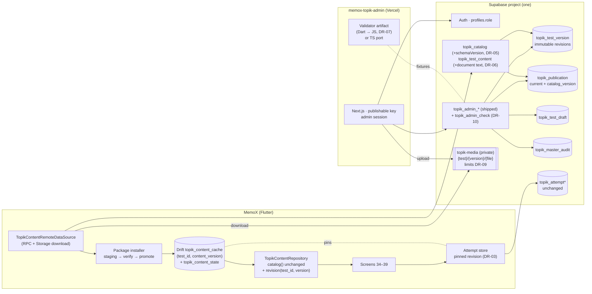
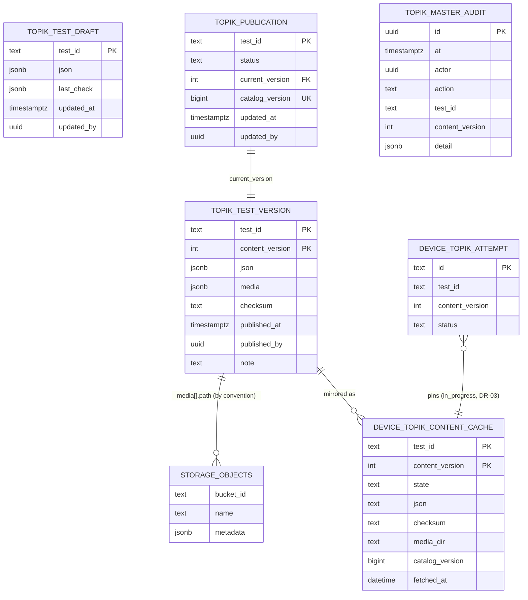

# TOPIK Master Data Architecture: Decision Package

Date: 2026-10-17 · Status: **decision package for owner review, nothing here is approved or built** · Baseline: `master` = `b420592f` (merge of pull request 306 of `ntgptit/memox-v8`), branch `ccr-b0d5b7c9-mlvno2` reset to it · Linear: epic DEV-394 (Done; the package is recorded as a comment there until a spec is approved and gets its own epic per CLAUDE.md "Progress on Linear").

This document is design only. It creates no migration, runs nothing against Supabase, changes no production Dart, Drift or SQL, deploys nothing and uploads no content. Every SQL, DDL and RPC contract below is a **candidate**, written as documentation. The one companion document is a **draft** ADR, [ADR-025](../../shared/decisions/ADR-025-ghim-luot-dang-lam-vao-phien-ban-noi-dung-topik.md), which stays `draft` until the owner rules; ADR-024 stays `active` and nothing here supersedes it.

It builds on, and never duplicates, the approved design [2026-10-16 Master Data and Admin Web](2026-10-16-topik-master-data-admin-web-design.md) (the **spec**) and [ADR-024](../../shared/decisions/ADR-024-master-data-topik-tren-supabase-va-admin-web.md). Where this package proposes a different answer, the proposal carries a status in the [Decision Register](#13-decision-register) and the spec's text stays the authority until the owner approves.

## 1. Executive summary

**Where the project stands.** The server side of ADR-024 is shipped: migration `supabase/migrations/20261016120000_topik_master_data.sql` is merged (pull requests 304 and 305) and was pushed to project `hgacyucfagsvolymlqto` by the `supabase migrations` workflow (run 31, owner-dispatched, 2026-10-17). It holds four tables (`topik_test_draft`, `topik_test_version`, `topik_publication`, `topik_master_audit`), eleven admin RPCs, two client RPCs, the private bucket `topik-media` with four Storage policies, and is pinned by 282 + 30 pgTAP assertions. The Flutter app still reads bundled assets, and `assets/topik/manifest.json` is `{"tests": []}`: **no TOPIK content has ever shipped to a device, and no real attempt exists**. The Admin Web does not exist yet. The learner-data store (`topik_attempt`, `topik_attempt_answer`, Drift v17, sync) is complete and unaffected.

**Recommended architecture.** Keep the shipped design as the authoritative Master Data model: one immutable JSON document per published revision, a global `catalog_version` cursor, retire as a tombstone, rollback as a new revision, media as immutable Storage objects under `{test_id}/{content_version}/{file}`, admin writes through `SECURITY DEFINER` RPCs gated by `profiles.role`, Storage access through policies limited to the bucket. A normalized question schema is **not** recommended: nothing reads questions with SQL, the Dart validator is the reference rule set, and a relational twin would be a second source of truth (§5.4). On top of the shipped baseline the package proposes seven targeted amendments, each small and additive:

1. **Pin an in-progress attempt to the revision it started on** (DR-03, the critical conflict of §6.5). Today an attempt started on revision 1 and submitted after revision 2 is published is silently re-graded on revision 2 and its `content_version` overwritten (`lib/features/topik/data/repositories/topik_attempt_repository_impl.dart:170-196`). With bundled content that could only happen across an app update; with foreground refresh it becomes an ordinary event. The recommendation changes BR-TOPIK-013 and BR-TOPIK-019 wording and the spec's §8.4, so it **requires the owner's approval**.
2. **Cache keyed by `(test_id, content_version)` with a retention state** so a pinned revision survives a newer publication until its attempt ends (DR-04; amends spec §8.2, not built yet).
3. **A verifiable document checksum**: the content RPC returns the stored document as text next to `checksum`, so the app hashes the exact bytes it received (DR-06). Today `md5(json::text)` is a Postgres rendering the client cannot reproduce from a Dart `jsonEncode`.
4. **`schemaVersion` in every catalog entry** so an older app skips content it cannot read instead of downloading and rejecting it (DR-05).
5. **Bucket limits** (`file_size_limit`, `allowed_mime_types`) and a **publish dry-run RPC** (DR-09, DR-10).
6. **One validator implementation in the Admin Web**, the Dart `checkTopikTest` compiled with `dart compile js`, in place of a hand-written TypeScript port (DR-07; amends ADR-024 #5 and O7, **requires the owner's approval**; the fixture contract stays either way).
7. **History stays reachable when a test is retired** on screen 36 (DR-11; a screen-state change, **requires the owner's approval**).

**What does not change.** Learner data (attempts, answers, sync, account switch), scoring of completed attempts, screens 34–39 as state machines (one state gains a hint, one screen gains a banner row), the audio door, routes, the `TopikContentRepository.catalog()` contract, the Dart validator as the reference, no service-role key in any client, no separate auth, no Phase B or C feature.

**Critical risks.** (a) The NIIED redistribution question is an explicit dependency, not a design input: every authenticated user, anonymous sign-in included, can read published media (§7.4, DR-14, `BLOCKED` on the owner). (b) A mid-attempt publication without pinning silently changes what a learner is graded on (§6.5). (c) The workflow's drift check covers `public,private` only, so a dashboard change to the bucket or its policies goes unnoticed (DR-15). (d) Storage behaviour is proven only on the real stack (pgTAP stub mirrors `protect_delete` alone). (e) A validator port that drifts; the fixture contract is the guard, and DR-07 removes the port.

**Roadmap.** Seven PRs ordered by dependency (§12): PR-01 Supabase contract additions → PR-02 validator artifact → PR-03 Flutter cache and distribution → PR-04 attempt pinning and screen 36 → PR-05 Admin Web (external repo) → PR-06 round 96 publication runbook → PR-07 documents and governance. PR-01, PR-03 and PR-05 can start as soon as the owner rules on the register; PR-04 waits on DR-03; PR-06 waits on the NIIED files.

## 2. Current-state architecture (verified at `b420592f`)

### 2.1 Content pipeline in the app (bundled, to be replaced)

| Piece | Where | What it does today |
|---|---|---|
| Manifest and packs | `assets/topik/manifest.json` (`{"tests": []}`); `pubspec.yaml:70` declares `assets/topik/` | Lists pack files by relative path; file names are free (`topik2/96/reading.json` in tests). No `{testId}.json` rule |
| Asset data source | `lib/features/topik/data/datasources/topik_content_asset_data_source.dart:19-82` | `rootBundle.loadString` of the manifest and each pack; media existence through `AssetManifest.listAssets()`; never throws for content, returns issues |
| Mapper and validator | `lib/features/topik/data/mappers/topik_test_mapper.dart:81-364`, `domain/models/topik_content_check_model.dart:18-253`, `data/mappers/topik_content_pack_mapper.dart:34-69` | JSON → `TopikTest` (shape issues), `checkTopikTest` (12 rules, `assetExists` injectable), `topikContentOf` (first valid id wins, invalid test rejected alone) |
| Repository | `lib/features/topik/domain/repositories/topik_content_repository.dart:5-8`; impl `data/repositories/topik_content_repository_impl.dart:10-52` | Interface is `Future<List<TopikTest>> catalog()` only. One `Future` cached for the app run; reset only when the load throws; `topik.content_rejected` logged per rejected test |
| Providers | `lib/features/topik/di/topik_content_repository_provider.dart:12-24` (`keepAlive`) | Builds the asset data source over `rootBundle`; six use-case providers read it |
| Test lookup | `domain/usecases/watch_topik_test_detail_use_case.dart:29-37` (`topikTestIn`) | Linear scan of `catalog()`; every use case resolves the **current** content |
| Audio | `data/datasources/plugin_topik_audio_player_data_source.dart:305` | The only `just_audio` importer (guard rule `topik_audio_plugin_has_one_door`); `ClippingAudioSource(child: AudioSource.asset(asset))` is the single asset-specific line |
| Images | `presentation/widgets/sections/topik_group_pane_widget.dart:117`, `topik_question_pane_widget.dart:75`, `topik_review_question_widget.dart:123` | `Image.asset(path)`, no `errorBuilder` |
| Lint | `tools/topik/topik_lint.dart:28-205`; gate tests `test/tools/topik_content_assets_test.dart`, `test/tools/topik_lint_test.dart` | The same `topikContentOf` over `dart:io`; checks pubspec folder declarations and case-exact file names |
| Fixture contract | `test/support/topik_contract_fixtures.dart`, `test/tools/topik_fixtures_export_test.dart` | 15 fixtures (4 valid, 11 broken) → `test/fixtures/topik/*.json` and the generated `supabase/tests/database/19_topik_master_fixtures.sql` |

### 2.2 Learner data (unchanged by this package)

- Drift v17 (`lib/core/database/app_database.dart:63`, `from16To17` at `:299-311`): `topik_attempt` and `topik_attempt_answer` (`lib/core/database/tables/topik.drift:5-87`) with the completed-immutable triggers, one open attempt per test (`idx_topik_attempt_one_open`), snapshot CHECKs; sync capture only on completion (`lib/core/database/tables/sync.drift:222-240`).
- `content_version` is written at start (`topik_attempt_repository_impl.dart:224`) and **overwritten at submit** with the current test's version (`:195`; `lib/core/database/queries/topik_queries.drift:80-83`). The only comparison in the feature is the Review banner `isContentChanged` (`domain/models/topik_views_model.dart:85-86`). `_sameQuestions` (`:270-279`) compares test id and the question-number set only.
- Scoring: `scoreTopikAttempt` (`domain/models/topik_attempt_score_model.dart:239-287`) inside `submit` (`:153-199`) writes per-answer `correct_idx`, `points`, `points_earned`, `question_type` and the attempt totals in one transaction that also fires the sync trigger (BR-TOPIK-013, BR-TOPIK-026).
- Account switch: `LocalDataReset` deletes every `topik_attempt` row (`lib/core/database/local_data_reset.dart:33-41`); completed attempts return by pull; in-progress attempts are device-local and lost (BR-TOPIK-027). Server merge moves attempts to the target account (`supabase/migrations/20261016000000_topik_attempt_sync.sql:394-475`).
- Server: insert-only `topik_attempt_upsert` with integrity checks only (BR-TOPIK-028); `content_version` checked for `> 0` alone (`:25`); **no FK and no lookup into Master Data**.

### 2.3 Server Master Data (shipped plan 1)

The spec §5–§6 describe the contract; the migration is the implementation. Facts the package relies on (all in `supabase/migrations/20261016120000_topik_master_data.sql`, "M16"):

- One jsonb document per published revision; `checksum = md5(json::text)` (M16:486); the server overwrites the stored JSON's `contentVersion` at publish (M16:431-497).
- `catalog_version` from `topik_catalog_version_seq` under `pg_advisory_xact_lock(7102, …)` (M16:406-412); per-test lock `(7101, hashtext(test_id))` (M16:394-400). Allocation order is commit order.
- Immutability triggers on `topik_test_version` and `topik_master_audit` with a null-only carve-out for `published_by` / `actor` (M16:85-122).
- `topik_catalog(since)` pages 500, retired entries are three-key tombstones (M16:671-701). `topik_test_content(test_id, version)` returns the bare jsonb document, `NOT_FOUND` unless it is the published current version (M16:705-720).
- Storage: bucket private, no `file_size_limit`, no `allowed_mime_types` (M16:733-735); policies call `topik_media_can_read/can_write/can_modify` (M16:738-783); path contract enforced at publish only (M16:460-471).
- Admin = `profiles.role = 'admin'` in Postgres, not a JWT claim (`supabase/migrations/20261010000000_accounts.sql:48-52`); anonymous sign-in is on, so anonymous users hold `authenticated` and can read the catalog, content and media.
- pgTAP: `18_topik_master_data.sql` 282 asserts, `19_topik_master_fixtures.sql` 30, `04_function_privileges.sql` pins 31 callable names including the three `topik_media_can_*` helpers. Not proven locally: storage-api triggers other than `protect_delete`, a direct `UPDATE` on `storage.objects`, hosted ownership, concurrency, `UNAUTHORIZED` on the admin RPCs.
- Workflow `.github/workflows/supabase-migrations.yml`: pgTAP → `db push` → `db diff --linked --schema public,private`.

### 2.4 Documents and their state

- Authority chain for TOPIK: BR/UC (`docs/features/topik/`) > spec 2026-10-15 (practice design) and spec 2026-10-16 (Master Data) > ADR-023 (active, #3 and #5 struck) and ADR-024 (active) > screen detail files 34–39.
- **Stale, factual** (fixed in this branch, see §12 PR-00): spec 2026-10-16 header line 3 and ADR-024 "Hệ quả" say the migration is not yet pushed.
- **Stale, pending plan 5 of the spec** (left for PR-07, listed in §15): spec 2026-10-15 lacks the "thay bởi ADR-024" annotations ADR-024 claims; UC-TOPIK-001…005 "API" lines say "nội dung đóng gói"; `docs/features/topik/README.md`, `PRODUCT.md:52`, screen 34 lines 6 and 19 say bundled; BR-TOPIK-008 summary line says one checker; `docs/features/topik/it-scenarios.md` IT-001/008/013 assume a bundle; no IT scenario for refresh, retire, new version or offline first run.
- **Open owner questions that interact with this package**: Q-A-8 (Review marks the snapshot's `correct_idx` beside current text, screen 39 line 86), Q-A-1/2/3 (unrelated to content distribution, listed for completeness in §16).

## 3. Target architecture



Three boundaries, as the spec §4 draws them, with two sharpened edges:

1. **Master Data** (global, owner-managed): revisions are immutable documents; the catalog is a pointer plus a cursor. Written by admin RPCs only; read by two client RPCs; never part of `sync_push`/`sync_changes`.
2. **Learner data** (per account): unchanged tables and sync. The link to Master Data is `(test_id, content_version)` without a foreign key. **New edge (DR-03):** while an attempt is in progress its `content_version` is a pin the app honours; once completed it is the revision scored on, as today.
3. **The app's content cache**: a rebuildable mirror of published revisions, never wiped on account switch. **New edge (DR-04):** a cached revision has a state (`current`, `retained`, `pending`, `failed`), and a `retained` revision is one an in-progress attempt still needs.

## 4. Baseline and impact analysis (Deliverable A)

Classification: **U** unchanged · **E** extended (new members, old behaviour kept) · **I** internal change (same contract, new implementation) · **N** new · **O** obsolete (removed). "Breaking" means a consumer or stored data must change.

| Component | Current responsibility | Proposed responsibility | Class | Breaking | Data migration | Compatibility concern | Risk | Required verification |
|---|---|---|---|---|---|---|---|---|
| `TopikContentAssetDataSource` + `assets/topik/` + pubspec folder | Read bundled packs | None | O | No consumer outside the provider | None (manifest is empty, nothing shipped) | Gate tests that walk `assets/topik/` lose their subject | Low | `test/tools/topik_content_assets_test.dart` re-pointed at fixtures; lint tests kept |
| `TopikContentRepository` (interface) | `catalog()` once per run | `catalog()` kept; `watchCatalog()` stream and `revision(testId, contentVersion)` added for pinning | E | No (additive) | None | Use cases that read `Stream.fromFuture(catalog())` must switch to the stream to see refreshes | Medium | Use-case tests with a fake that emits twice; existing 4 impl tests kept |
| `TopikContentRepositoryImpl` | Memo over the asset load | Reads the Drift cache, parses on read, re-emits on write | I | No | None | Parse cost per read (one document per test, tens of KB) | Low | Repository tests on an in-memory Drift db |
| `TopikContentRemoteDataSource` | — | RPC calls, Storage downloads, size/eTag and checksum verification | N | — | — | Supabase client errors mapped to codes, never to screens | Medium | Unit tests over a fake Supabase client; contract tests against pgTAP fixtures |
| Package installer (`TopikContentInstaller`) | — | Staging dir → verify → atomic promote → row write; startup sweeper | N | — | — | Crash between steps | Medium | Unit tests with an injected file system; crash-point tests |
| `RefreshTopikContentUseCase` | — | Catalog paging, per-entry install, cursor rule | N | — | — | Runs off the UI thread; minimum interval | Medium | Tests: retire, new version, failed download leaves cursor |
| Drift schema | v17 | v18: `topik_content_cache`, `topik_content_state` (create only) | E | No | None (new tables) | `test/drift/generated/schema_v18.dart`, migration test v17→v18 | Low | `migration_test.dart`, `schema_v18` verifier |
| Use cases (catalog, detail, attempt, review, start, submit) | Resolve current content | Catalog/detail: current content from the stream. Attempt/submit/review-of-in-progress: the **pinned** revision (DR-03); review of completed: current content (unchanged) | I | No (same signatures) | None | `topikTestIn` gains a version-aware sibling | Medium | 12 use-case tests + new pin tests |
| `TopikAttemptRepositoryImpl.submit` | Score against the passed test; overwrite `content_version` | Score against the passed (pinned) test; `content_version` kept equal to start (DR-03). `_sameQuestions` stays as a safety check | I | No | None | Existing test "a content correction made before submit is the one that scores" changes meaning → rewritten, not weakened | Medium | Submit tests: pinned revision scores; version mismatch never overwrites |
| `topik_attempt`, `topik_attempt_answer`, sync DAO, outbox, `sync_push`/`sync_changes`, `LocalDataReset` | Learner data | Unchanged | U | No | None | None | None | Existing suites (`topik_schema_test`, `topik_sync_trigger_test`, convergence, `17_topik_attempt_sync.sql`) |
| Audio door (`PluginTopikAudioPlayerDataSource`) | `AudioSource.asset` | `AudioSource.file` under the package dir; interface `setClip` keeps `asset` renamed `path` | I | No (door interface only) | None | The fake platform rewrites `uri.path`; test at `plugin_topik_audio_player_data_source_test.dart:75-84` updated | Low | Plugin tests; audio repository tests unchanged (18) |
| Image widgets (3 call sites) | `Image.asset` | `Image.file` with `errorBuilder` (a missing file shows a neutral placeholder) | I | No | None | Goldens unaffected when fixtures use the same placeholder | Low | Widget tests for the error builder |
| Screens 34–39 | State machines per detail file | 34: `noTests` gains an offline hint line (spec §8.3). 36: `testMissing` splits into `testMissing` and `testRetired` with History (DR-11). 37/39: unchanged states; 37 gains no state (pinning is invisible) | E | No | None | Detail files 34 and 36 updated; goldens for the two new looks | Medium | Widget tests + goldens; Impeccable critique/audit of the touched states (Tier 1) |
| `topik_catalog` | Entries without `schemaVersion` | Entry gains `schemaVersion` (DR-05) | E | No (additive key) | None | pgTAP "entry field set exact" updated | Low | pgTAP 18 |
| `topik_test_content` | Bare jsonb | Returns `{testId, contentVersion, checksum, document}` with `document` the `json::text` (DR-06) | I | **Yes for the contract, no for any consumer** (none exists) | None | Changing a pushed function needs a new migration with `create or replace`; the spec §6.2 text changes | Low | pgTAP 18: checksum equals `md5(document)` |
| `topik_admin_publish` and friends | As shipped | Unchanged; `topik_admin_check` added (DR-10) | E | No | None | Shared body refactored into `private.topik_publish_issues` | Low | pgTAP 18 |
| Bucket `topik-media` | Private, no limits | `file_size_limit`, `allowed_mime_types` (DR-09) | E | No | `update storage.buckets` | A future media type needs a migration | Low | pgTAP: bucket row |
| `topik_media_can_*` policies | As shipped | Unchanged | U | No | None | Helpers callable as RPCs (boolean oracle) | Low | pgTAP 18 + 04 |
| Fixture contract | Dart ↔ SQL | Dart ↔ SQL ↔ validator artifact (JS) | E | No | None | The Admin repo consumes `test/fixtures/topik/` | Low | New export of expected rule lists; Admin CI contract test |
| `tools/topik/topik_lint.dart` | Pack lint | Kept for fixtures and the content repo; the pubspec-folder rule becomes optional | I | No | None | None | Low | `topik_lint_test.dart` |
| Migrations workflow | pgTAP → push → diff `public,private` | Adds a post-push check of bucket and policies (DR-15) | E | No | None | `storage` schema is storage-api's; check only our rows | Low | A dry run of the workflow |
| Admin Web (`memox-topik-admin`) | — | MVP per spec §9, validator via artifact or port | N | — | — | Generated types and error codes pinned in its CI | Medium | Its own CI + fixture contract |
| Docs: BR-013, BR-019, BR-007, BR-008, UC-003/005, spec annotations, README, PRODUCT.md, schema.md | Bundled-era wording | Pinning wording, three gates, cache tables v18 | E | No | None | `tools/docs/check.py` | Low | `python3 tools/docs/check.py` |
## 5. Data model (Deliverable B)

### 5.1 Table inventory

Schema placement: the shipped tables live in `public` with RLS on, no policy and no client privilege, which is the project's established isolation mechanism (ADR-015 #5, pgTAP `01_schema_privileges.sql`, `18_topik_master_data.sql:15-30`). A dedicated schema `topik_master` would add nothing the grants do not already give, would need the PostgREST exposed-schema list reviewed, and would break the shipped pgTAP, the generated types the Admin Web will consume and the README's rule list. **Decision: stay in `public` with the `topik_` prefix** (DR-01, `APPROVED_DIRECTION`).

| # | Table | Status | Role | Granularity |
|---|---|---|---|---|
| 1 | `public.topik_test_draft` | shipped | Working copy per test id, may be invalid | one row per test id |
| 2 | `public.topik_test_version` | shipped | Immutable published revision: the document, its media manifest, checksum | one row per `(test_id, content_version)` |
| 3 | `public.topik_publication` | shipped | What clients see: current revision, status, global cursor | one row per test id |
| 4 | `public.topik_master_audit` | shipped | Append-only log of every change | one row per action |
| 5 | `public.topik_catalog_version_seq` | shipped | Global cursor source | sequence |
| 6 | `storage.buckets` row `topik-media` + `storage.objects` | shipped | Media bytes and their `size`/`eTag` | one object per file |
| — | `topik_master.question`, `option`, `question_group`, `media_asset`, `package` | **not proposed** | Normalized twin of the document | see §5.4 |

The Master Data store has no `package` table because the package **is** the revision (§8.2): `topik_test_version.json` + `topik_test_version.media` + the Storage objects the manifest lists. Adding a bundle artifact (one zip per revision) is recorded as an alternative in §8.2 and not recommended now.

### 5.2 Data dictionary (per table)

For each table: purpose · primary key · natural key · columns · constraints · FKs · indexes · immutability · owner · reader · size · retention · audit · RLS · why it exists. Shipped columns cite the migration; proposed items are marked **(P)**.

**`topik_test_draft`** (M16:11-19)
- Purpose: the admin's working copy; the only mutable content row.
- PK `test_id text`; natural key = the same (`topik{1|2}-{round}-{section}`).
- Columns: `json jsonb not null`, `last_check jsonb not null default '{}'` (the Admin Web's validator report), `updated_at timestamptz`, `updated_by uuid → auth.users on delete set null`.
- Constraints: `json->>'testId' = test_id`. **(P)** `octet_length(json::text) <= 4 MiB` (DR-09b, a size ceiling on documents; the TOPIK II reading paper with explanations and translations is well under 1 MiB).
- Immutability: none (deleted freely; deleting touches no version).
- Owner: admin via `topik_admin_draft_save/_delete`. Reader: admin via `_draft_get`, `_list`.
- Size: tens of rows. Retention: until deleted. Audit: `draft_save`, `draft_import`, `draft_delete`.
- Why: separates authoring from publication; a draft may be invalid.

**`topik_test_version`** (M16:22-38)
- Purpose: one immutable published revision.
- PK `(test_id text, content_version integer)`; natural key = the same; `content_version > 0`.
- Columns: `json jsonb not null` (the document, `contentVersion` inside equals the column), `media jsonb not null default '[]'` (array of `{path, size, eTag}` ordered by path), `checksum text not null` (`md5(json::text)`), `published_at`, `published_by uuid → auth.users on delete set null`, `note text`.
- Constraints: `jsonb_typeof(media) = 'array'`, `json->>'testId' = test_id`, `(json->>'contentVersion')::integer = content_version`. **(P)** none added; `schemaVersion` is read from `json->>'schemaVersion'` by the catalog RPC (DR-05), no column needed.
- FKs: none to the draft (a draft may be deleted). Indexes: PK only. **(P)** none: `topik_media_can_modify` scans `media` of all versions (unindexed); at tens of versions this is a non-issue, a GIN index on `media` is the remedy if it ever is.
- Immutability: trigger `private.topik_version_immutable` on UPDATE/DELETE/TRUNCATE, carve-out `published_by → null` only (M16:85-104).
- Owner: `private.topik_publish_version` (publish and rollback). Reader: admin `_versions`, `_version_get`; client `topik_catalog` (current only), `topik_test_content` (current only).
- Size: ≤ hundreds of rows, each tens to hundreds of KB. Retention: forever. Audit: `publish`, `rollback`.
- Why: the unit of grading determinism (an attempt pins to it, DR-03), of rollback and of cache identity.

**`topik_publication`** (M16:40-53)
- Purpose: the pointer clients follow.
- PK `test_id`; columns `status text check in ('published','retired')`, `current_version integer not null`, `catalog_version bigint not null unique`, `updated_at`, `updated_by → auth.users on delete set null`.
- FK `(test_id, current_version) → topik_test_version`. Index `idx_topik_publication_catalog (catalog_version)`.
- Immutability: mutable by design; every change takes a new `catalog_version` under advisory lock 7102 so the cursor is total-ordered by commit (M16:402-412).
- Owner: `private.topik_publish_version`, `private.topik_set_status`. Reader: `topik_catalog`, `topik_test_content`, admin `_list`.
- Retention: a retired row stays (tombstone). Audit: `publish`, `retire`, `unretire`, `rollback`.
- Why: a single, pageable "what changed since N" for every device.

**`topik_master_audit`** (M16:55-67)
- Purpose: who did what, when, inside the same transaction as the change.
- PK `id uuid`; columns `at timestamptz` (`clock_timestamp()`), `actor uuid → auth.users on delete set null`, `action` (7 values), `test_id text not null`, `content_version integer null`, `detail jsonb`.
- Indexes `(at desc, id desc)`, `(test_id, at desc)`. Immutability: `private.topik_audit_append_only` (carve-out `actor → null`).
- Owner: `private.topik_audit` (called by every admin RPC). Reader: admin `_audit` (paged, newest first).
- Retention: forever (no purge; volume is admin actions only).
- Why: ADR-024 #3 "mọi thay đổi ghi `topik_master_audit` trong cùng transaction".

**Storage `topik-media`** (M16:733-783)
- Objects `{test_id}/{content_version}/{file}`; `storage.objects.metadata` holds `size` and `eTag` that publish copies into `media`.
- **(P)** bucket row: `file_size_limit = 52428800` (50 MiB, the local config's figure), `allowed_mime_types = {audio/mpeg, image/jpeg, image/png, image/webp}` (DR-09).
- Immutability: a path listed in any version's `media` cannot be updated or deleted (`topik_media_can_modify`); storage-api's `protect_delete` refuses direct deletes anyway.
- Reader: `authenticated` with a `profiles` row, published test, existing version segment; admins read all.
- Retention: forever for listed objects; unlisted uploads (orphans of an abandoned publish) are the admin's to delete.

### 5.3 Integrity rules, in one place

| Rule | Where enforced | Test |
|---|---|---|
| A revision's document names its own `testId` and `contentVersion` | CHECKs on `topik_test_version` | 18:33-51 |
| A published revision never changes | triggers | 18:33-51 |
| `current_version` points at an existing revision | composite FK | schema |
| Exactly one publication row per test; retired keeps its version | PK + `current_version not null` | 18:425-459 |
| `catalog_version` strictly increases per change, commit-ordered | sequence under lock 7102 | 18:486-497 (single session; concurrency untested) |
| Shape rules identity/metadata/numbering/points/options/groups/languages | `private.topik_master_shape_issues` at publish | 18:102-194, 19 (fixtures) |
| Media paths follow `{test_id}/{v_next or existing}/{file}` and exist | `private.topik_publish_version` steps 4–6 | 18:337-389 |
| A published media object is immutable | Storage policy via `topik_media_can_modify` | 18:698-713, 736-781 |
| Draft `testId` equals the row key | CHECK + `draft_save` | 18:222-252 |
| **(P)** Document size ceiling | CHECK on draft and version | new pgTAP |
| **(P)** Bucket accepts only known media types and sizes | bucket row | new pgTAP |

### 5.4 Alternatives considered for the schema

| Option | What it is | Why not (or when) |
|---|---|---|
| **A. Document per revision (shipped)** | One jsonb per `(test_id, content_version)`; SQL checks the shape; Dart is the reference validator | **Recommended.** Matches how every consumer reads content (whole tests), the three-gate validator model, the fixture contract and 312 shipped assertions. One source of truth per revision |
| B. Normalized master schema (`test`, `revision`, `question_group`, `question`, `option`, `media_asset`) with the document generated at publish | Per-question rows, FKs, SQL diffs | No client flow reads questions with SQL; the Admin Web edits and diffs JSON; the validator rules (points sum, numbering, groups) are set-level and already in Dart and SQL. It doubles the representations (rows and the served document) and every content-schema change becomes a schema migration. Revisit only for analytics across questions or a question-level editor, as a **read projection** generated from the document, never as the source |
| C. Documents in Storage, no tables | JSON files + a manifest | Rejected in spec §3.3: no states, no audit, no SQL checks |
| D. Hybrid: document plus a thin `topik_media_object` table | Registry of media paths per revision | The `media` array already is that registry; a table would only add an index for `can_modify`, which the volume does not need |
| E. Dedicated schema `topik_master` | Namespace isolation | Grants already isolate; see §5.1 |

### 5.5 ERD (as shipped, with the proposed cache on the device)



### 5.6 Candidate DDL (documentation only; the real text is written in PR-01 and PR-03)

Server, additive, one new migration file (never an edit of the pushed one):

```sql
-- PR-01 · topik master data: contract additions (candidate)
alter table public.topik_test_draft
  add constraint topik_test_draft_size check (octet_length(json::text) <= 4194304);
alter table public.topik_test_version
  add constraint topik_test_version_size check (octet_length(json::text) <= 4194304);

update storage.buckets
  set file_size_limit = 52428800,
      allowed_mime_types = array['audio/mpeg','image/jpeg','image/png','image/webp']
  where id = 'topik-media';

-- topik_catalog: add 'schemaVersion', (page.json->>'schemaVersion')::integer, to the published entry.
-- topik_test_content: return jsonb_build_object('testId', test_id, 'contentVersion', v,
--   'checksum', checksum, 'document', json::text)  -- md5(document) = checksum, byte for byte.
-- topik_admin_check(p_test_id): require_topik_admin(); runs the shape, path and media checks of
--   private.topik_publish_version against the draft without writing; returns
--   {testId, nextContentVersion, issues[], mediaMissing[], mediaInvalid[]}.
```

Device (Drift v18, create only; PR-03):

```sql
CREATE TABLE topik_content_cache (
  test_id TEXT NOT NULL,
  content_version INTEGER NOT NULL CHECK (content_version > 0),
  state TEXT NOT NULL CHECK (state IN ('pending', 'current', 'retained', 'failed')),
  catalog_version INTEGER NOT NULL,
  json TEXT,                 -- NULL while pending or failed
  checksum TEXT,
  media_dir TEXT,            -- relative to the documents dir: topik/{test_id}/{content_version}
  fetched_at DATETIME,
  last_error TEXT,           -- a code, never shown
  PRIMARY KEY (test_id, content_version)
);
CREATE UNIQUE INDEX idx_topik_content_one_current
  ON topik_content_cache (test_id) WHERE state = 'current';
CREATE TABLE topik_content_state (
  name TEXT NOT NULL PRIMARY KEY,   -- catalog_cursor, last_refresh_at, schema_version_supported
  value TEXT NOT NULL
);
```

## 6. Identity, versioning and publication (Deliverable C)

### 6.1 Identity model

| Concept | Identifier | Where it lives | Rule |
|---|---|---|---|
| Test | `test_id` = `topik{1|2}-{round}-{section}` (`topik2-96-reading`) | document `testId`, every table key | Natural key, never renamed; the `form` (홀수형/짝수형) is a field of the document, not part of the id (BR-TOPIK-003: the answers are only right for the paper's form) |
| Revision | `(test_id, content_version)` | `topik_test_version` | `content_version` is per test, integer, server-assigned `max + 1`, never reused |
| Document schema | `schemaVersion` | document, **(P)** catalog entry | The app supports a set (`{1}` today); a document whose `schemaVersion` the app does not support is never downloaded (DR-05) |
| Catalog position | `catalog_version` | `topik_publication` | Global, monotonic, commit-ordered; the only cursor a device keeps |
| Document hash | `checksum = md5(json::text)` | `topik_test_version`, catalog entry | Server-computed over the stored rendering; **(P)** the content RPC returns that exact text so the client verifies it (DR-06) |
| Media file | `{test_id}/{content_version}/{file}` + `size` + `eTag` | `media` array, Storage | Immutable once listed; the version segment may be an older revision of the same test (rollback carries old paths) |
| Active publication | `topik_publication.status = 'published'` and `current_version` | `topik_publication` | Exactly one current revision per test; retired keeps it but hides it |
| Device package | `(test_id, content_version)` + `state` | `topik_content_cache` | Mirrors a revision; `current` serves the catalog; `retained` serves a pinned attempt |
| Attempt link | `topik_attempt.test_id`, `topik_attempt.content_version` | Drift, server | No FK; in progress = the pin (DR-03); completed = the revision scored on |

### 6.2 Twelve identity questions, answered

1. **What identifies a test?** `test_id`, derived from level, round and section; checked by the `identity` rule in Dart and SQL (`topik_content_check_model.dart:44`, M16:130-244).
2. **What identifies the content a learner saw?** The revision `(test_id, content_version)`. Nothing finer: options, stems and keys are properties of the revision.
3. **Is `content_version` global or per test?** Per test. The global ordinal is `catalog_version`, which orders publication events, not content.
4. **Can two revisions share a number?** No: PK and the server assigns `max + 1` under the per-test lock. Rollback produces a new number (O4).
5. **How does an older app recognise content it cannot read?** By `schemaVersion` in the catalog entry (DR-05). Today it would download the document, fail `checkTopikTest` (`schemaVersion == 1`) and silently drop the test; the device would show "No tests yet" with no reason.
6. **Who computes the checksum and over what?** The server, `md5(json::text)` of the stored jsonb rendering. A client can only verify it over the same text, hence DR-06. Until DR-06 lands, the checksum is a server-side change detector only (compare catalog entry vs cached value), and integrity on the device rests on TLS, `checkTopikTest`, the identity CHECKs and per-file `size`/`eTag`.
7. **What is "the active publication" for a client?** The latest catalog entry per `test_id` with `status = 'published'`; a later `retired` entry for the same id is the tombstone. Entries are applied in `catalog_version` order so the last one wins.
8. **What happens to identity on rollback?** Nothing to `test_id`; a new `content_version` with the old document; media paths keep their old version segments, which the read policy allows (any existing version).
9. **What happens on retire then unretire?** Two catalog entries, the second re-announcing the same `current_version`. A device that deleted the package re-downloads it; a `retained` package (pinned attempt) is simply promoted back (§8.5).
10. **How is the answer key tied to the paper's form?** By the revision: `form` is in the document; a different form would be a different `test_id` only if NIIED publishes it as a different paper. Today one form per round and section is assumed (BR-TOPIK-003).
11. **What may the Admin Web change about an id?** Nothing after the first publish. A wrong id is a new draft and a retire of the wrong one (audited). A draft never published can be deleted.
12. **Which identity does an attempt carry across devices and accounts?** `(test_id, content_version)` on the wire (`private.topik_attempt_change`), free of FK, so an attempt from a retired or never-published test still syncs and still has a Summary.

### 6.3 Versioning rules (shipped, reaffirmed)

Publish → `max + 1`, draft `contentVersion` must already say so (`VERSION_MISMATCH` otherwise) · Retire → tombstone entry, versions kept · Unretire → explicit, audited · Rollback → new revision, re-checked for shape, `rolledBackFrom` in audit · Publish/rollback on retired → `INVALID_STATE` · every change bumps `catalog_version` under the global lock. All proven in `18_topik_master_data.sql`.

### 6.4 Publishing pipeline (Deliverable E)

| Step | Actor | Input | Output | Fields written | Error codes | Shipped? |
|---|---|---|---|---|---|---|
| 1 Create draft | Admin Web → `topik_admin_draft_save(p_imported=true)` | pack JSON from `memox-topik-content` | draft row, issues[] | `json`, `last_check`, `updated_*`; audit `draft_import` | `VALIDATION_FAILED` (testId ≠ key, not an object), `FORBIDDEN` | yes |
| 2 Edit | Admin Web → `_draft_save(p_imported=false)` | edited JSON + validator report | draft row | same; audit `draft_save` | same | yes |
| 3 Validate | Admin Web validator (DR-07 artifact or TS port) locally; **(P)** `topik_admin_check` on the server | draft | report: Dart-rule issues; SQL shape issues; missing/invalid media | none | — | partly (SQL runs only inside publish today) |
| 4 Build | Admin Web | validated JSON | JSON with `contentVersion = max + 1`, media paths rewritten to `{test_id}/{next}/{file}` | none | — | Admin Web (plan 3) |
| 5 Upload | Admin Web → supabase-js Storage, admin session | files | objects under `{test_id}/{next}/` | `storage.objects` rows (`size`, `eTag` in metadata) | Storage 4xx (policy `insert` for admins; **(P)** mime/size limits) | yes (policies) |
| 6 Verify | **(P)** `topik_admin_check` | draft + bucket | `mediaMissing[]`, `mediaInvalid[]`, `issues[]`, `nextContentVersion` | none | — | proposed |
| 7 Publish | `topik_admin_publish(test_id, expected, note)` | draft | version row, publication row, catalog_version, audit | §2.3 | `VERSION_MISMATCH`, `VALIDATION_FAILED` (rules or `media`), `MEDIA_MISSING`, `INVALID_STATE`, `NOT_FOUND` | yes |
| 8 Activate | implicit in 7 | — | visible to clients on their next refresh | — | — | yes |

Mandatory properties and how they hold:
- **Immutability:** version rows and listed media never change (triggers, `can_modify`).
- **Atomicity:** steps 7–8 are one transaction; every check runs before any write (M16:431-497). Postgres and Storage metadata are consistent because `storage.objects` is a table in the same database; object **bytes** are the one thing outside the transaction, and a missing byte stream behind an existing row is a Storage failure the client's `size`/`eTag` check catches at download.
- **Validation:** three gates on one rule set (BR-TOPIK-008). The reference is Dart `checkTopikTest`. The server gate is a subset (seven rules). The Admin Web gate is **(P)** the same Dart code compiled to JS (DR-07): `tools/topik/validator_js/` with a small entry point `checkTopikJson(String json) → String issuesJson`, built by `dart compile js -O2`, published as a versioned artifact the Admin repo pins; the fixture contract runs over it in the Admin repo's CI and proves `artifact ≡ Dart` on every fixture (trivially, same code) and `SQL ⊆ Dart` as today. If the owner keeps the TypeScript port (ADR-024 #5 as written), the fixture contract is the only equivalence proof, as spec §7 says.
- **Auditability:** every step that writes has an audit row in the same transaction; the Admin Web shows `topik_admin_audit`.
- **Idempotency:** `expected_content_version` makes a repeated publish a `VERSION_MISMATCH`, never a duplicate; retire/unretire of the same status is `INVALID_STATE`.
- **Orphans:** objects uploaded under `{test_id}/{next}/` for a publish that never happened stay in the bucket; admins may delete them (not listed → `can_modify` true). A sweep is an Admin Web feature, not a server rule.
- **`memox-topik-content` integration:** the pipeline repo produces `{pack}.json` + media with the bundled-era `assets/topik/...` paths; the Admin Web import (step 1) or a build step in that repo rewrites them to the Storage path contract. Nothing in this repo depends on that repo's internals; the contract is the content schema (spec 2026-10-15 §4.1) and the fixtures.

### 6.5 The critical conflict: a publication while an attempt is in progress

**Today (built, approved):** an attempt started on revision 1 continues on whatever the catalog holds; at submit it is scored on the current revision, `content_version` and `max_score` are overwritten with the current revision's (`topik_attempt_repository_impl.dart:170-196`, `topik_queries.drift:80-83`), and only a changed question-number set is refused (`contentMismatch`). Stated in BR-TOPIK-013 ("bản sửa nội dung có trước lúc nộp là bản dùng để chấm"), spec 2026-10-15 §5.3, spec 2026-10-16 §8.4 and §12. With bundled content it could only happen across an app update that restarts the app, so it was never observed. With a cache refreshed on foreground it is the normal case for any learner who pauses mid-paper. The test "a content correction made before submit is the one that scores" (`test/features/topik/data/topik_attempt_repository_submit_test.dart`) pins the current rule.

| Option | Behaviour | What the learner sees | Determinism | Data model | Cost | Rule changes |
|---|---|---|---|---|---|---|
| **1. Grade against latest** (status quo) | Continue and score on the current revision; refuse only a different question set | Mid-attempt the stems or options may change under their feet; Review shows the version they were scored on | Low: the key may differ from the one in force when they answered; `content_version` at start is lost | None | None | None (but spec §8.4 needs the mid-attempt case spelled out) |
| **2. Pin to the starting revision** (recommended) | The attempt reads, continues and is scored on revision N it started on; the device retains revision N until the attempt is submitted or deleted; `content_version` is never overwritten | Nothing changes mid-attempt; after submit, Review shows the current revision with the existing banner when it differs | High: "what you saw is what you were graded on"; `content_version` becomes a reliable fact for Review and Phase B | Cache keyed by revision with a `retained` state (DR-04); `TopikContentRepository.revision(testId, version)`; attempt/submit use cases resolve the pinned revision | One extra package per open attempt (at most one per test per device); eviction rule; ~6 files | BR-TOPIK-013 third paragraph, BR-TOPIK-019 third bullet, spec 2026-10-15 §5.3 last sentence, spec 2026-10-16 §8.4, screen 37 row "submit refused", UC-TOPIK-003 postcondition |
| 3. Pin, and refuse to continue when the pinned package is gone | As 2, but if the device lost revision N (cache cleared, reinstall) the attempt is `contentMissing` → Delete | A dead end only after local data loss; in-progress attempts are already device-bound and lost on account switch (BR-TOPIK-027) | High | As 2 | As 2 | As 2 |
| 4. Pin with fallback | As 2; if revision N is gone and the current revision has the same question set, re-pin to current with a one-time notice | Rare notice; no dead end | Medium | As 2 plus a re-pin path | More states on 37 | As 2 plus a new 37 state |
| 5. Freeze the key at start | Snapshot `correct_idx`/`points` into answers at start, grade from the snapshot | Learner sees current text but is graded on the start key | Medium | Breaks BR-TOPIK-013 "store nothing about correctness while in progress" and the Drift CHECK that snapshot columns are all-or-nothing at completion | Schema change to learner data | Large |

**Recommendation: option 2 with option 3's rule for the lost-package case** (strict pin; no fallback). Reasons: (a) it is the only option that keeps the content stable **while** the learner is answering, which is the actual harm; (b) it needs no change to learner-data tables, sync or the server; (c) `content_version` stops being overwritten, so a completed attempt's version is both the one started and the one scored on, which simplifies BR-TOPIK-019 and gives Q-A-8 a clean footing later; (d) the retention cost is bounded by BR-TOPIK-011 (one open attempt per test per device); (e) the dead end of option 3 is already the project's rule for in-progress attempts after local data loss. Option 4 adds a state for a case that today ends in loss anyway; option 5 breaks an invariant.

**Impact on BR-TOPIK-013:** the third paragraph becomes "While the attempt is `in_progress`, nothing about correctness is stored; at submit the attempt is graded on the revision it started on (`content_version`), which the device retains until the attempt ends." **Impact on BR-TOPIK-019:** the third bullet becomes "Continue is refused, with an offer to delete, when the attempt's revision is no longer on the device (retired, or lost) or no longer matches the attempt's questions." The `contentMismatch` refusal at submit stays as a defence in depth and is finally written into BR-TOPIK-019 and UC-TOPIK-003 (today it exists only in spec 2026-10-16 §8.4 and screens 37/39). Completed attempts: **no change** to scoring, Summary or Review.

**Retired test, open attempt:** the retire tombstone deletes `current` packages; a `retained` package pinned by an open attempt is deleted too and the attempt becomes `contentMissing` → Delete, as BR-TOPIK-019 already rules for a test that is "gone". The alternative (let the pinned attempt finish on the retained revision) is listed in §16 as a question, not recommended: a retire is the owner saying the paper must not be practised.

**Status:** DR-03 `PROPOSED`, `REQUIRES_OWNER_APPROVAL` (it changes two active BRs, an approved spec sentence and a screen row). Until approved, the status quo stands and PR-04 does not start; PR-03's cache is designed so either answer fits (the `retained` state is simply never used under option 1).
## 7. Security (Deliverable D)

### 7.1 Principals

| Principal | How it appears to Postgres | Who it is in practice |
|---|---|---|
| Anonymous (no session) | role `anon` | A request without a JWT; the app never makes one after `Supabase.initialize` signs in anonymously (ADR-015 #4) |
| Authenticated | role `authenticated`, `auth.uid()` set; `private.require_current_profile()` demands a `profiles` row | Every signed-in app user, **anonymous sign-ins included** (`supabase/config.toml:177`) |
| Admin | `authenticated` whose `profiles.role = 'admin'` (`private.is_admin()`) | The owner, through the app or the Admin Web; never an anonymous user (`role_set` refuses, `ANONYMOUS_USER`) |
| Trusted service | `postgres` / `service_role` | Only the migrations workflow (`db push`) and the owner's SQL console. **No client, server component or Edge Function holds it** (M7) |

### 7.2 Access matrix (shipped unless marked **(P)**)

| Operation | Anonymous (`anon`) | Authenticated (incl. anonymous sign-in) | Admin | Trusted service |
|---|---|---|---|---|
| Read catalog (`topik_catalog`) | denied (no EXECUTE) | allowed, needs `profiles` row (`UNAUTHORIZED` otherwise) | allowed | n/a |
| Read a published revision's document (`topik_test_content`) | denied | allowed, current revision only | allowed | n/a |
| Read a superseded revision's document | denied | **denied** (`NOT_FOUND`); pinning relies on local retention, not re-download (§6.5) | admin `_version_get` | n/a |
| Download published media (Storage `select`) | denied (no policy) | allowed for `{published test}/{any existing version}/…` with a `profiles` row | whole bucket | n/a |
| Download draft media (uploaded, not yet listed) | denied | denied | allowed | n/a |
| Upload media (`insert`) | denied | denied | bucket `topik-media` only; **(P)** mime and size limits | n/a |
| Update/delete media | denied | denied | only objects no revision lists | storage-api refuses direct `DELETE` regardless |
| Read drafts, versions, audit (`topik_admin_*` reads) | denied | `FORBIDDEN` | allowed | n/a |
| Save/delete draft, publish, retire, unretire, rollback | denied | `FORBIDDEN` | allowed | n/a |
| **(P)** Publish dry-run (`topik_admin_check`) | denied | `FORBIDDEN` | allowed | n/a |
| Direct table access (`select … from topik_*`) | denied | denied (RLS on, no policy, no grant) | denied (an admin is still `authenticated`) | yes |
| Change roles (`role_set`) | denied | `FORBIDDEN` | allowed (not the last admin, not an anonymous target) | yes |
| Call `topik_media_can_read/write/modify` directly | denied | allowed (boolean) | allowed | n/a |

### 7.3 Authorization options compared

| Option | Shape | Pros | Cons | Verdict |
|---|---|---|---|---|
| RLS policies on the master tables, direct table access | `select` policy for authenticated on published rows, `all` for admins | Fewer functions; PostgREST filtering for free | Breaks ADR-015 #5 and pgTAP 01/18; exposes raw rows and column names to clients; admin checks per table; harder to audit | Rejected |
| **Privileged RPCs (`SECURITY DEFINER`, `search_path = ''`, `EXECUTE` to authenticated, admin check first)** | As shipped for every table | Matches every other RPC in the project; one entry per operation; audit in the same transaction; error codes enumerable; pgTAP pins the callable list | Every read is a function; paging by hand | **Recommended, shipped** |
| Edge Functions for admin writes | Deno functions with a service key | A place for secrets or heavy work | Needs a secret; a second runtime to test and deploy; nothing here needs it (spec §3.3) | Rejected now; revisit only if media signing needs a secret |
| **Hybrid: RPCs for tables + Storage policies for the bucket** | As shipped | Storage has no other mechanism; policies call security-definer helpers so the logic is one SQL function per verb | The documented exception to ADR-015 #5 (O1); the helpers must be executable by `authenticated` | **Recommended, shipped (O1)** |

### 7.4 Security concerns and their handling

| # | Concern | Evidence | Handling | Status |
|---|---|---|---|---|
| S1 | Anonymous-sign-in users can read every published document and media file | `config.toml:177`; grants to `authenticated` | Accepted by ADR-015 #4 / ADR-024 #7 for a personal app. **Depends on DR-14** (redistribution of NIIED papers): if the owner restricts, the gate is `require_current_profile()` plus a `profiles.role` or an "is not anonymous" check in `topik_catalog`, `topik_test_content` and `topik_media_can_read`, one migration | `BLOCKED` on the owner (DR-14) |
| S2 | Correct answers live on the client (the document carries `answerIdx`) | spec 2026-10-15 §4.1 | Unavoidable for offline grading (BR-TOPIK-028: the server never grades). The papers and keys are public NIIED material. Accept; never add client-side obfuscation | `APPROVED_DIRECTION` (ADR-023 #4) |
| S3 | `topik_media_can_*` helpers are public RPCs | `04_function_privileges.sql:26-35` | They return booleans; `can_modify(name)` is a path-existence oracle over published media, which the same caller may read anyway. Keep; note in README | Accepted |
| S4 | No bucket `file_size_limit` / `allowed_mime_types` | M16:733-735 | DR-09: set both in PR-01; a mistaken upload type cannot enter | `PROPOSED` |
| S5 | Drift check ignores `storage` | workflow `:67-82` | DR-15: after `db push`, a query against the linked project asserting the bucket row and the four policy names (via `supabase db query` or psql with the CI password), or a periodic row in the `usage` workflow | `PROPOSED` |
| S6 | A deleted user's live JWT | `require_current_profile()`; `topik_media_can_read` checks the `profiles` row | Already closed for RPCs and media | Done |
| S7 | Admin demotion latency | `is_admin()` reads `profiles`, not the JWT | Instant | Done |
| S8 | Concurrency of publish/retire | single global lock 7102 | Serialised; no test exercises two sessions (pgTAP is single-session). Accept at this volume; a `pg_sleep`-free two-connection test is not available in pgTAP | Accepted, noted |
| S9 | Storage path contract enforced at publish only; an admin can upload any name | M16:460-471 | Harmless (unlisted objects are deletable by admins; readers see only published prefixes). **(P)** the Admin Web only uploads under the next-version prefix | Accepted |
| S10 | `UNAUTHORIZED`/`NOT_AUTHENTICATED` on admin RPCs untested | `18:213-220` covers `FORBIDDEN` only | Add two asserts in PR-01 | `PROPOSED` |
| S11 | Document size unbounded | no CHECK | DR-09b size ceiling | `PROPOSED` |
| S12 | Service-role key anywhere in a client | M7, spec §9 | Admin Web env holds URL + publishable key only; PR-05's CI greps for `service_role` | `APPROVED_DIRECTION` |

### 7.5 pgTAP security test matrix (shipped ✓, proposed ＋)

| Assertion | Anonymous | Authenticated | Admin | File |
|---|---|---|---|---|
| Master tables: RLS on, no policy, no grant | ✓ | ✓ | ✓ | 18:11-30 |
| `topik_catalog` / `topik_test_content` | ✓ permission denied | ✓ ok; ✓ `UNAUTHORIZED` without profile | ✓ | 18:508-573 |
| Every `topik_admin_*` | ＋ permission denied | ✓ `FORBIDDEN`; ＋ `UNAUTHORIZED` without profile; ＋ `NOT_AUTHENTICATED` with null uid | ✓ ok | 18:213-220, 281-286 |
| ＋ `topik_admin_check` | ＋ | ＋ `FORBIDDEN` | ＋ issues without a write (no version/audit row) | new |
| Storage `select` policy | ✓ nothing | ✓ published prefix, existing version only; ✓ retired/unpublished denied; ✓ malformed names denied | ✓ whole bucket | 18:714-781 |
| Storage `insert` | ✓ denied | ✓ denied | ✓ bucket only | 18:736-781 |
| Storage `update`/`delete` on a listed object | — | ✓ 0 rows | ✓ 0 rows | 18:698-713 |
| ＋ Bucket row has `file_size_limit` and `allowed_mime_types` | — | — | — | new |
| ＋ Catalog entry carries `schemaVersion`; `topik_test_content.document` text has `md5 = checksum` | — | ＋ | — | new |
| ＋ Anonymous-sign-in caller (`is_anonymous` claim) reads catalog | — | ＋ (documents S1 either way) | — | new |
| Immutability of versions/audit; actor nulling on account deletion | ✓ | ✓ | ✓ | 18:33-71 |
| Callable-function list unchanged except the additions | ✓ | ✓ | ✓ | 04 (plan 9 → updated list) |

## 8. Offline distribution (Deliverables F and G)

### 8.1 Catalog and refresh (shipped server, planned client)

- **API:** `topik_catalog(since)` → `{entries[], next, more}`; entries ordered by `catalog_version`; a published entry `{testId, status, catalogVersion, contentVersion, checksum, media[], level, round, section, titleKo, tags[], (P) schemaVersion}`; a retired entry `{testId, status, catalogVersion}`. `topik_test_content(testId, contentVersion)` → **(P)** `{testId, contentVersion, checksum, document}`.
- **Tokens:** the device keeps one `catalog_cursor` (bigint) in `topik_content_state`; the server keeps nothing per device.
- **Trigger:** app start and return to foreground when online, minimum interval (O5); never from a screen's UI thread; a failure is logged, never shown (spec §8.3).
- **Order of application:** entries in `catalog_version` order; retired → remove `current` (and `retained`, §6.5) packages of that test; published with a `(testId, contentVersion)` not `current` → install; published and already `current` with equal checksum → nothing.
- **Cursor rule:** advance only after every entry of the page has a terminal outcome. **(P) refinement:** a failed install writes a `failed` row for `(testId, contentVersion)` with `last_error`, counts as terminal for the cursor, and is retried on the next refresh by scanning `failed` rows, so one broken download never blocks later entries. This refines spec §8.3 step 2 (which leaves the cursor on any failure) without changing its guarantee: nothing is served until it is verified.
- **Activation:** a revision becomes visible to clients on their next refresh; there is no server-side scheduling.
- **Unpublish:** retire; clients delete on the next refresh; attempts keep their snapshots.
- **Interrupted downloads:** the installer works in a staging directory (§8.4); a half-downloaded package is swept at the next start and re-downloaded.
- **CDN:** Supabase Storage is fronted by its CDN; for a private bucket every request carries the user's JWT and the policy runs per request. Egress on the Free plan is 5 GB/month (O8); one round is tens of MB; one device downloads a revision once. Monitor through the weekly `usage` workflow once it reads Storage (it does not today).
- **Backward compatibility:** a device skips entries whose `schemaVersion` it does not support (DR-05) and keeps serving what it has; an app update that adds support picks them up at its next refresh because they are still in the catalog (the cursor is advanced past them, so **(P)** the device records skipped `(testId, contentVersion, schemaVersion)` rows as `failed` with `last_error = 'SCHEMA_UNSUPPORTED'`, and the retry scan covers them).
- **Download policy:** every published test is downloaded (spec §8.3, approved). On-demand media per test is recorded as a future option (DR-13) with the trigger "total published media above ~200 MB or a second user".

### 8.2 The package unit

A **package** is one revision as installed on a device: the document (as text, verified), its media files, and the `topik_content_cache` row that makes it visible. It is versioned and immutable by construction (its identity is `(test_id, content_version)`; nothing ever rewrites a file under `topik/{test_id}/{content_version}/`). No new server artifact is needed: the server already serves exactly the package's parts with the integrity data the device needs (document checksum, per-file `size` and `eTag`).

| Alternative | Why not now |
|---|---|
| One zip per revision built at publish (an Edge Function or the Admin Web) | A second artifact to keep consistent with the version row; needs a server-side builder (Edge Function or client-side zip upload) and a hash of the zip; doubles storage; loses per-file resumability. Worth it only if the file count per revision grows past a few dozen (today: one or two audio files and a handful of images) |
| Media on demand, document eagerly | Fewer bytes per device; adds "Download" states to screens 35/36 and an explicit "not downloaded" refusal on Start. Deferred (DR-13) |
| Relational cache in Drift | Rejected in spec §3.3; nothing reads questions with SQL on the device either |

### 8.3 Storage security for distribution

Private bucket with policy, downloads through the Supabase client with the user's session (no signed URLs, no secret, spec §6.4). Signed URLs would add a server round-trip per file and a URL lifetime to manage for no gain while readers are authenticated users. A **public** bucket would let the CDN cache freely but would make every NIIED file world-readable by URL, which is exactly what DR-14 must rule on first. Offline: once installed, nothing is fetched. Licensing: see DR-14. Correct answers on the client: S2.

### 8.4 Flutter offline cache: components, states, transitions

Components (all `lib/features/topik/data/`, names indicative):

| Component | Responsibility | Depends on |
|---|---|---|
| `TopikContentRemoteDataSource` | `catalog(since)`, `document(testId, version)`, `downloadMedia(path) → bytes/stream` | `SupabaseClient` (RPC + Storage); maps errors to codes |
| `TopikContentInstaller` | Install one revision: staging → download → verify (size/eTag per file, `md5(document) == checksum`, `topikTestOf` + `checkTopikTest` with `assetExists` over the staged files) → promote (rename dir) → write row `current`, demote the previous `current` to `retained` or delete it → sweep | file system abstraction (injectable root), Drift DAO |
| `TopikContentCacheDao` | Rows of `topik_content_cache` and `topik_content_state`; `watchCurrent()`, `current(testId)`, `revision(testId, version)`, `retain/unretain` | Drift |
| `RefreshTopikContentUseCase` | The refresh loop of §8.1 | remote, installer, dao, connectivity, clock |
| `TopikContentRepositoryImpl` | `catalog()` and `watchCatalog()` over `current` rows; `revision(testId, version)` over any row | dao, mapper |
| Audio door | `AudioSource.file(File(path))` instead of `AudioSource.asset` | unchanged interface |
| Sweeper (part of the installer, run at start) | Delete staging dirs; delete dirs with no row; delete rows with no dir (→ `failed`) | file system, dao |

Storage decision: **hybrid**. The document and its metadata live in Drift (`json TEXT` in `topik_content_cache`, parsed on read; one document is tens to hundreds of KB, well inside SQLite's comfort and the existing pattern "one document row, never joined", spec §8.2). Media live as raw files under the app's documents directory (`topik/{test_id}/{content_version}/{file}`), because `just_audio` and `Image.file` need paths and SQLite blobs would be copied out on every play. Not chosen: documents as raw files (loses transactional state and the `watch` stream Drift gives), everything in Drift (blobs), a relational cache.

Cache states per `(test_id, content_version)`:

| State | Meaning | Visible to `catalog()` |
|---|---|---|
| (absent) | Not announced or deleted | no |
| `pending` | Announced; staging in progress or scheduled | no |
| `current` | Verified and promoted; the revision the catalog serves for this test (at most one per test, unique index) | **yes** |
| `retained` | Superseded by a newer `current`, kept because an in-progress attempt pins it (DR-03) | no (served only through `revision()`) |
| `failed` | Install failed; `last_error` holds the code; retried on refresh | no |

Transitions:

| From | Event | To | Side effects |
|---|---|---|---|
| absent | catalog entry `published`, version not current, `schemaVersion` supported | pending | row written; staging dir created |
| absent | entry `published`, `schemaVersion` unsupported | failed (`SCHEMA_UNSUPPORTED`) | row written, nothing downloaded |
| pending | all files verified, document verified and valid | current | rename staging → final; previous `current` of the test → `retained` if an in-progress attempt pins it, else deleted with its dir |
| pending | any verification fails, network error, disk full | failed | staging dir deleted; `last_error` |
| pending | app killed | pending (then swept) | sweeper at start: staging dir deleted, row → failed (`INTERRUPTED`) |
| failed | next refresh | pending | retry |
| current | entry `retired` | absent | row and dir deleted; a `retained` row of the same test deleted too (§6.5) |
| current | entry `published` with a newer version | retained or absent | as above, after the newer one is `current` (the old one serves until then: no gap) |
| retained | its attempt submitted or deleted | absent | row and dir deleted |
| retained | entry `unretire` of the same version | current | promote back |
| any | `catalog()` read | same | reads `current` rows only |

Atomic installation and crash survival: (1) write `pending`; (2) download every file to `topik/.staging/{test_id}/{content_version}/`; (3) verify each file's `size` and `eTag` (a `null` skips that check only), verify `md5(documentText) == checksum`, parse and `checkTopikTest` with `assetExists` = "staged file exists"; (4) `rename` the staging dir to the final path (atomic on one filesystem); (5) in one Drift transaction: row → `current` with `media_dir`, previous `current` → `retained` or deleted, `catalog_version` recorded; (6) delete the demoted dir outside the transaction if it was not retained. A crash before (4) leaves staging only; between (4) and (5) leaves a final dir without a `current` row (swept, re-downloaded: the files are immutable so this is only wasted bytes); after (5) is complete. **A failed update never touches the existing `current` package**: it is demoted only inside the transaction that promotes the verified replacement.

Eviction: `current` rows live as long as the publication; `retained` rows live as long as their attempt; `failed` rows are retried, and deleted when the test is retired. No size cap is needed at the planned volume; a cap would be a Phase B item with DR-13.

Audio abstraction: the single `just_audio` door stays (`PluginTopikAudioPlayerDataSource`, guard rule); `TopikAudioClip.asset` becomes `TopikAudioClip.path` (a file path resolved from the package's `media_dir` + the document's media path), `ClippingAudioSource(child: AudioSource.file(File(path)))`. The fake platform's `/clips/` rewrite and the test at `plugin_topik_audio_player_data_source_test.dart:75-84` follow. Nothing else in the audio stack changes (18 repository tests stay).

## 9. Existing MemoX integration (Deliverable H)

### 9.1 Per-rule impact

| Rule | Current | Proposed | Reason | Compatibility | Migration | Tests | Approval |
|---|---|---|---|---|---|---|---|
| BR-TOPIK-007 version | Published immutable, server-assigned | unchanged | — | — | — | pgTAP 18 | none |
| BR-TOPIK-008 three gates | Dart ref, SQL subset, TS port | Third gate = Dart compiled to JS (DR-07) **or** TS port | one implementation beats a proven-equal port | fixture contract either way | — | Admin CI contract test | **owner** (DR-07) |
| BR-TOPIK-010 lifecycle | `in_progress` → `completed` or deleted | unchanged | — | — | — | existing | none |
| BR-TOPIK-011 one open attempt per test | unchanged | unchanged; bounds the retention cost | — | — | — | existing | none |
| BR-TOPIK-013 scoring at submit | Graded on current content; `content_version` overwritten | Graded on the pinned revision; `content_version` kept (DR-03) | determinism | completed attempts unchanged; the wire row unchanged | none | submit tests rewritten (meaning changes) | **owner** (DR-03) |
| BR-TOPIK-019 content changed | Summary snapshot; Review current + banner; continue refused when gone/invalid | Same for completed attempts; continue refused when the **pinned revision** is gone or mismatched; `contentMismatch` written in | pin | — | none | views/use-case tests | **owner** (DR-03) |
| BR-TOPIK-026 only completed sync | unchanged | unchanged | — | — | — | convergence tests | none |
| BR-TOPIK-027 account switch wipes TOPIK | Attempts wiped; cache not user data | unchanged; the cache survives; a `retained` package whose attempt was wiped is deleted at the next sweep | cache is global | — | none | `local_data_reset_test` + sweep test | none |
| BR-TOPIK-028 server integrity only | `content_version > 0` only | unchanged (no lookup into Master Data) | server never grades | — | none | pgTAP 17 | none |
| BR-TOPIK-020/021/022 progress, history, status | From snapshots; `max_score` always 100 (BR-TOPIK-002) so cross-version means are sound | unchanged | — | — | — | existing | none |
| BR-TOPIK-023/024 summary | Snapshot only | unchanged | — | — | — | existing | none |
| UC-TOPIK-002 detail | `testMissing` hides History | **(P)** `testRetired`: History and Summary links stay, no Start (DR-11) | a retire is now an ordinary event | screen 36 detail file | none | widget + golden | **owner** (DR-11) |
| UC-TOPIK-003 attempt | Current content | Pinned revision (DR-03) | — | — | — | use-case tests | owner (DR-03) |
| UC-TOPIK-005 review | Current content + banner; Q-A-8 open | unchanged in this package | Q-A-8 is the owner's | — | — | — | Q-A-8 stays open |

### 9.2 Snapshots and version references

- Completed attempts: unchanged snapshot (`correct_idx`, `points`, `points_earned`, `question_type`, totals) and `content_version` = revision scored on. The wire row and server checks are untouched.
- In-progress attempts: `content_version` becomes the pin (DR-03). No new column: the semantics of an existing column sharpen, and the Drift CHECKs already allow it.
- History, progress, Summary, Review: unchanged readers. Review of a completed attempt stays on the current revision with the banner (BR-TOPIK-019); whether it should show the pinned revision's text is a later question (needs superseded documents on the device or a server read of old revisions, both out of scope).
- Account switching, anonymous accounts, linking and merging: unchanged; the cache is not account data; `merge_user_data` moves attempts by `user_id` and never reads content.
- Sync: unchanged. A pulled attempt for an unknown `test_id` is stored as today (no FK); one for an unknown level/section/mode is skipped (existing behaviour, `topik_attempt_sync_dao.dart:79-86`), noted in §16.

### 9.3 Phase B conceptual ownership (no tables now)

| Phase B item | Owner | Key | Sync | Notes |
|---|---|---|---|---|
| Bookmarks | learner data, device-first + outbox like attempts | `(test_id, question_no)` + `content_version` seen | yes, as rows | a bookmark outlives a retire; shows "unavailable" like Review |
| Notes | learner data | `(test_id, question_no)` + `content_version` | yes | text only |
| Progress (Score Trend, Needs Review) | derived from attempts | — | no (derived) | BR-TOPIK-029/030 drafts |
| Words → flashcards | learner data through the **existing deck/card contracts** (`lib/features/deck`, `lib/features/card`) | a deck per test or per level; a card per `TopikWord` | existing deck/card sync | content stays Master Data; the card copies `ko`/`vi`/`en`/`pos` at creation (a card is the learner's) |
| Exam mode | app behaviour on the same revision | — | — | BR-TOPIK-032 draft; needs no Master Data change (`playCount` is in the document) |
| Estimated grade | derived | — | — | BR-TOPIK-031 draft |

None of these needs a Master Data change; all key on the revision the learner used, which is why pinning (DR-03) matters before Phase B.
## 10. Migration and compatibility strategy (Deliverable I)

Thirteen points, each with its answer at this baseline:

| # | Point | Answer |
|---|---|---|
| 1 | Installed base with bundled content | **None.** `assets/topik/manifest.json` is empty on every shipped build; no device holds TOPIK content or a real attempt. There is no content data to migrate |
| 2 | Drift schema | v17 → v18, create-only (two tables, one index). `from17To18` adds no row changes and no outbox seed. `test/drift/generated/schema_v18.dart` and a migration test as for v17 |
| 3 | Attempt rows | Unchanged shape. Under DR-03 the meaning of `content_version` on in-progress rows sharpens; existing in-progress rows (none in production) would be treated as pinned to their recorded version |
| 4 | Server schema | Additive only: new CHECKs, bucket row update, `create or replace` of two client RPCs and one new admin RPC, in a **new** migration file. The pushed migration is never edited (README rule) |
| 5 | RPC contract | `topik_catalog`: additive key. `topik_test_content`: return shape changes (DR-06); no consumer exists, the spec §6.2 text and pgTAP 18 change in the same PR |
| 6 | Admin Web | Starts against the PR-01 contract; generated types committed in its repo and checked in CI (spec §9) |
| 7 | App compatibility window | An app built before PR-03 never calls the RPCs. An app with PR-03 and a server without PR-01: `schemaVersion` absent → treat as 1; `topik_test_content` returning a bare document → the client must accept both shapes during the window **or** PR-01 is pushed before PR-03 ships (recommended order; the roadmap enforces it) |
| 8 | Reversibility | Every server change is reversible by a follow-up migration (drop CHECKs, revert bucket limits, `create or replace` back). Content: retire or rollback RPCs. App: the cache is rebuildable; dropping v18 tables is a downgrade the project never does (forward-only migrations), so a rollback of PR-03 is a new app build that ignores the tables |
| 9 | Data at risk | Only the device cache (rebuildable) and in-progress attempts (already device-bound). Completed attempts and the server Master Data are never touched |
| 10 | Rollout gates | Server: pgTAP green locally (`tools/supabase/image_pgtap.sh`) → PR merged → workflow run (pgTAP on the real CLI stack, `db push`, drift check) green. App: `dod_check.sh` green, goldens reviewed, IT scenarios for refresh/retire/new version/offline first run executed. Admin Web: its CI incl. the fixture contract. Content: round 96 validated against the official 정답·배점표 before publish |
| 11 | Rollback gates | Server: a failing workflow stops before `db push` (nothing applied). App: a release is withdrawn, the cache stays harmless. Content: `topik_admin_retire` hides a bad paper within one refresh interval; `topik_admin_rollback` restores a prior revision as a new one |
| 12 | Observability | `topik.content_rejected`, new `topik.content_install_failed` (code, testId, version) through the existing `appLogger` → `log_push`; the admin monitoring screen already reads `app_log`. Server: `topik_master_audit` |
| 13 | Order of operations | PR-01 pushed → PR-03 released → PR-05 deployed → first publish (round 96) → PR-04 (pinning) can ship before or after the first publish; before is cleaner (no live in-progress attempts to reason about) |

## 11. Admin management functional scope (Deliverable J)

| Workflow | Preconditions | Input | Output | Mutation | Authz | Errors | Concurrency | Audit | Acceptance |
|---|---|---|---|---|---|---|---|---|---|
| Import a pack | admin; JSON parses | file | draft + issues | `draft_save(p_imported=true)` | `require_topik_admin` | `VALIDATION_FAILED` (testId) | last write wins on the draft row | `draft_import` | a valid fixture imports with 0 issues; a broken one lists its rule |
| Edit a draft | admin; draft exists | JSON | draft + issues | `draft_save` | same | same | same | `draft_save` | live validator report equals the artifact's verdict |
| Upload media | admin | files | objects under `{test_id}/{next}/` | Storage insert | policy `insert` | 4xx on type/size **(P)** | per object | none (Storage) | an object appears with `size`/`eTag` metadata |
| Check before publish **(P)** | admin; draft exists | — | issues, missing media, next version | none | same | — | — | none | report equals what publish would raise |
| Publish | admin; draft valid; media present; not retired | expected version, note | new revision, publication, catalog_version | `publish` | same | `VERSION_MISMATCH`, `VALIDATION_FAILED`, `MEDIA_MISSING`, `INVALID_STATE`, `NOT_FOUND` | per-test lock 7101, global 7102 | `publish` | the catalog shows the new entry; the app installs it on refresh |
| Retire / Unretire | admin; publication exists | note | status + catalog_version | `retire`/`unretire` | same | `INVALID_STATE`, `NOT_FOUND` | 7102 | `retire`/`unretire` | the app removes/restores the test |
| Rollback | admin; target version exists, not current, not retired | version, note | new revision | `rollback` | same | `INVALID_STATE`, `NOT_FOUND`, `VALIDATION_FAILED`, `MEDIA_MISSING` | 7101, 7102 | `rollback` (`rolledBackFrom`) | the new revision's document equals the old one but for `contentVersion` |
| Browse versions, diff | admin | test | list, two documents | none | same | `NOT_FOUND` | — | none | diff of two revisions renders |
| Audit log | admin | filter, cursor | rows | none | same | — | — | — | newest first, paged |
| Delete orphan uploads | admin | object | removed | Storage delete | `can_modify` | denied for listed objects | — | none | a listed object cannot be deleted |

**CLI vs UI:** the Admin Web (spec §9) is the MVP surface. A CLI in `memox-topik-content` (supabase-js with an admin session) would reuse the same RPCs and would suit batch imports of many rounds; it is not needed for round 96 and is recorded as a later option (DR-18). No workflow needs a service-role key.

## 12. Implementation roadmap (revised by dependencies)

Each PR is Tier 1 or Tier 2 per CLAUDE.md "Sizing the work"; each gets a plan through `writing-plans` after the owner approves this package and the register items it depends on. Nothing below starts in this session.

| PR | Repo | Content | Depends on | Owner approval needed | Tier |
|---|---|---|---|---|---|
| PR-00 (this branch) | memox-v8 | This package, draft ADR-025, two factual header fixes | — | review of the package | Tier 0 (docs) |
| PR-01 Supabase contract additions | memox-v8 `supabase/` | DR-05 `schemaVersion` in catalog; DR-06 `topik_test_content` returns `{testId, contentVersion, checksum, document}`; DR-09 bucket limits + document size CHECKs; DR-10 `topik_admin_check`; S10 pgTAP asserts; stale comment M16:382-383; spec §6.2/§6.4 and README updates; **owner runs the workflow after merge** | DR-05/06/09/10 | yes (register) | Tier 1 (RPC change) |
| PR-02 Validator artifact | memox-v8 `tools/topik/` | `dart compile js` entry point, build script, versioned artifact + a JS fixture-contract runner the Admin repo pins; `test/fixtures/topik/` export gains the expected Dart rule list per fixture | DR-07 | **yes** (amends ADR-024 #5) | Tier 0/1 (tooling) |
| PR-03 Flutter cache and distribution | memox-v8 | Drift v18; remote data source; installer with staging/sweeper; refresh use case; repository over the cache with `watchCatalog()`; audio door on files; `Image.file` + `errorBuilder`; removal of `assets/topik/` and the asset data source; screen 34 offline hint; IT scenarios refresh/retire/new version/offline first run; docs plan 5 items that belong to the cache | PR-01 pushed | DR-02/04/13 are `APPROVED_DIRECTION` with amendments noted; no new approval beyond this package | Tier 2 |
| PR-04 Attempt pinning + screen 36 retired | memox-v8 | `revision()` on the repository; attempt/submit/review-in-progress use cases on the pinned revision; `content_version` never overwritten; retention in the installer; BR-TOPIK-013/019, UC-TOPIK-003, spec 2026-10-15 §5.3 and spec 2026-10-16 §8.4 wording; screen 36 `testRetired` with History (DR-11) | PR-03 | **yes** (DR-03, DR-11) | Tier 2 |
| PR-05 Admin Web MVP | memox-topik-admin | spec §9 screens; validator artifact (PR-02) or TS port; generated types; CI contract test; Vercel preview | PR-01, PR-02 | spec §9 approved; DR-07 decides the validator | external |
| PR-06 Round 96 | content + Admin Web | import, validate against 정답·배점표, upload, check, publish; runbook in `docs/features/topik/` | PR-03 released, PR-05 deployed, NIIED files, DR-14 ruled | DR-14 | runbook |
| PR-07 Documents and governance | memox-v8 | ADR-025 → `active` (if approved) and ADR-024 "Hệ quả" amended; spec 2026-10-15 annotations ADR-024 promised; UC-TOPIK-001…005 "API" lines; README topik; `PRODUCT.md:52`; `schema.md` v18; BR-TOPIK-007/008 summary lines; IT scenario catalogue; DR-15 workflow check | all | — | Tier 0 |

Parallelism: PR-01 and PR-02 are independent; PR-03 can be written against PR-01's branch and merged after it is pushed; PR-05 starts once PR-01 is pushed; PR-04 after PR-03.

## 13. Decision register

Statuses: `APPROVED_DIRECTION` (already decided by the owner, ADR-024 / spec 2026-10-16, reaffirmed here) · `PROPOSED` (new, additive, within the approved direction; executed when the package is approved) · `REQUIRES_OWNER_APPROVAL` (changes an approved document or an active BR) · `BLOCKED` (needs an input only the owner has).

| ID | Decision | Status | Changes | Where it lands |
|---|---|---|---|---|
| DR-01 | Master Data stays one immutable document per revision in `public.topik_*`; no normalized question tables, no `topik_master` schema | `APPROVED_DIRECTION` (ADR-024 #1, spec §5) | — | §5 |
| DR-02 | The offline package is one revision: document + media manifest + files; no zip artifact | `APPROVED_DIRECTION` (spec §6.4, §8.2) | — | §8.2 |
| DR-03 | An in-progress attempt is pinned to the revision it started on; graded on it; `content_version` never overwritten; refused when the pinned revision is gone | `PROPOSED` · `REQUIRES_OWNER_APPROVAL` | BR-TOPIK-013 ¶3, BR-TOPIK-019 bullet 3, spec 2026-10-15 §5.3, spec 2026-10-16 §8.4 and §12, screen 37 row, UC-TOPIK-003 | §6.5, ADR-025 #1 |
| DR-04 | `topik_content_cache` keyed `(test_id, content_version)` with `state in (pending, current, retained, failed)`; a `failed` row is terminal for the cursor and retried | `PROPOSED` (amends spec §8.2/§8.3 before they are built) | spec §8.2 pk, §8.3 step 2 | §5.6, §8.4, ADR-025 #2 |
| DR-05 | `topik_catalog` entries carry `schemaVersion`; the app skips unsupported entries | `PROPOSED` | spec §6.2 (additive) | §6.2 Q5, PR-01 |
| DR-06 | `topik_test_content` returns `{testId, contentVersion, checksum, document}` with `document = json::text`; the app verifies `md5(document) == checksum` | `PROPOSED` | spec §6.2 return shape, §8.3 wording "compare the JSON's checksum" | §6.2 Q6, PR-01 |
| DR-07 | The Admin Web's validator is the Dart `checkTopikTest` compiled to JS, not a TypeScript port | `PROPOSED` · `REQUIRES_OWNER_APPROVAL` | ADR-024 #5 wording, spec §7 item 3, BR-TOPIK-008 "TypeScript ở Admin Web" | §6.4, ADR-025 #3 |
| DR-08 | Authorization = `SECURITY DEFINER` RPCs on tables + Storage policies on the bucket | `APPROVED_DIRECTION` (ADR-015 #5, ADR-024 #7, O1) | — | §7.3 |
| DR-09 | Bucket `file_size_limit` 50 MiB and `allowed_mime_types`; document size CHECK 4 MiB on draft and version | `PROPOSED` | spec §6.4 (additive) | §5.2, PR-01 |
| DR-10 | `topik_admin_check(test_id)`: publish dry-run without writes | `PROPOSED` | spec §6.1 (additive) | §6.4 step 6, PR-01 |
| DR-11 | Screen 36 keeps History and Summary links when the test is retired (`testRetired`), no Start | `PROPOSED` · `REQUIRES_OWNER_APPROVAL` | screen 36 detail file, UC-TOPIK-002 E1 | §9.1, PR-04 |
| DR-12 | Review of completed attempts stays on the current revision with the banner; Q-A-8 (which option to mark) unchanged | `BLOCKED` (Q-A-8 is the owner's ruling) | — | §9.2, §16 |
| DR-13 | Every published test is downloaded; on-demand media deferred until ~200 MB total or a second user | `APPROVED_DIRECTION` (spec §8.3) + deferred option | — | §8.1 |
| DR-14 | NIIED redistribution: an explicit dependency before the first publish; S1 is its lever | `BLOCKED` on the owner | possibly `topik_catalog`/`topik_test_content`/`topik_media_can_read` gating | §7.4 S1, §16 |
| DR-15 | Post-push check of the bucket row and the four policies in the migrations workflow | `PROPOSED` | workflow | §7.4 S5, PR-07 |
| DR-16 | In-progress attempts stay device-local; completed attempts sync as today | `APPROVED_DIRECTION` (ADR-023 #6, BR-TOPIK-026/027) | — | §9 |
| DR-17 | Phase B items key on `(test_id, question_no, content_version)`; words become cards through the existing deck/card contracts; no tables now | `PROPOSED` (conceptual) | — | §9.3 |
| DR-18 | Admin surface is the Admin Web; a CLI in `memox-topik-content` is a later option | `APPROVED_DIRECTION` (spec §9) + deferred option | — | §11 |
| DR-19 | `contentMismatch` and the pin rule are written into BR-TOPIK-019 and UC-TOPIK-003 | `PROPOSED` (docs, with DR-03) | BR/UC text | PR-04 |
| DR-20 | Linear: a new epic for the Master Data app work once this package is approved; this branch is recorded on DEV-394 | process (CLAUDE.md) | — | §16 |

## 14. Verification and acceptance matrix (Deliverable K)

Measurable criteria per group; layer names the test harness. Nothing below has run for the proposed items.

| Group | Criterion | Layer | Status at `b420592f` |
|---|---|---|---|
| **Database** | Tables, RLS, grants, immutability, actor nulling | pgTAP 18 | ✓ 282 asserts |
| | Shape rules = Dart subset over fixtures | pgTAP 19 (generated) | ✓ 30 asserts |
| | Publish/retire/unretire/rollback codes and audit | pgTAP 18 | ✓ |
| | Catalog paging 500/501, tombstones, `since` | pgTAP 18 | ✓ |
| | Callable list pinned | pgTAP 04 | ✓ (31 names) |
| | **(P)** `schemaVersion` in entries; `md5(document) == checksum`; `topik_admin_check` writes nothing; bucket limits; `UNAUTHORIZED`/`NOT_AUTHENTICATED` on admin RPCs; anonymous-sign-in reader | pgTAP 18 additions | ☐ PR-01 |
| | Real-stack Storage behaviour (`protect_delete`, ownership) | workflow pgTAP step + push | ✓ run 31; re-run per migration |
| **Publishing** | Validator artifact ≡ Dart on all 15 fixtures (same verdicts, same rule names) | Admin repo CI (JS) | ☐ PR-02/PR-05 |
| | TS/JS validator vs SQL: SQL ⊆ Dart on accepted fixtures | pgTAP 19 + Admin CI | ✓ / ☐ |
| | Publish of round 96 refused until media present; `MEDIA_MISSING` names the path | pgTAP 18 (synthetic) + runbook | ✓ / ☐ PR-06 |
| | Admin Web gate: non-admin sees nothing; every RPC `FORBIDDEN` | Admin e2e + pgTAP | ☐ / ✓ |
| **Flutter content** | Catalog page applied in order; retire deletes; new version promotes; equal checksum no-op | unit (fake remote) | ☐ PR-03 |
| | Failed download → `failed`, cursor advances, retried next refresh; `current` untouched | unit | ☐ |
| | Crash points: before rename, between rename and row, after row → sweeper outcome | unit with injected fs | ☐ |
| | Per-file `size`/`eTag` mismatch rejects the package; `null` skips that check only | unit | ☐ |
| | `md5(document) == checksum`; a tampered byte rejects | unit | ☐ |
| | `checkTopikTest` with `assetExists` over staged files rejects a missing image | unit (existing 19 rule tests + 1) | ✓ rules / ☐ wiring |
| | Repository `watchCatalog()` re-emits after install; use cases follow | unit | ☐ |
| | Audio door plays `AudioSource.file`; clip equality by path | plugin test | ☐ (test rewritten) |
| | `Image.file` error builder shows a placeholder | widget | ☐ |
| | Screen 34 `noTests` offline hint; goldens light/dark | widget + golden | ☐ |
| | Drift v17→v18 migration keeps every v17 row | `migration_test.dart` | ☐ |
| | IT: refresh, retire, new version, offline first run | `docs/features/topik/it-scenarios.md` + host-flow tests | ☐ |
| | Gate | `dod_check.sh`, `run_goldens.sh` | ☐ per PR |
| **Attempts** | Submit scores on the pinned revision even when a newer one is `current`; `content_version` unchanged from start | Drift repository test (replaces "a content correction made before submit…") | ☐ PR-04 |
| | Continue refused when the pinned revision is gone (`contentMissing`); allowed when present and current differs | use-case + widget | ☐ |
| | Retire with an open attempt → `retained` deleted → `contentMissing` | installer + use-case | ☐ |
| | Completed attempts: Summary snapshot-only; Review current + banner; sync wire unchanged | existing 368 feature tests + convergence | ✓ |
| | Server: integrity checks only; no master-data lookup | pgTAP 17 | ✓ 21 |
| | Account switch: attempts wiped, cache kept, orphan `retained` swept | `local_data_reset_test` + sweep test | ✓ / ☐ |
| | Screen 36 `testRetired` shows History; Summary/Review reachable; no Start | widget + golden | ☐ (DR-11) |

## 15. Traceability map

| Requirement / rule | Section here | Decision | PR |
|---|---|---|---|
| Invariant A (authoritative Master Data, admins only, immutable, revisions, drafts hidden, audited) | §5, §6.3, §7 | DR-01, DR-08 | shipped; PR-01 |
| Invariant B (learner data owned, Drift-first, completed immutable + sync, in-progress device-local, no Master Data in user sync) | §9 | DR-16 | none |
| Invariant C (versioned immutable packages, no per-question queries, reuse schema/validator, no full Drift twin, integrity before activation, failed update never destroys a valid package) | §8 | DR-02, DR-04, DR-06 | PR-03 |
| Invariant D (no silent scoring change, no screen/sync break, no separate auth, `profiles.role`, no service role, no Phase B/C) | §6.5, §7.1, §9 | DR-03 (owner), DR-08 | PR-04 |
| BR-TOPIK-007 | §6.1, §6.3 | — | — |
| BR-TOPIK-008 | §6.4 | DR-07 | PR-02 |
| BR-TOPIK-013, BR-TOPIK-019 | §6.5, §9.1 | DR-03, DR-19 | PR-04 |
| BR-TOPIK-026/027/028 | §9.1 | DR-16 | — |
| UC-TOPIK-002 E1 | §9.1 | DR-11 | PR-04 |
| UC-TOPIK-003 | §6.5 | DR-03 | PR-04 |
| Spec 2026-10-16 §5, §6, §7, §8, §9, §10, §11 O1–O9, §12 | §5, §6, §7, §8, §11, §12 | reaffirmed; amendments DR-04/05/06/07 | PR-01…PR-05 |
| ADR-015 #4, #5 | §7 | DR-08 | — |
| ADR-023 #4 (NIIED source) | §7.4 S1/S2 | DR-14 | PR-06 |
| ADR-024 #1–#7 | §5, §6, §7, §8 | reaffirmed; #5 amended by DR-07 | PR-07 |
| Screen 34, 36, 37, 39 detail files | §4, §9.1 | DR-11 | PR-03, PR-04 |
| Q-A-8 | §9.2 | DR-12 | owner |
| Stale docs list (§2.4) | §12 PR-07 | — | PR-07 |

## 16. Open questions for the owner

1. **DR-03 pinning** (§6.5): approve pinning in-progress attempts to their starting revision, or keep "the content of the submit moment scores"?
2. **DR-03 variant**: when a retired test has an open attempt on this device, delete the retained package (recommended, consistent with "gone") or let the attempt finish on it?
3. **DR-07 validator**: Dart compiled to JS as the Admin Web's validator (recommended), or the TypeScript port of ADR-024 #5?
4. **DR-11 screen 36**: show History when a test is retired (recommended), or keep the single `testMissing` empty state?
5. **DR-14 NIIED redistribution**: confirm that serving the published papers and audio to every authenticated user of this project (anonymous sign-ins included) is acceptable for a personal app, or restrict reads (to non-anonymous users, or to admins only until further notice). This gates PR-06.
6. **Q-A-8** (standing): in Review, mark the snapshot's `correct_idx` (today) or the current revision's `answerIdx`?
7. **DR-13**: confirm "download every published test" for the first release, with on-demand media deferred.
8. **Linear**: the package is recorded on DEV-394 (Done). Open a new epic for the app-side Master Data work (PR-03/PR-04) when this package is approved, as CLAUDE.md requires one spec, one epic?
9. **Standing items unrelated to distribution** (recorded, no action here): Q-A-1 (level with Listening only opens an empty Reading), Q-A-2 (sort trigger TalkBack name), Q-A-3 (list row "Best 88" vs `score / max`), Q-A-4/5/6/7 (screens 36/37 low items), the pulled attempt skipped for an unknown level/section/mode and never retried (`topik_attempt_sync_dao.dart:79-86`).
